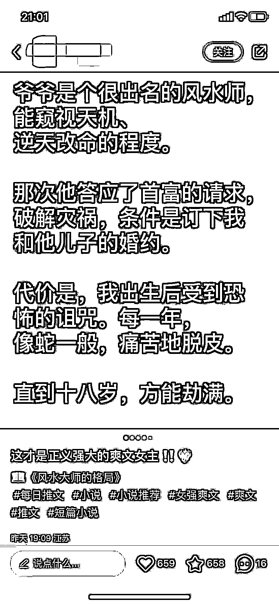
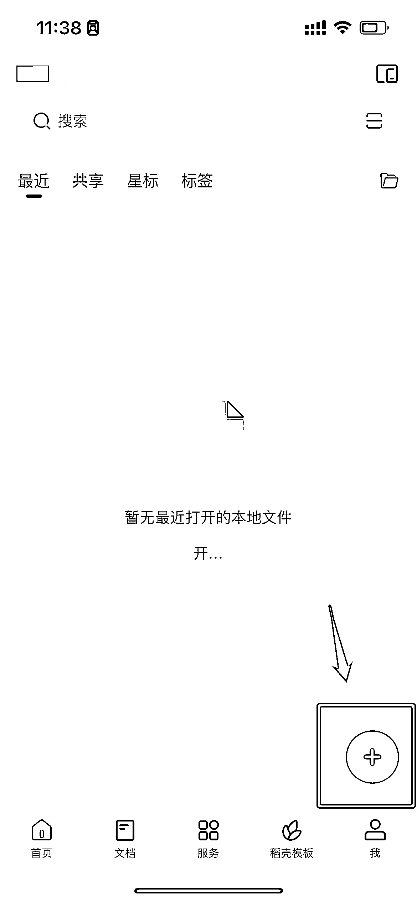
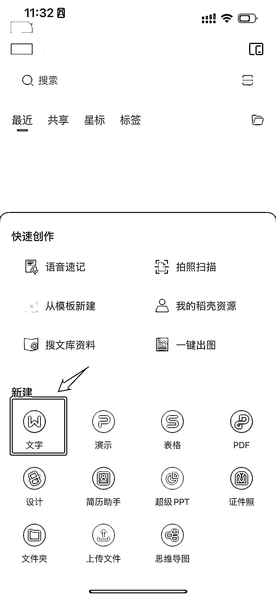
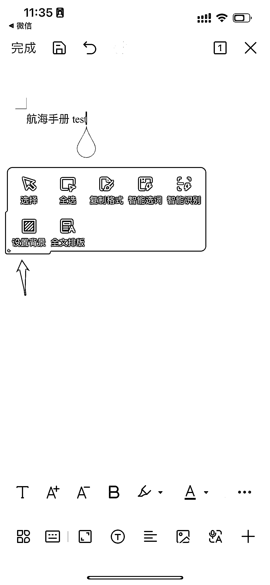
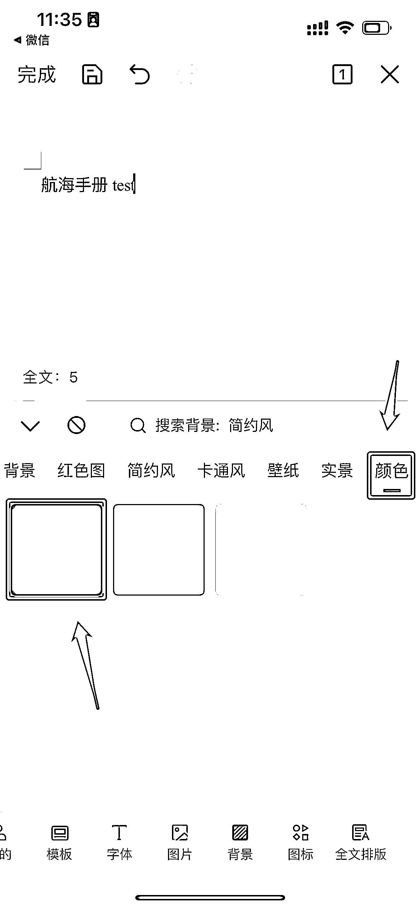
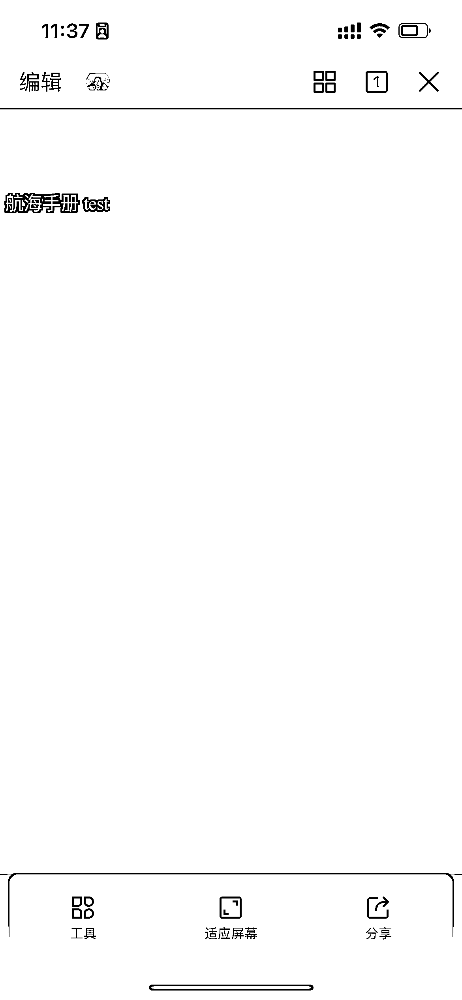

# 5.2.3 黑底白字型

制作首图时，建议把你最想展示的、小说中最亮眼的几句话提炼出来，一般不超过五句。后续配图可以直接放正文内容，通常选用第一章的文字。图片张数没有硬性限制，但务必要按顺序排列，不然读起来会很别扭。

这种黑底白字的图，用 WPS 来做很方便，也可以把手机切到夜间模式后直接在小说页面截图。下面以手机端操作为例，教大家怎么用 WPS 搞定。

第一步：打开 WPS，点击右下角的「+」按钮。

第二步：选择「文字」下的「新建空白」，把要用的文字粘贴进去。

第三步：轻点文字区域，光标出现后，底部会弹出简易工具栏。找到「设置背景」进入背景设置，选择「颜色」中的「黑色」，页面立刻变成黑底白字。此时截个图，就得到一张黑底白字图了。

