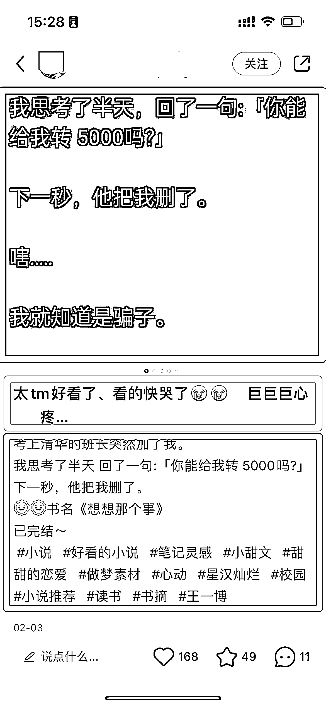
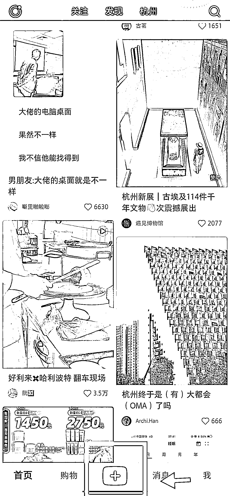
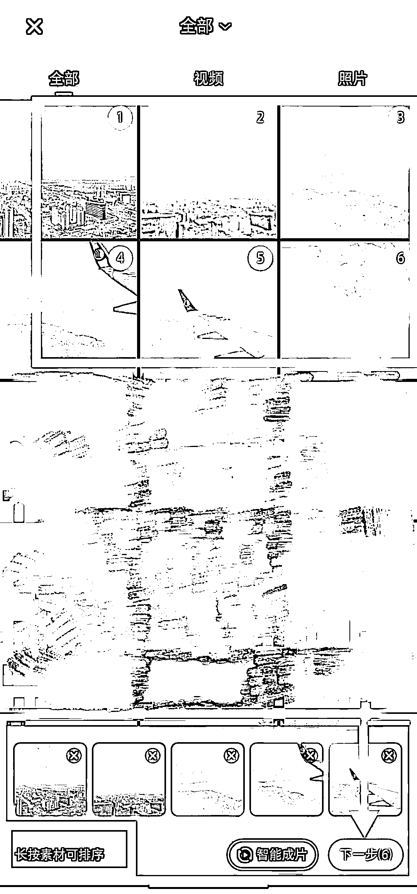
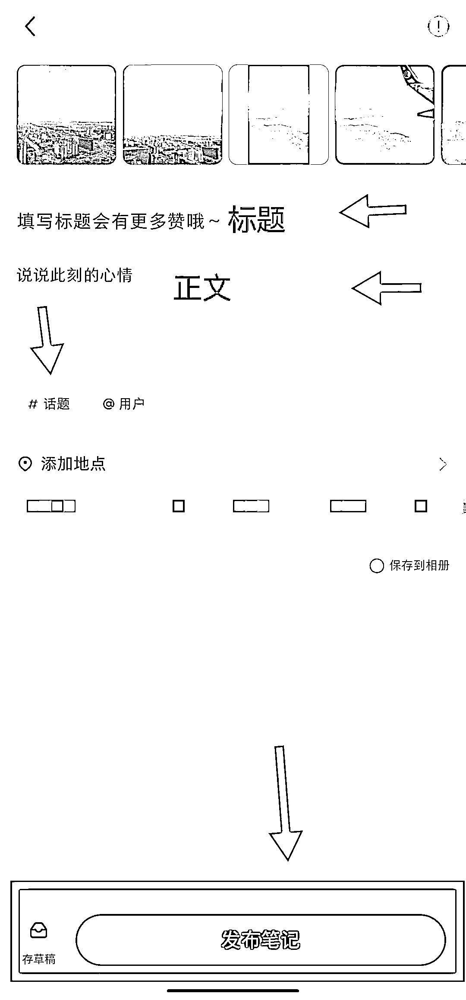

# 5.3.2 小红书笔记发布，三步搞定

一篇小红书笔记要完整呈现，通常离不开三块内容：封面图片、文字标题与正文内容。

对照上图：红框标出的是封面，黄框标出的是标题，蓝框标出的则是正文。

具体怎么发？结合下面三张操作图，把发布流程拆成三步来看。

第 1 步：启动小红书，在首页底部中央找到“+”并点击。

第 2 步：系统进入相册后，按打算发布的顺序依次勾选图片；其中最先选中的那张会充当封面。

第 3 步：把标题与正文分别填入对应输入框，再选定这篇笔记的 #话题，点击发布。

还有两个小技巧：

其一，正文可以提前复制好，发布时直接粘贴，接着调整排版、补上表情即可；
其二，标签最好提前构思，可参照同类型热门笔记的标签来选。但标签别图省事直接复制，务必手动输入——实测复制标签的流量表现并不好。

