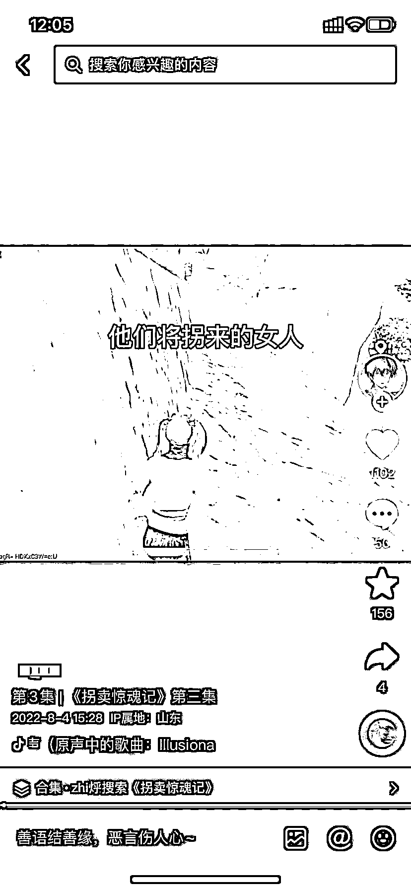
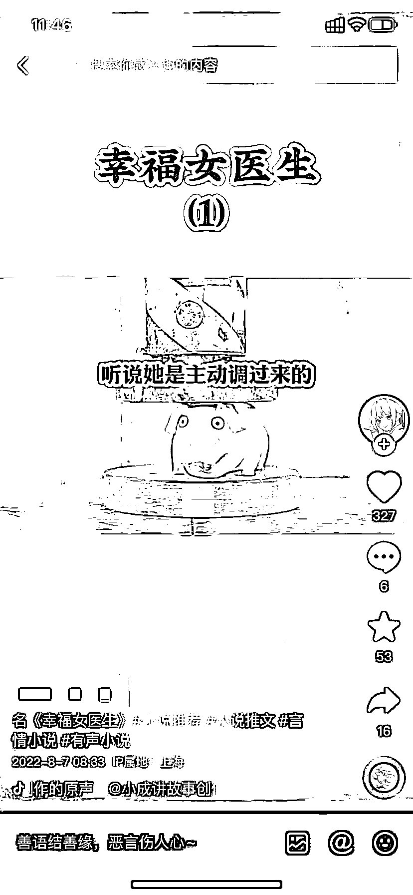
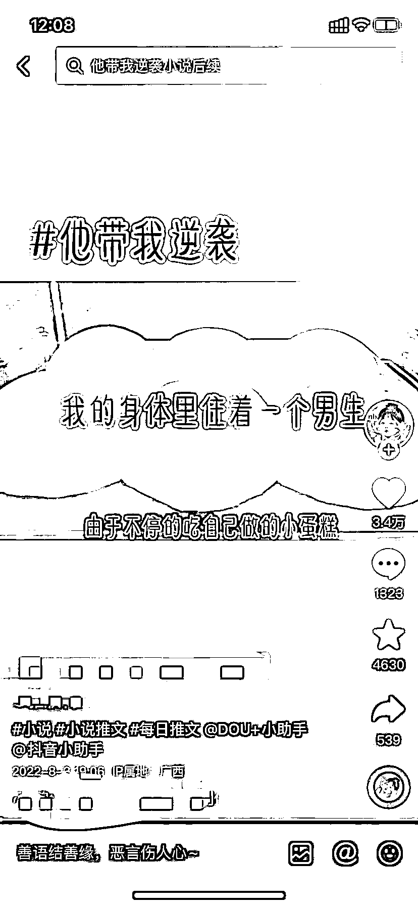
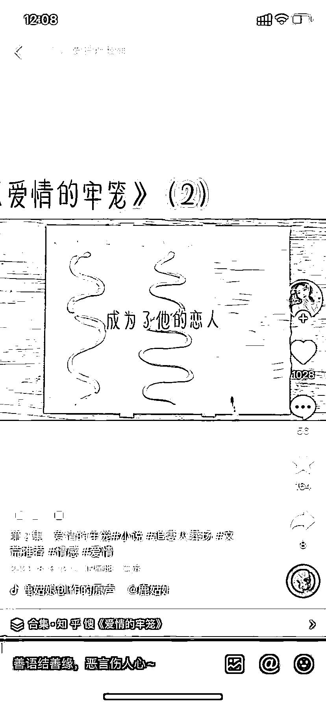
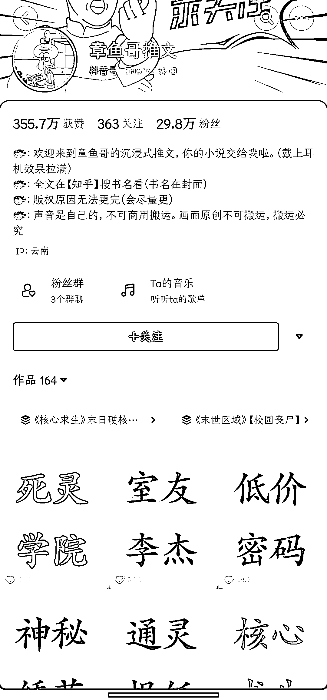
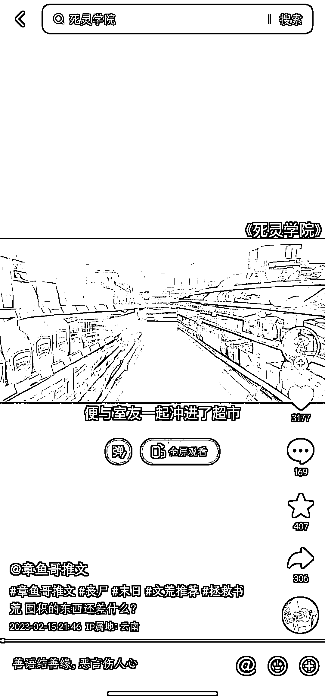
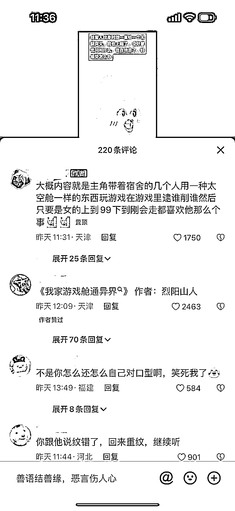

# 6.1 视频类型怎么定？@seven@张柯 Ker

准备做视频，第一步不是急着拍，而是先想清楚哪类账号更适合自己。每个赛道都跑出过标杆账号，新手刚开始，优先挑自己真正感兴趣的题材，更容易坚持。要是暂时没找到兴趣点，可以先把游戏类视频当作切口，这类内容原创空间大，对刚入门的人也相对友好。

时间紧、想尽快看到收益、看重投入产出效率的话，推荐顺序可参考：

图文类 > 真人出镜 > 游戏AI配音 = 混剪AI配音

如果你时间更宽裕，希望顺便学点技能、积累经验，赚多赚少先放一边，那么可以按这个方向尝试：

AI绘画+真人配音 > AI绘画+AI配音 > 混剪+AI配音 > 游戏+AI配音

这里要提醒一句：AI绘画类账号因为内容纯原创，基本不用担违规问题；不过它的制作链路很长，数据表现也未必亮眼。任何玩法都有做不起来的可能，投入和产出怎么平衡，得自己提前盘算。

1）游戏类视频

适合谁：男女观众比例比较均衡，题材普适性强。

素材从哪来：常见的是地铁跑酷、王者荣耀、🐧飞车手游，可以自己录屏，也能从网上下载现成素材。

2）解压向视频

适合谁：偏悬疑故事受众。

素材从哪来：搜“液压机”“解压”这类关键词即可找。

3）美食与绘画视频

适合谁：喜欢甜文的群体，女性用户占比较高。

素材从哪来：范围比较杂，蛋糕、轻食等都能用，搜“烘焙”“油漆画”等关键词可找。

4）AI绘画账号

特点：原创性强，模式生命周期更久；但产出较费时间，还需要具备一定AI绘画基础。

参考账号：章鱼哥推文

5）真人露脸内容

特点：模式更耐做，前期可做推文或小说，后续还能转向实体书推广；不过拍摄制作门槛偏高。

参考账号：帅帅的牙签云、烽火聊网文等

另外，把真人出镜和AI特效组合起来，能降低真人露脸的难度，也能缓解镜头前的尴尬感，成片效果通常比单纯AI配音更有优势。

内容来源：《起底小说推文整体逻辑，一个月实操分享》

