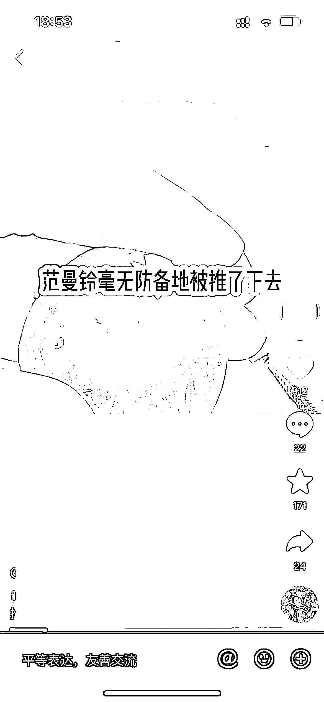
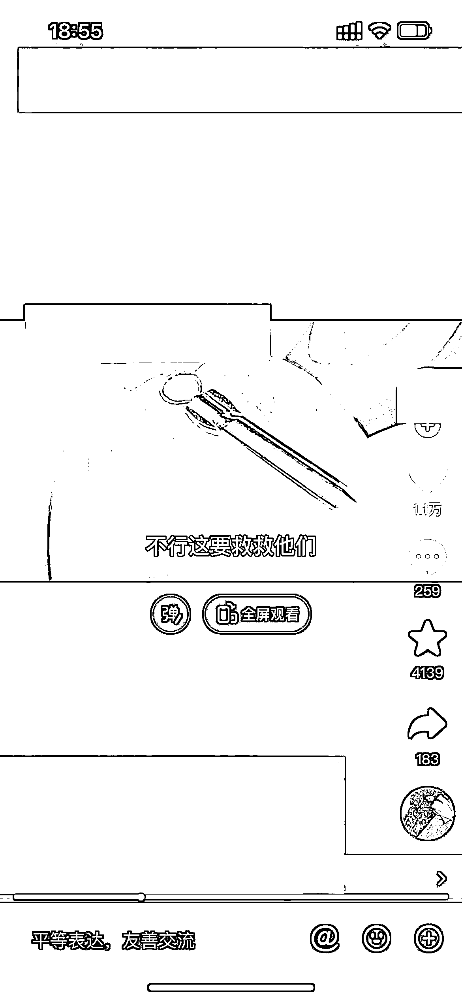
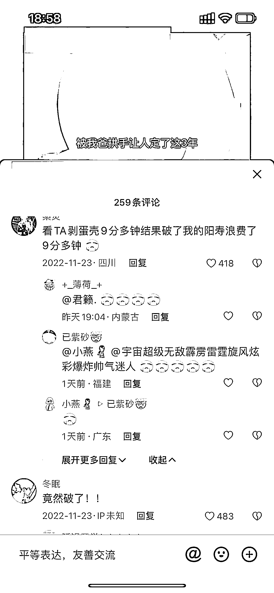
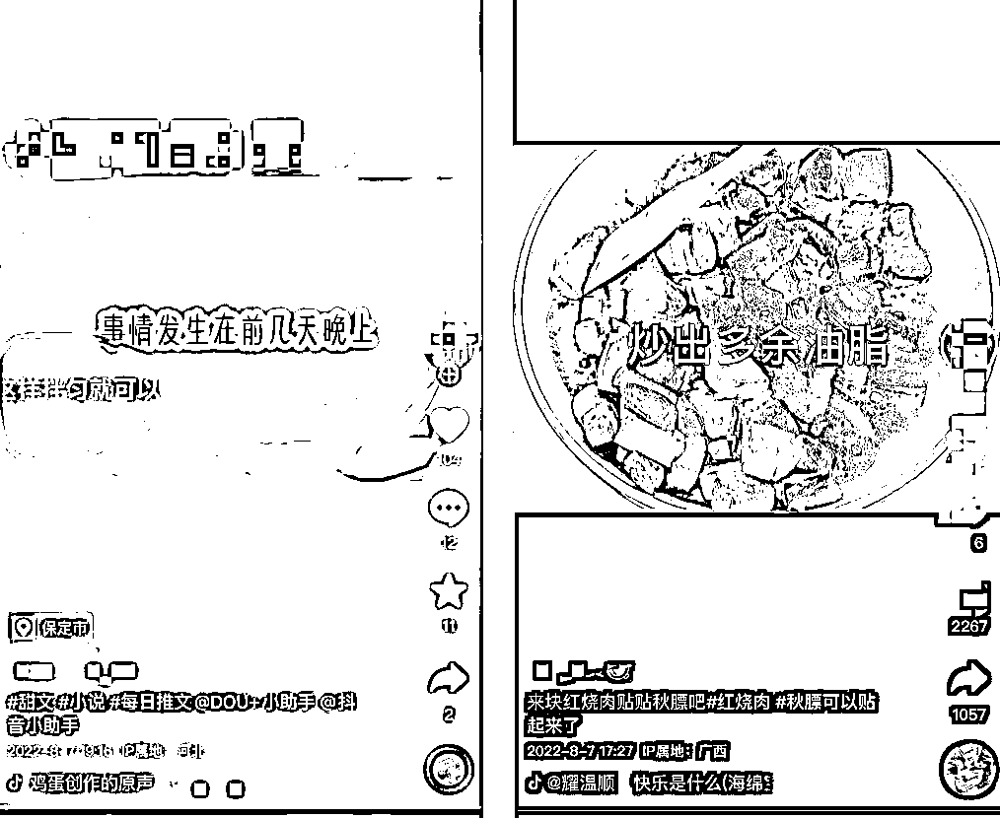

# 6.2.1 抖音素材怎么挑：先看同行，再找冷门互动款

做短视频时，素材来源可以优先考虑抖音。尤其像近期讨论度很高的美食类内容，不少都能在抖音上刷到。这类内容已经在平台跑出过热度，拿来做二次剪辑、拼接后再发布，起量概率往往比另找陌生素材更可观。

不过抖音的内容池非常庞大，热点几乎一刻不停。我的建议是别一上来就埋头找，先观察同赛道账号最近都在用什么类型：是美食甜点、手工制作，还是解压放松类内容？

等大类定下来，再往细分方向搜。比如美食甜点下面，可以找马卡龙、泡芙、巧克力蛋糕；手工制作下面，可以找木雕、木工、砌房子、陶艺等。

另外，素材最好带点“梗”或话题点，优先挑有趣、新奇、容易引发讨论的内容。这里举个例子：剥鸡蛋。

剥鸡蛋看起来偏冷门、受众也窄，但用工具剥鸡蛋壳居然也有人愿意看。点开评论区会发现，观众围绕素材本身的讨论热情，甚至比小说内容还高。这类冷门却能拉高互动率的素材，值得重点考虑。

当然，这类素材的复用率偏高，发布前需要做更深入的剪辑处理。具体剪辑方法和视频模板制作步骤，可以参考[《如何剪辑视频和制作视频模板》](https://shengcaiyoushu01.feishu.cn/docx/doxcnA72uVU4Aq4TYuApGrPLaxb)。

优点：素材已经过平台验证；  
缺点：重复度偏高。

