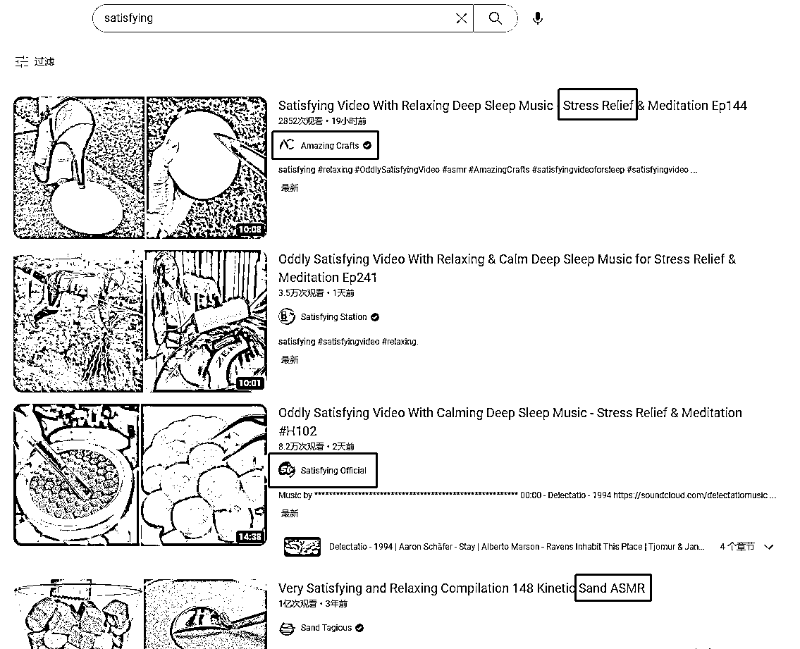
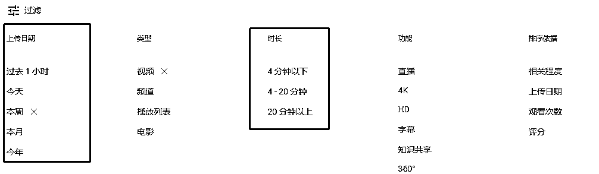
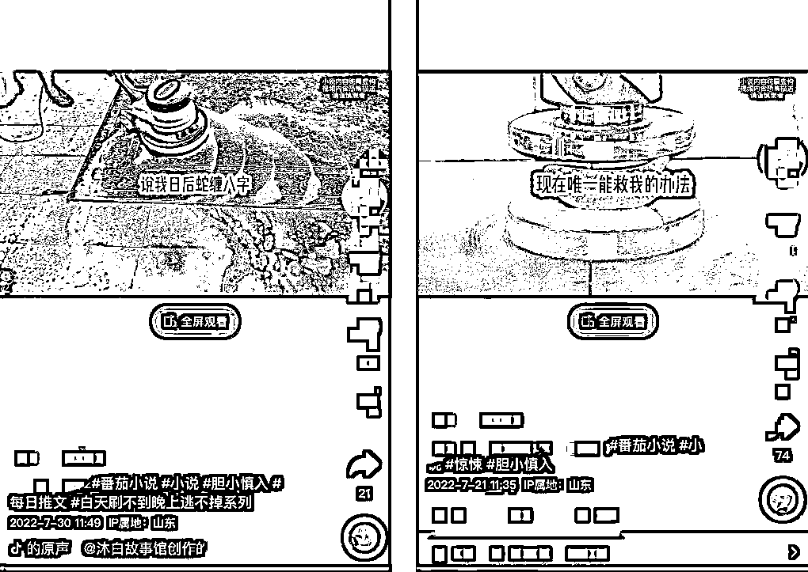

# 6.2.2 国外平台：找素材，别只刷抖音

做解压类内容时，抖音上也能找到相应素材，但海外平台的选择明显更多。你可以在 YouTube、TikTok、推特等国外平台切换不同语言去检索，清洗地毯、汽车修复、液压机等都是不错的搜索入口。

海外视频素材最常去的站点是 YouTube：内容更猎奇、画质更清晰、库存也更庞大。稍微刷一刷油管就会发现，抖音上不少博主其实也在搬运相关素材；如果你曾用过这些画面，那就算找到源头了。

在外网找素材有个前提：关键词得用英文，而且要是符合老外使用习惯的英文。若仍按中文思路直搜“美食甜品”“做饭”，结果往往还是同一批博主在油管发布的同一批视频。

比如想做解压视频，直接输入“解压”，出来的多半是挤痘、清黑头、清粉刺这类内容。它们属于猎奇素材，有博主测试过：互动量高，转化率却很低。

换成 satisfying 就不同了。它直译为“令人高兴、愉悦”，搜到的才是老外那种解压、舒适的视频。标题里也常出现 stress relief、satisfying、ASMR、Meditation 等与解压相关的词。

另外，在油管检索时别忽略筛选。上传日期和时长值得重点看，用这两个指标可以判断素材源是否稳定更新、时长合适、内容过硬。

优势：重复度低；短板：素材未经验证。

