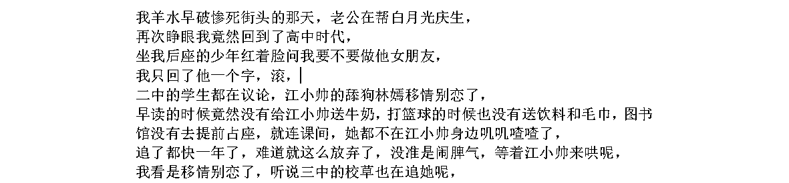
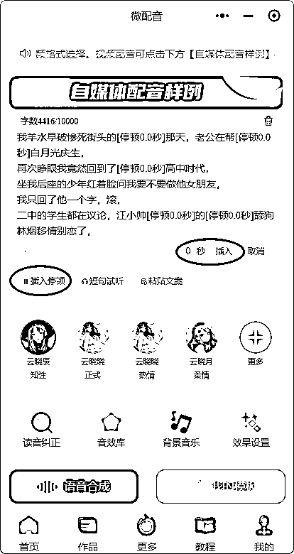
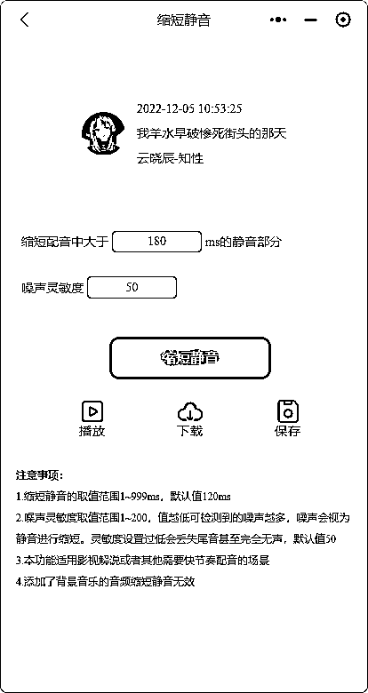
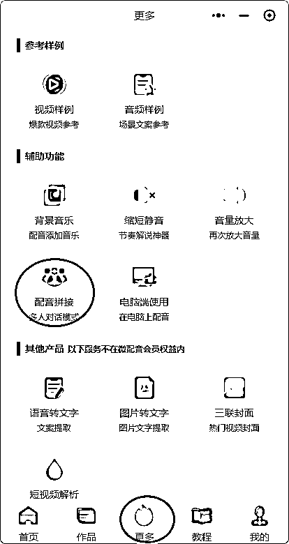
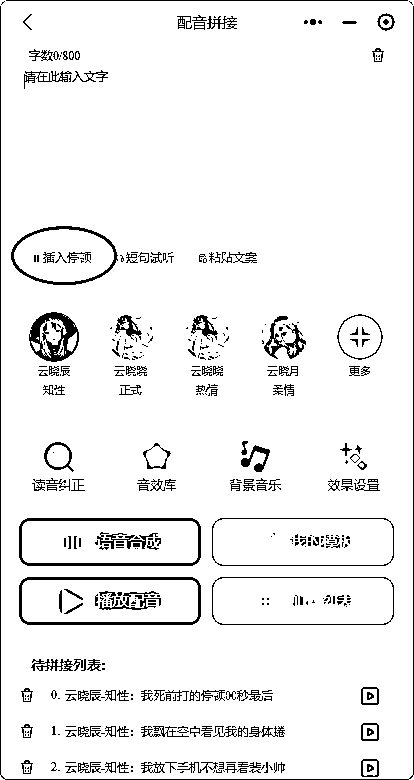
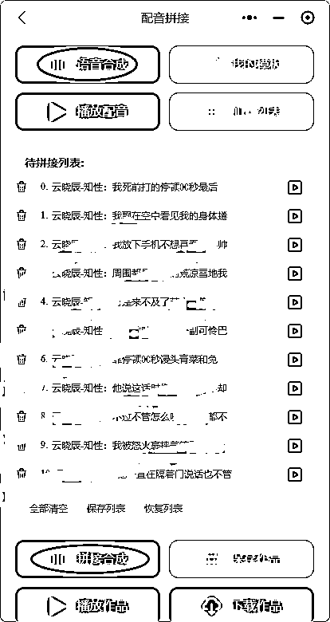

# 第一步：配音精细化，留住听众

做短视频和有声内容时，配音的精细程度直接影响完播率。这篇文章就来拆解配音优化这件事，包括工具怎么选、具体怎么操作、如何拼接音频、音色怎么挑，大家可以根据需要灵活取用。

另外，@seven 老师还准备了一份现成音频素材，方便大家参考：

•[`pan.baidu.com/s/1nEY1ShBLJve9EbRDphmPdQ`](https://pan.baidu.com/s/1nEY1ShBLJve9EbRDphmPdQ) 提取码：Dygs

1）工具怎么选：三大配音软件

•魔音工坊：[`www.moyin.com/?promottype=BAIDU__PZ-mygf`](https://www.moyin.com/?promottype=BAIDU__PZ-mygf) （付费）

•微配音：微信搜索「微配音」小程序（付费）

•配音家：微信搜索「配音家」小程序 （付费）

2）直接配音：标点与读音的处理

以微配音小程序来举例，音频应该少停顿，最好没有停顿。文章改好之后，除了逗号以外，其他标点全部替换成逗号。这样小程序不会因为识别句号、问号、感叹号等符号而自动留出长停顿。

多音字也是容易翻车的地方。同一个字反复出现时，一定用「读音纠正」把正确读音固定下来；偶尔一两次或许无伤大雅，但反复出现就会影响听感。

初步配音完成后，还可以在文本里手动插入0秒的停顿，用来抵消音频自带的那种微小停顿。打开「缩短静音」功能，把超过150-200ms的静音片段收缩掉，批量处理后，音频就不会再出现较长的停顿。

特别提醒，音频开头的20到30秒必须干净顺畅，不能有明显或突兀的停顿。这个时段直接决定5秒完播率和用户的第一印象。试想，如果一段音频磕磕绊绊、偶有错音、语调忽高忽低，观众还愿意点赞和收藏吗？

3）用配音拼接做到无停顿

如果追求全文零停顿，可以在更多菜单中找到「配音拼接」。具体做法是每段音频的文本量控制在350到450字，每配一段就顺手插入停顿点，保证每段音频既没有停顿也没有错字。

不过，这个方式的缺点也很突出——非常耗时。每段音频至少要反复听两遍，还要边听边修正，如果有多个配音账号，这种效率会更让人头疼，剪辑速度也会被明显拖慢。

另外，配音拼接支持根据不同说话人分配不同音色，能实现角色区分和内容差异化。但多人配音要考虑的线更多，比如旁白、声音1、声音2都要分别安排。如果你不是要做精细化运营，新手阶段最好别碰。

4）音色选择的关键

声音决定了听众的第一印象，可以小众，但不能“邪门”。音色需要跟着内容类型走：比如悬疑故事更适合男声，言情故事更适合女声。知乎小说通常以女性第一人称来写，所以用温和的普通话女声就完全够用，播音腔、夹子音这些花活可有可无。

这不是录助眠ASMR，只需要把故事讲得吸引人、娓娓道来即可。你喜欢粤语、东北话还是河南话，都不重要；关键是要让观众觉得自然、正常，这一点必须排在第一位。

目前最普遍的选择是微配音里的“云晓辰”（知性女声），语速11.2，语调8/15，音量15。如果5秒完播率还是不理想，可以考虑改语调或换配音员。