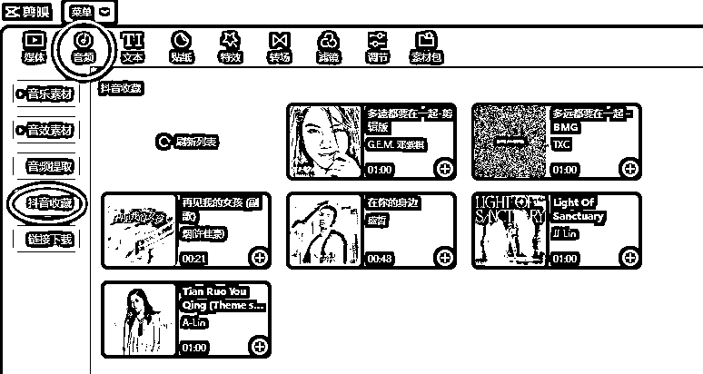

# 第二步：BGM怎么选才不翻车

1）配乐类型要贴内容
给视频或文章挑配乐，先看内容气质。甜向故事配歌颂甜蜜爱情的歌；虐向故事则更适合能把人唱到眼眶发热、讲悲欢离合的曲子，比如《多远都要在一起》《喜帖街》。反过来想，剧情里主角死的死、残的残，配乐却欢天喜地放着《好运来》《今天是个好日子》，观众哪来的代入感？多半笑一下就划走了。

2）节奏要跟内容走
配乐的节拍最好和文章节拍合上。剧情紧、对话密的稿子，可以用轻快一点的音乐；古代言情往往推进较慢，A-Lin 的《天若有情》就很合适。其实只要不是刻意整活，BGM 通常不会出大问题。能在抖音传唱的歌，本身就是被大众和市场验证过的；连这些歌都听不下去，还能听什么？

3）版权来源要稳妥
想规避版权风险，BGM 最好取自抖音现成的音乐切片：先收藏原声，再到剪映里用抖音账号登录，就能直接看到自己收藏的音频。

虐文就配伤感一些的歌，比如 A-Lin 的《天若有情》、邓紫棋的《多远都要在一起》等；爽文可以用轻松欢快的 BGM；悬疑文则适合偏阴间一些的音乐，既有代入感，又能引发吐槽。想省事的话，可以统一用林俊杰的《裹着心的光》，音量 -10。