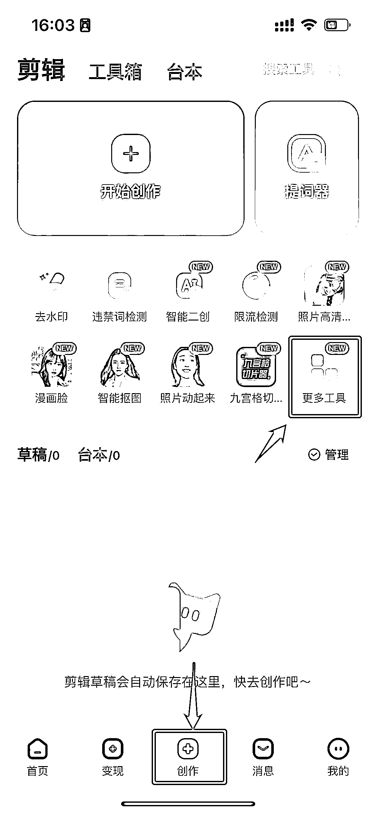
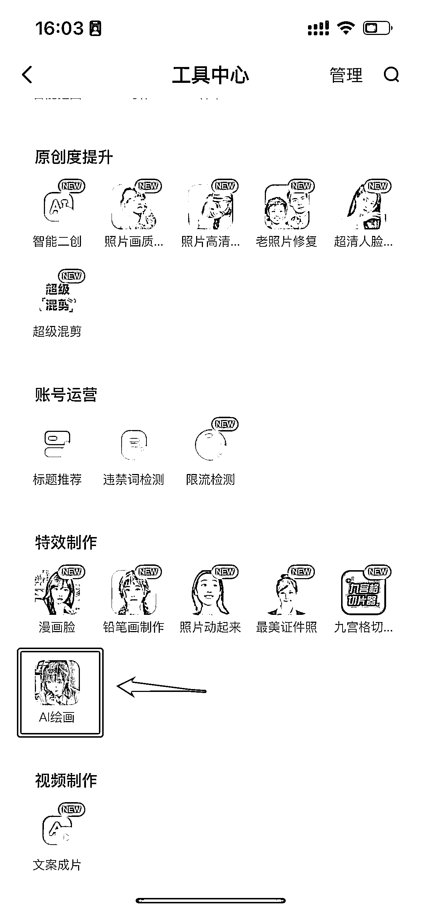
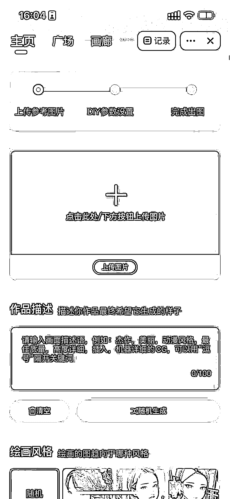
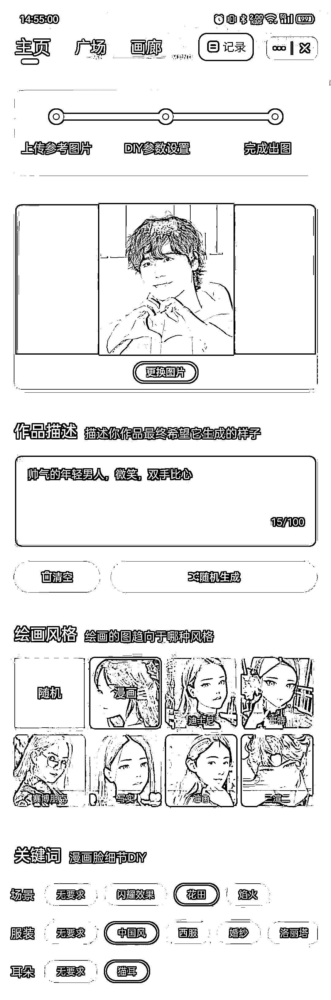
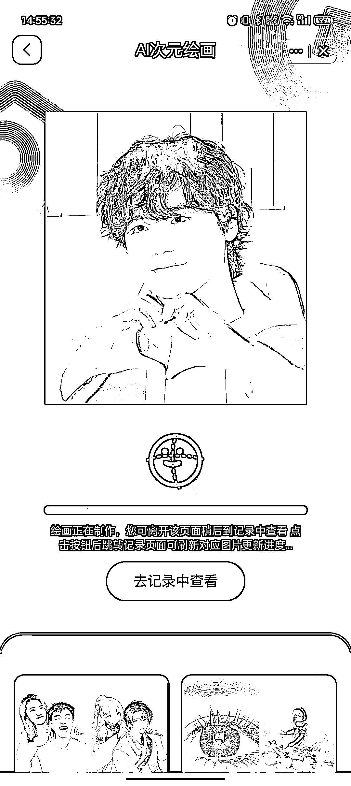
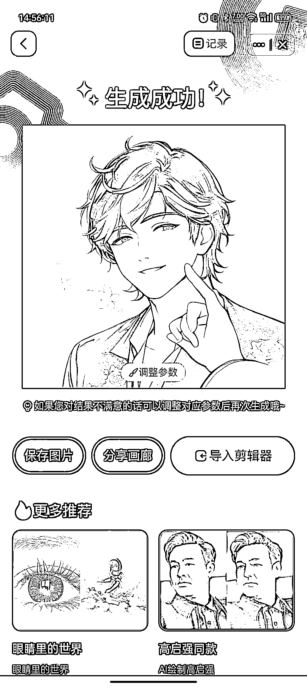
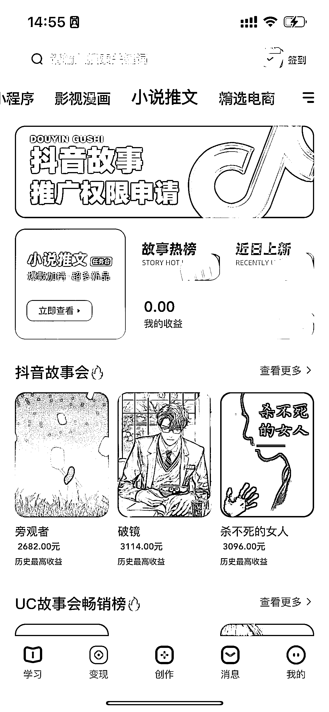

# 创作猫APP：推文视频创作一站搞定

想把小说推文视频更快做出来？除了剪映，创作猫APP也能提供一站式支持。

它的视频剪辑能力和剪映大体相近，不过额外集成了不少AI辅助工具，对创作更友好。下面重点介绍它的AI绘画功能。

进入创作猫APP后，打开「创作」页面，点击「更多工具」进入工具中心，往下滑动页面，就能看到「AI绘画」。

要完成一幅AI绘画作品，需要做这几步：

• 先上传一张参考图片，AI会以它为底进行转绘；
• 再填写作品描述，说清你希望生成什么画面；
• 最后挑选绘画风格和关键词。

可对照下方图片：

另外，APP里设有小说推文变现入口，不过它和前面提到的服务商不是一回事，记得区分。由于变现思路大体一致，这里就不展开，需要的朋友可自行进APP了解。

