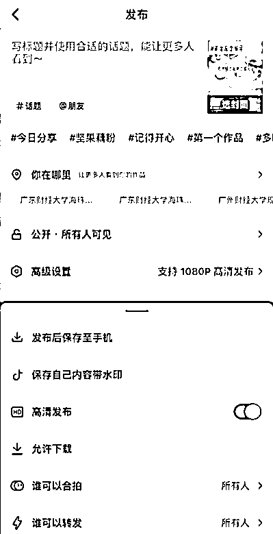
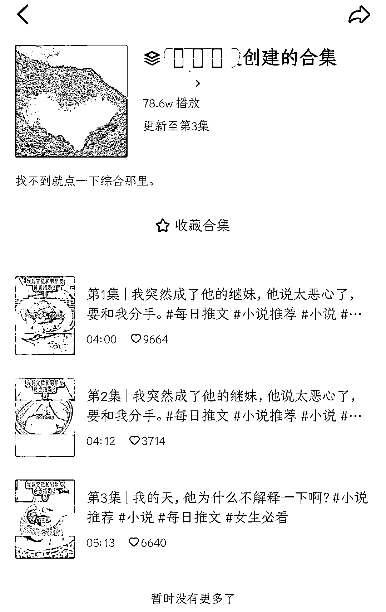
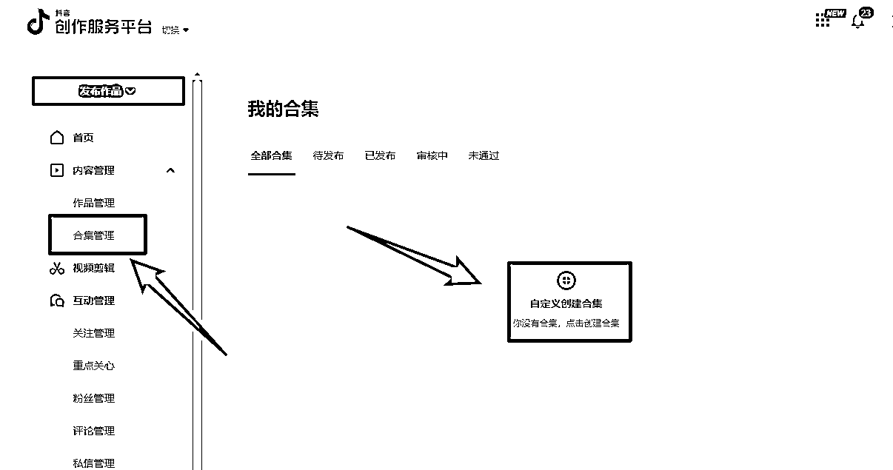
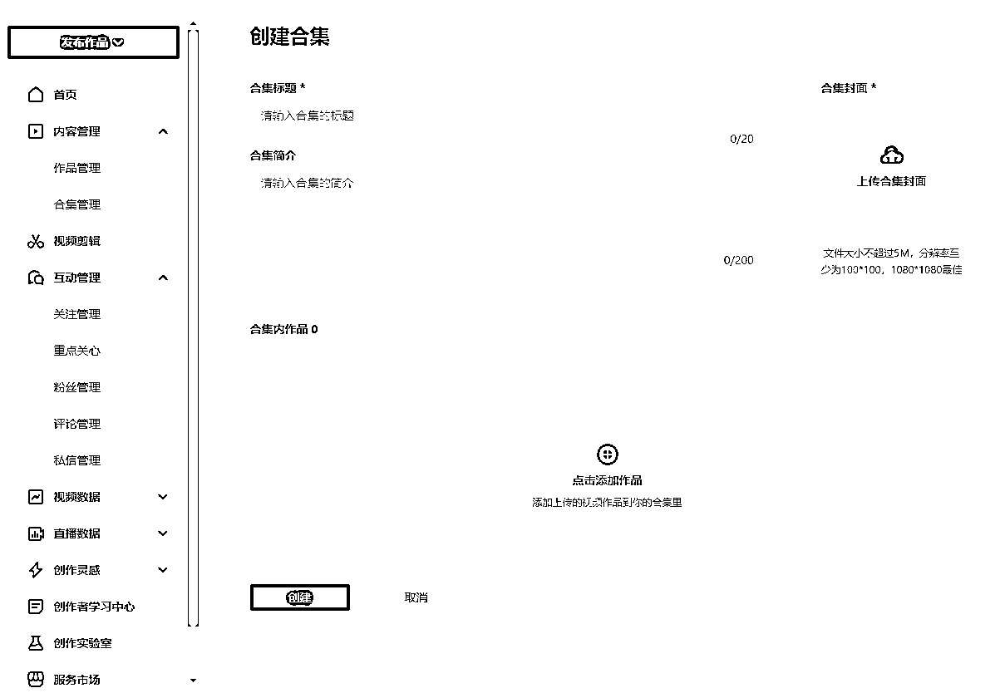

# 6.4.1 发抖音之前，这几步别省 @鲸鱼 @seven @某人周

抖音可不是单纯拿来上传视频的通道。每条片子正式发出去之前，提前一刻钟左右就该打开 app 暖场了——先刷一圈同赛道的内容，顺手点几个赞，在别人的评论区露个脸，同时留意对方是怎么做引导的、哪些留言质量高值得学。

再去热点榜单里翻一翻：进入视频板块搜推文相关词，尤其盯紧近三天冒出来的高播放内容，琢磨一下能不能收进自己的选题储备；顺手扒拉评论区，把那些互动量大的留言记下来，往后自己造互动时能派上用场。

上传之前再过一遍：片子有没有缺胳膊少腿、台词画面里有没有踩雷的词、整体画风合不合规矩。传完之后别忘了挂话题——按账号定位挑就行，通常分两类：一类是通用型，一类是赛道专属型。

通用型可以带：#小说、#番茄小说、#小说推荐、#小说推文、#文荒推荐 等；
赛道专属型可以带：#悬疑小说、#言情小说、#都市爽文、#言情、#女频 等。

还有，把同步开关关掉，进高级选项里把「保存本地」和「允许下载」这两个口子堵上。发完别急着切走，盯着上传进度走完，自己先点个赞、留句话、转一手，再让账号泡上十五分钟，把活跃状态续住。

内容来源：《知乎小说推文项目保姆级实战教程》《起底小说推文整体逻辑，一个月实操分享》《小说推文进阶玩法，精细化运营所带来的稳定出单》

2）爆款不是一蹴而就

心里先有个底：一条片子从冷启动到起量、再到小范围出圈，花上半个月到一个月都算正常节奏，不必自己吓自己。保持日更习惯，让账号始终有热乎气儿。

3）合集怎么用

单条播放量破了 15W 之后，就可以着手建合集了。同品类的内容打包在一起，能把人留在账号里更长时间；分集类内容尤其吃这一套——用户哪怕只刷到其中一集，也有机会被引着往后看，整体播放量自然往上走。

合集在电脑端抖音创作者后台就能配：[`creator.douyin.com/creator-micro/home`](https://creator.douyin.com/creator-micro/home)

4）审核卡住了怎么办

万一片子没通过审核，可以照着抖音内容公约写理由去申诉。要是申诉也没能翻盘，那就等这条内容流量彻底走完，再把它设为隐藏。

内容来源：《知乎小说推文项目保姆级实战教程》