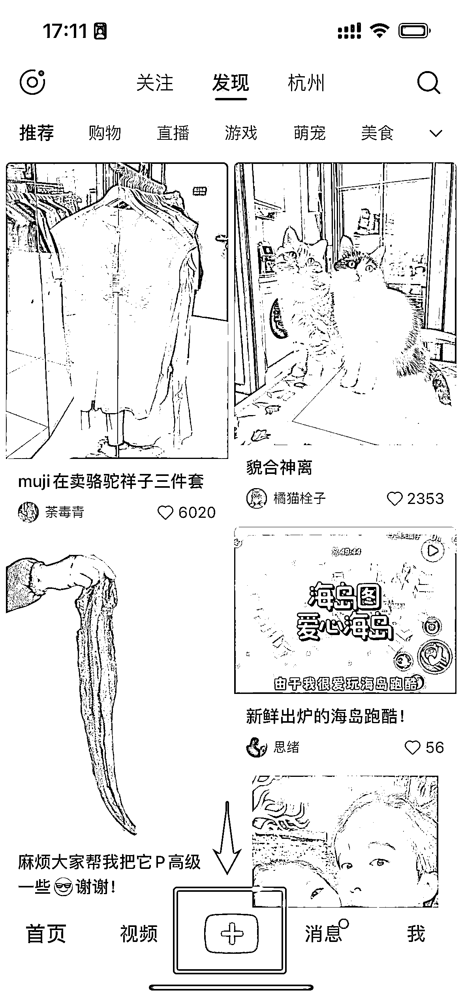
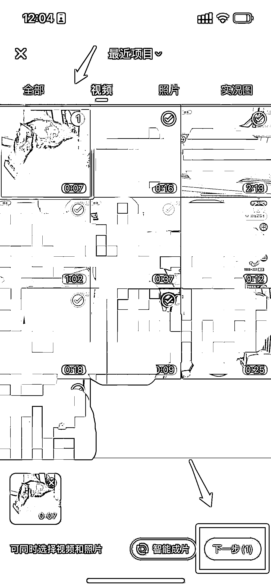
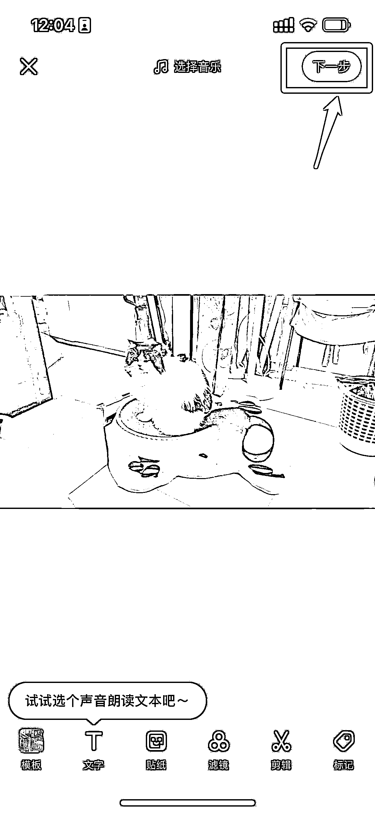
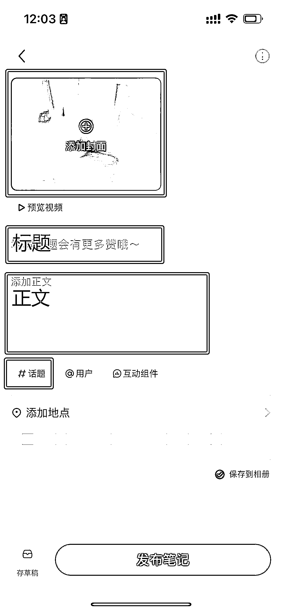
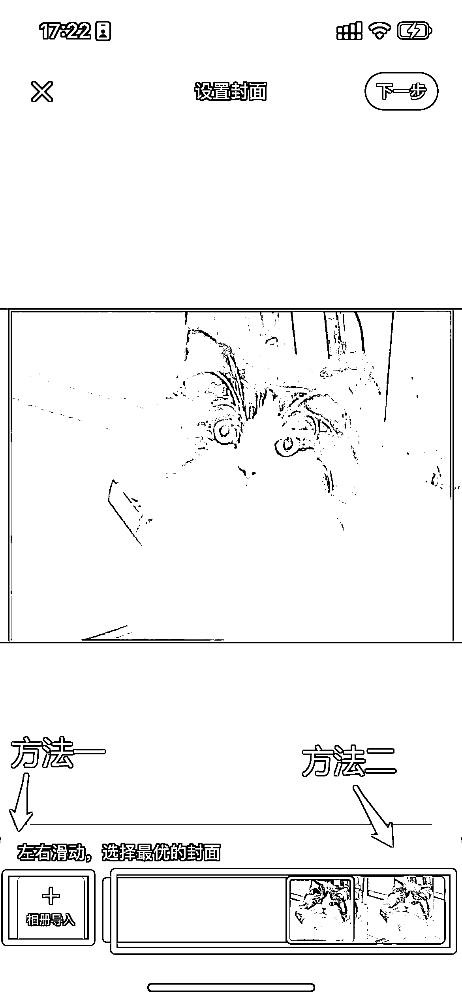

# 6.4.2 📕发笔记，照这个流程走

先启动📕，在首页底部正中央找到「+」并点开；接着从相册里挑出准备发布的视频；进入编辑界面后一般不用改动，点一下「下一步」就行。

随后设置封面，把标题和正文分别填好，选上对应的话题标签（#话题），再发布笔记。封面有两种设置方式：一是直接从相册导入；二是拖动下方进度条，挑选合适的画面。做小说推文时，封面通常取第一帧就够了，不必再单独制作。

最后再提醒一句：发布前务必复核视频是否完整、文案里有没有违禁词、画面内容是否合规。话题标签别图省事直接复制，一定要手动输入——实际测试下来，粘贴标签的流量表现并不理想。

