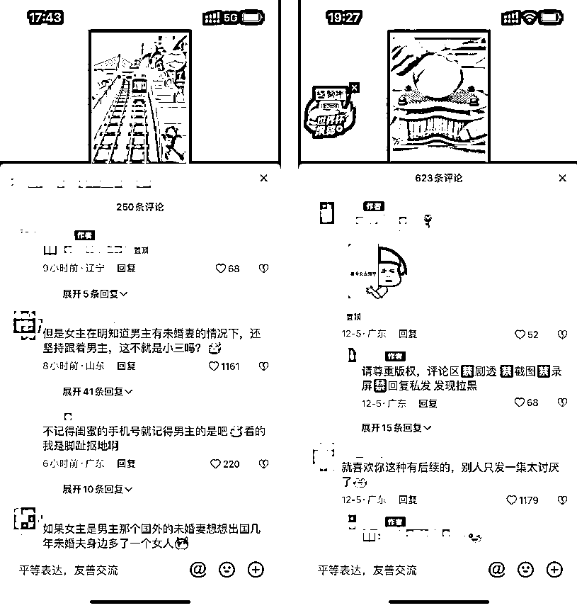

# 7.2.1 别让评论区冷场

抖音这边，单条播放量超过5k时，就可以着手主动引导；等某条视频跑到15w播放，再把引导信息置顶会更合适。小红书更省事，发布完就能直接引导。别觉得没人问出处就无需引导——评论区长期空着，本身就是一个明显问题。

有的人读完内容，心里认可，可一瞧评论区没人说话，往往点个赞就滑走——一个潜在付费用户就这么流失了；除非内容特别对味，他才会主动开口追问后续。此时，用一两个小号在评论区做几轮互动，再把关键词引导放到置顶，他很可能顺手点开评论区扫一眼；看到有人和自己感受相近，就更可能跟着我们留下的引导去看后续。