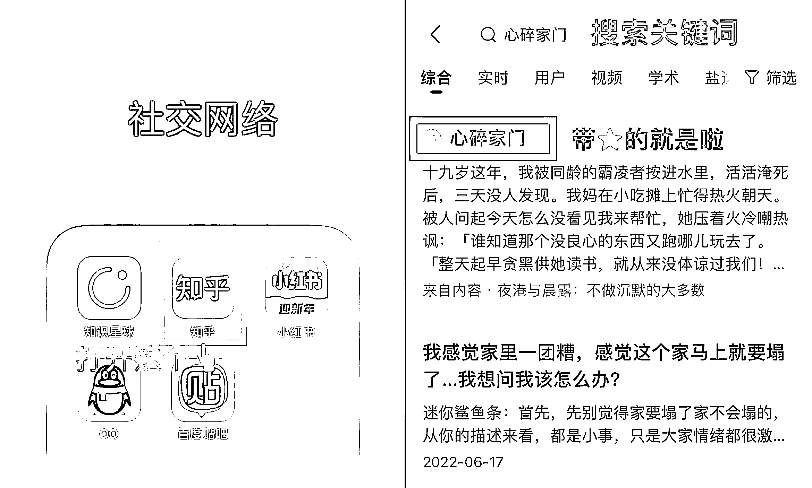

# 7.2.3 方法三：私信引导，先验人

观众反复说找不到入口时，可以把私信引导当作备选方案。但动手前先确认：对方会不会是同行来钓鱼的？私信这条路很容易触发举报，一旦被限流就麻烦。先翻翻他的主页，看看是不是正常运营的抖音账号，再决定要不要发私信。

原则上，能不走私信就别走。原因很直接：钓鱼的同行、小号太多，被举报“往站外引流”后，封号往往一抓一个准。

当然也有例外：有人确实不熟悉关键词怎么用，原来的关键词已经失效，或者因为搜不到而在评论区连续刷屏。遇到这类情况，可以试着私信引导，但尽量别发文字，改用图片说明。

发之前，先点进对方主页：默认头像、乱码昵称、关注数动辄几千上万，这种就别理会了。再看看他有没有作品：发的是生活日常，还是同类型的推文内容？这能帮你判断他是真读者，还是同行。

最棘手的是，上面这些甄别信号都可能被刻意伪装。屏幕那头究竟是想看小说的真心观众，还是蹲点举报的同行，并没有百分之百可靠的判断办法。所以结论不变：能不私信引导，就尽量别私信引导。