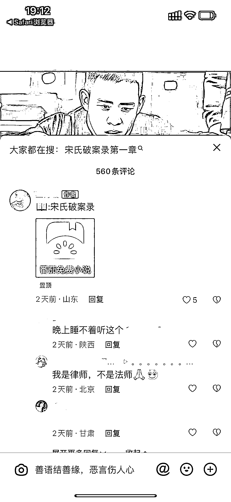
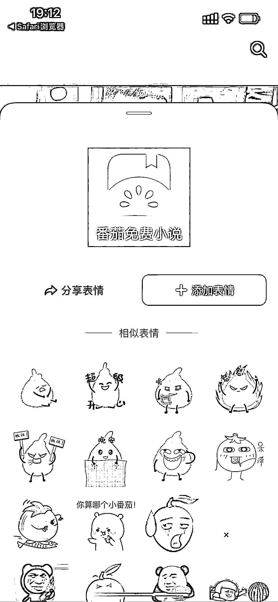
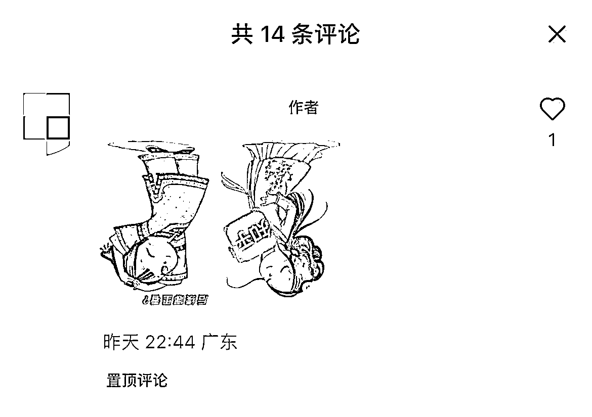

# 7.3.2 安全导流的几个招@seven

各大平台对把流量往站外引这件事向来比较敏感，抖音、📕也不例外。特别是最近，📕对站外导流的排查格外紧，一旦被发现，账号有可能直接被封。

针对这种情况，可以试试下面这几种做法：

方法一：先安排辅助账号在评论区装作普通用户发问“去哪里能看到”，再由主账号出面回应；也可以先把关键词置顶，然后让辅助账号补一句“刚在知乎读完这篇，回到📕又刷到了”。

方法二：抖音评论区允许发自定义表情，可以把小说平台的图标做成表情包发出去，用这种方式避开审核。

📕评论区眼下也能发图片，操作思路和上面一样。

另外，📕导流还有不少细节技巧，点开👉「5 月航海 | 📕运营 | 实战手册」就能看到具体内容。

