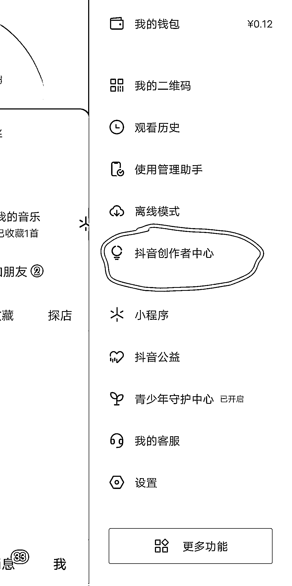
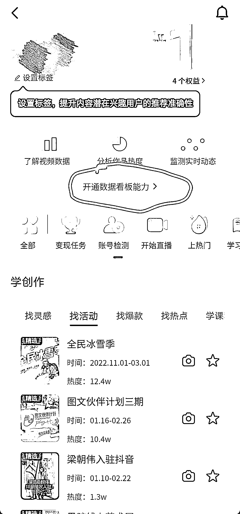
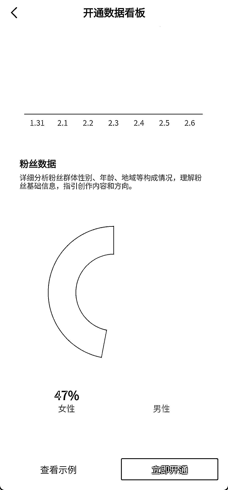
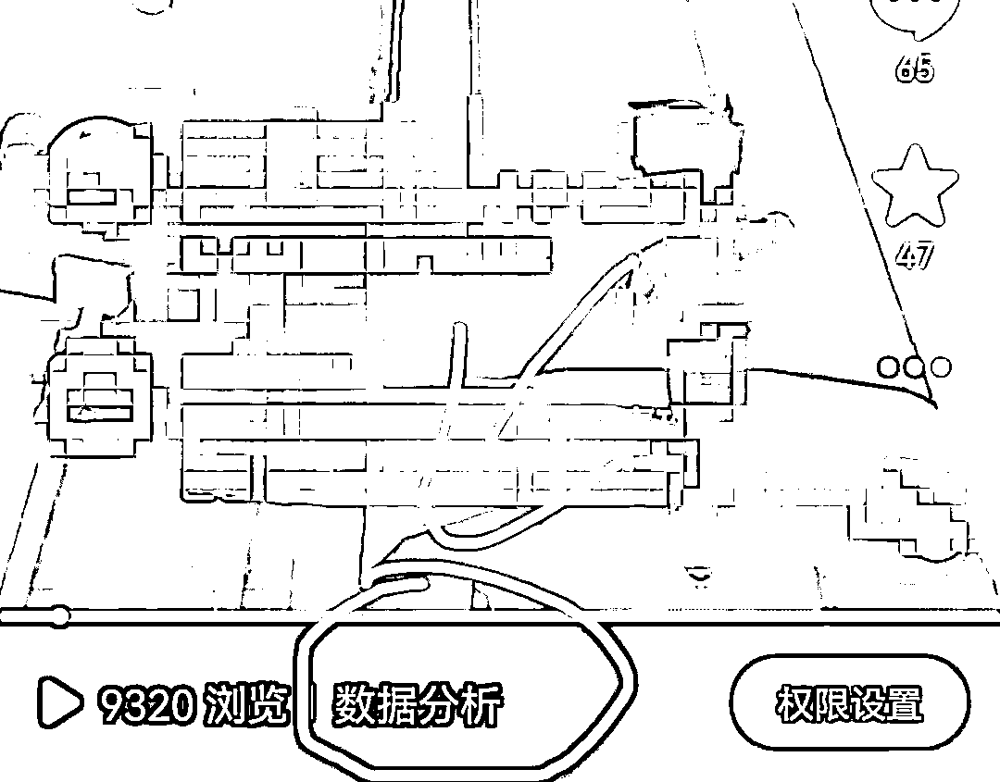
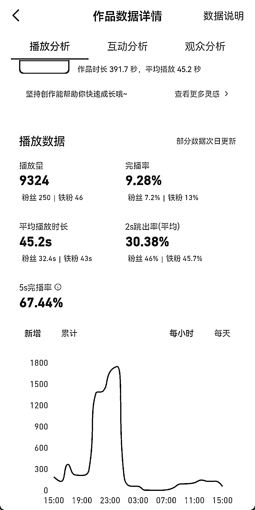
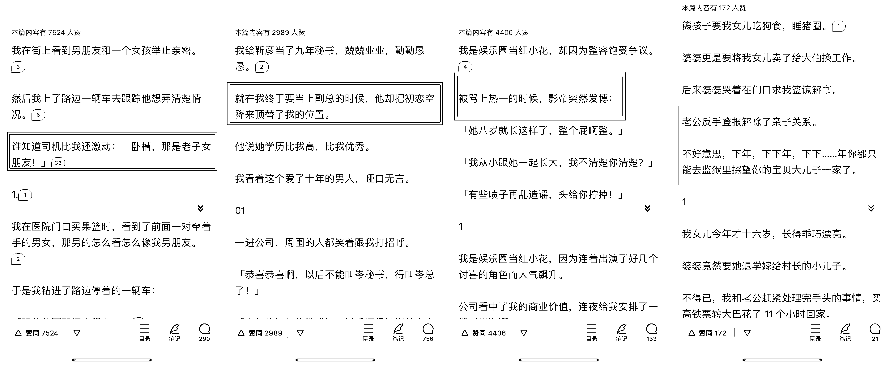

# 8.1.1 抖音运营 @某人周

不知道从哪下手复盘？照着下面这几个方向拆就行。

一、内容数据怎么拆

新手最常见的困惑就是：作品播放量老是卡在 200 到 500 之间，过一阵子干脆不动了，是不是被限流了？

其实这背后是抖音的推送逻辑：流量池一层层往上走，赛马机制决定谁能晋级。

系统一开始只给你 200～500 的初始曝光，后面能不能到 5000、1万、10万、30万，看你在这个池子里的表现够不够打。衡量表现主要看四个数：点赞、评论、转发、完播。

播放量到 500，只说明内容没问题，仅此而已。后面不涨了，就是没跑赢同池子的对手，晋级失败。打个比方，班级第一不代表年级第一，年级第一放到全市全省也未必能打。

所以别死盯播放量，多关注完播、点赞、评论、转发，把心思放在持续更新和反复优化上。

那数据从哪看？

打开个人主页，点右上角的【三】三道杠，找到【抖音创作者中心】：

进去之后能看到【开通数据看板能力】：

往下滑到底，点【立即开通】：

系统会提示你，大概第二天上午 10 点，就能看到已发作品的数据了。到时候打开任意一条已发布视频，左下角会冒出【数据分析】，点进去就是详细情况：

里面有播放量、完播率、平均播放时长、2 秒跳出率、5 秒完播率，还有【互动分析】和【观众分析】，自己挨个翻就行：

最值得盯的两个指标是 5 秒完播率和整体完播率。基本上，这两个数就能看出作品成色如何，以及有没有爆的潜力。

按我个人的经验，推文类作品 5 秒完播率及格线是 50%，想冲下一级流量池，5 秒完播率最好到 60%，整体完播率最好在 15% 上下（纯个人标准，仅供参考）。

5 秒完播率看的是开头抓不抓人。开头够勾人，观众才愿意停下来，而不是手指一滑就走。要是 5 秒完播率偏低，那就该考虑改文了：把最吸引人的核心情节往前挪，用好奇、愤怒、爽感、意外等情绪把人留住。

常刷知乎小说的人会发现，很多作者早就在这么干了——把高潮、结局、名场面直接甩到前面，让你明明猜到剧情走向，还是忍不住想看后续，心里痒得不行。

举个例子，看上面截图里第一篇文章：

核心情节是“我男友劈腿司机的女友”，两组当事人交叉分成两对，被放到同一个时空里，读者自然就会好奇后面怎么撞上、怎么撕。我可能会把开头改成：“我一把抓住了我男友的女朋友……”这句话乍一看逻辑上要多想几秒，再配合小号在评论区扔一句“你这开头给我 cpu 干烧了……”，互动率也能顺手拉一拉。

整体完播率反映的是小说本身的质量，决定了观众愿不愿意去搜原文看后续。这是整个推文项目最核心的环节。

整体完播率低，先检查素材和配音有没有明显硬伤，然后认真过一遍选文。

是新文还是老文？剧情是不是太套路？情节是不是流水账？先把全文读完，摸清它的框架和套路，看清起承转合，再跑去评论区看大家在吵什么、最想讨论哪个点、为什么。把这些想明白，慢慢就能形成自己的选文方法论，也就是所谓的“文感”。

前面也提过，互动率跟抖音的赛马推流是绑定的。有时候完播率挺高，但播放量卡在几千一万上不去，多半就是互动率拖了后腿——大家默默看完点个赞就走了，没有后续动作。

选文角度来说，要挑能调动情绪、能引发讨论的文章，而不是“写得顺溜的流水账”。账号运营角度来说，可以主动在评论区带带节奏，去同行的评论区偷师，收集一些神评热评；如果同一篇文章有爆款视频（要是有的话），直接把那边的热评搬过来用也行。

前面 4.4 节“制作选文表”说过，可以建个表格，把选文的各项信息记下来，比如文章特色（分手虐渣、重男轻女这种）、核心剧情（妹妹抢了我男友之类）、发布一段时间后的完播率，配合内容数据一起分析。

二、粉丝分析怎么做

养成习惯，每天进数据中心看一眼粉丝画像，重点看男女比例和年龄分布。起号阶段就得想明白：这条作品到底是发给谁看的？主攻男粉还是女粉？年龄范围大概多少？

检查的时候，适当清掉一些跟账号定位不符的粉丝，比如年龄偏大的男粉。

根据不同视频的涨粉情况和粉丝画像反馈，再来优化选文和改文。选文改文优化和坚持发视频涨粉是互相影响、动态推进的。

一旦发现粉丝画像跑偏，要赶紧调。

先看看哪几条作品涨粉不正常，考虑把作品隐藏；然后再筛掉一些不符合定位的粉丝，重点留意这几类：

• 关注了几千上万个账号的人。
• 40 岁以上的“大龄粉丝”。
• 默认头像、乱码 ID、空白主页的“三无账号”。
• 作品质量差、更新断断续续的同行。

一般情况下，第一条爆款视频对账号粉丝结构的影响最大。所以只要出了第一条爆款，后面不管之前的作品是什么类型，最好都往这条爆款的方向靠。

三、策略分析也不能漏

除了内容本身，每天的发作品策略同样会影响完播率、播放量、评论量，包括：

• 发布时间：观众什么时候活跃、平台什么时候推流，都会影响流量。是早中晚各发一条？还是下午和晚上各一条？或者晚上到凌晨连续更新？不同时间段活跃的人群不一样，系统推流快慢也不一样，不同文章的受众也不一样。只能通过记录和对比不断试，不断发作品去测，最后把发布时间调到精准用户最活跃的时段。

• 发布标签：话题标签影响曝光和搜索。先加领域标签，比如“#小说 #推文”；再加内容标签，比如“#虐文 #甜文 #爽文 #追妻火葬场”；还可以配点热度标签，比如“#女生必看 #内容过于真实”。通过调整标签的组合方式，慢慢测出最适合账号的那套。

• 发布定位：选人流量大的地点，曝光量会相对多一些。不过我自己的感觉是，地点这个因素有点“玄学”，发布时顺手带上就行，不用强求。

内容来源：《知乎小说推文项目保姆级实战教程》《小说推文进阶玩法，精细化运营所带来的稳定出单》

