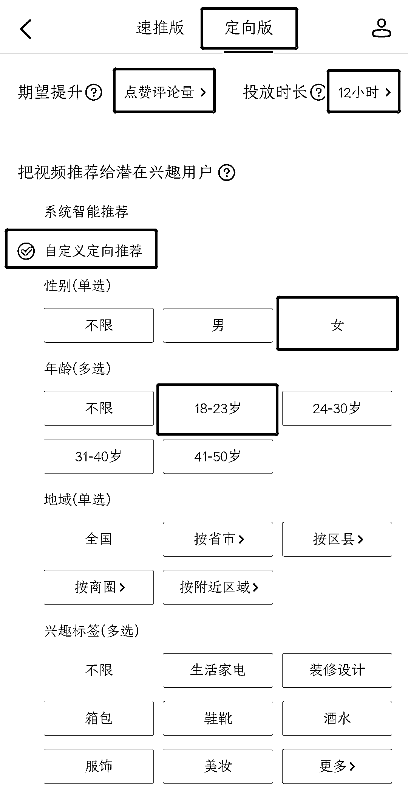
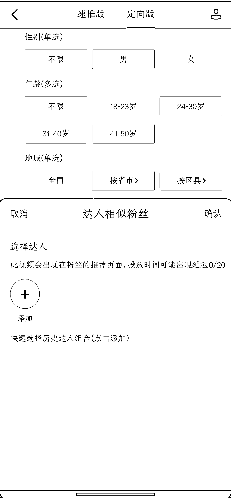

# 8.3.1 用 DOU+ 给新号快速打标签

刚注册的账号，数据标签还不稳定，这时候别干等自然流量，可以直接靠 DOU+ 付费投放来“喂”一波推荐，帮系统更快认清你的账号属性。

具体怎么操作？下午把作品发出去之后，马上打开 DOU+。点视频右下角的“三个点”——选“上热门”——切到“定向版”——目标选“点赞评论量”——时长设 12 小时——推荐方式选“自定义推荐”。然后根据你做的内容类型来定人群，比如你是写甜文的，就选 18 到 23 岁、女性。

至于“达人相似粉丝”这个选项，不是非选不可。如果想选，可以挑 10 个粉丝不多但出过爆款的新号作为对标账号来投放。

