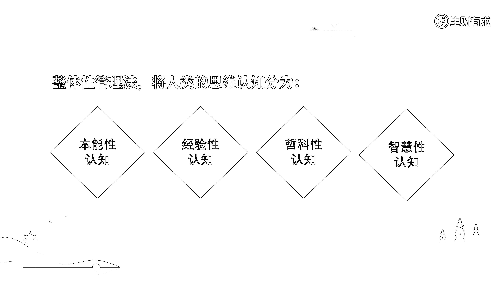

# 2.2.2.1 认知资料四层级

在全部资料中，认知类排在第一位。它对应的是人如何理解、如何判断世间事物。千百年来，这类内容不断累积，体量极其庞大。按照不同认知能够解释问题的覆盖范围与穿透程度，我把人的思维再往下拆成四个层次：

• 本能性认知

• 经验性认知

• 哲科性认知

• 智慧性认知

这四类并非平铺并列，而是逐级向上：越靠后的层级越深，能解释的问题范围更广，力度也更强。

本能性认知处在最底层。它深植于人的天性之中，不必依赖亲身实践，也不需要教化参与就能拥有。人身上那些偏直觉的感受、看法和念头，通常都归入这一层。

经验性认知最为常见。人们在实际做事中获得的各类理论、办法和心得，都可以放进这里。它既可能来自前人留下的经验，也可能来自自己在实践中一点点攒下的体会。

哲科性认知则站得更高。它与经验性认知最关键的分界是：前者经过数理逻辑的检验，并且是在更大规模的数据样本上做系统归纳后形成的经验。各类学科知识与资料，一般都属于这一层。

智慧性认知位于最高处。人的存在时间有限，思考能力也有限，所以世界上仍有大量知识，是我们当下碰不到、也想不明白的。宗教、灵修、冥想等资料，通常被归入这一层。