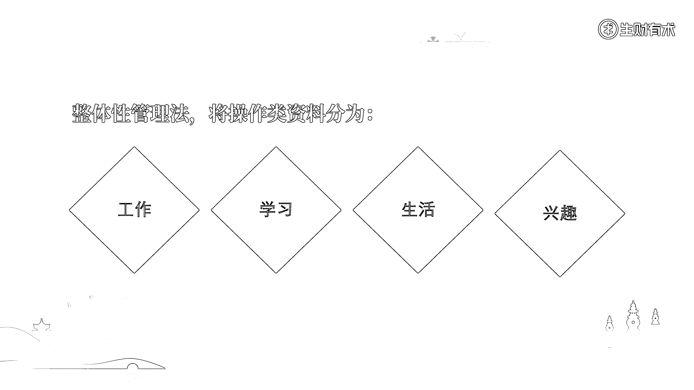
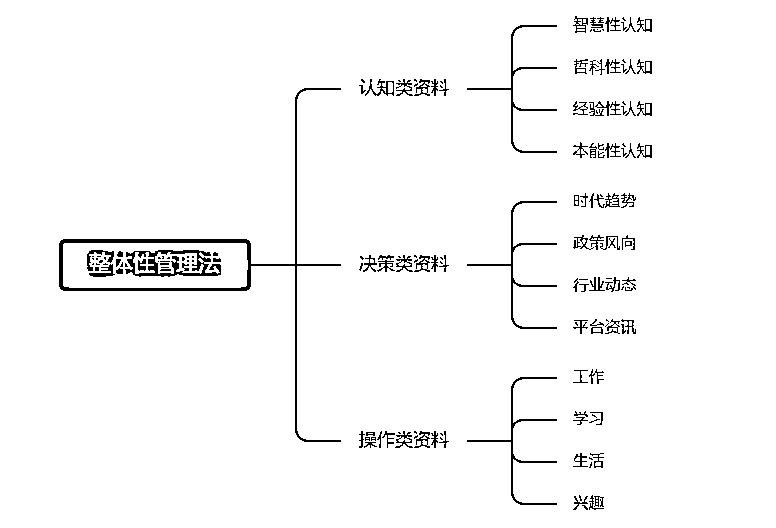

# 2.2.2.3 操作类资料

第三大类资料，就是操作类资料。它记录的是，当认知引导我们做出决策之后，我们实际执行的一系列行为。换句话说，这些资料是我们行动的存档。

操作可能蔓延到很多领域，不过最核心的其实就四个方向：工作、学习、生活、兴趣。我管理操作类资料时，也是按这几个方向来归类的。

说到底，“整体性管理法”最根本的诉求，就是让全世界的资源都能为我所用。为了达到这个目的，我们把世上所有资料做了一个大分类：

