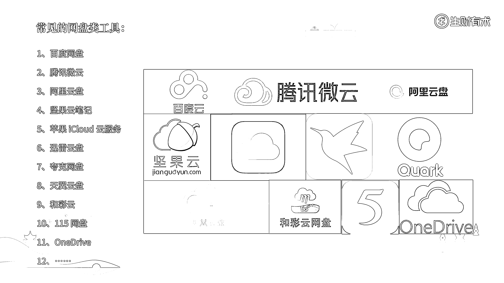
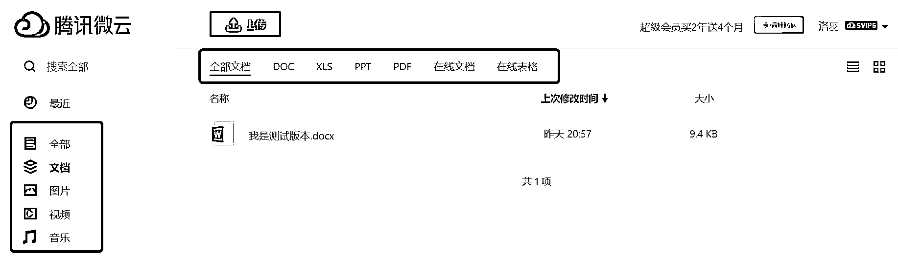
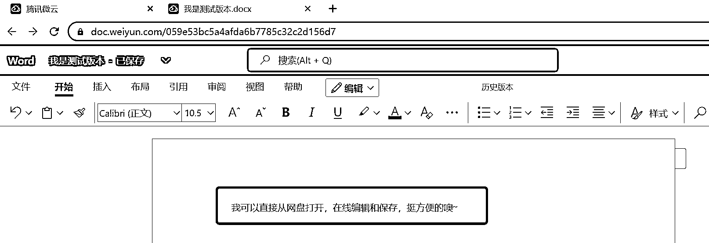
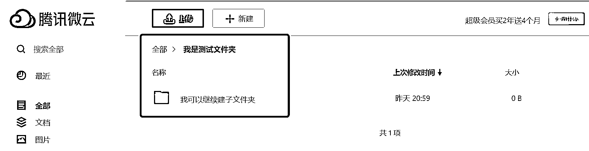
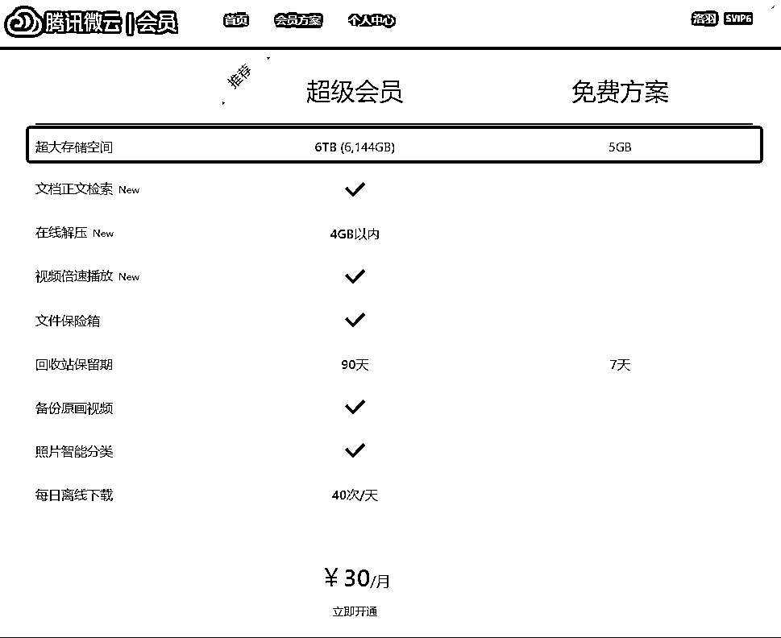
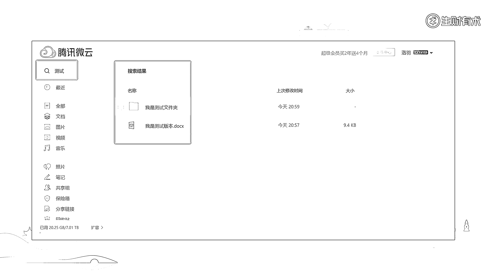
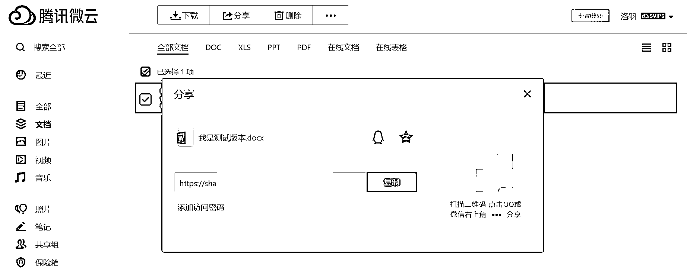

# 3.2.2 网盘工具：备份顺手，收集费劲 ★★★

市面上的网盘产品并不少，百度网盘、腾讯微云、阿里云盘、坚果云笔记等都属于常见选择。

如果让我给网盘类工具在资料管理上的表现打分，满分100分的话，我会给70分。我的使用建议是：把本地文件同步到云端做备份，同时将它当作大文件的存放处。

各家网盘的基础能力大同小异，这里不逐个展开，感兴趣可以直接去官网了解。下面以腾讯微云为例，聊聊实际使用感受。

1）收集资料

网盘在这里扮演两个角色：一是把本地文件夹搬到云端备份，二是承接外部传来的资料。

作为“云端文件夹”，相册类内容通常能自动同步，但其他文档大多要手动上传。作为“外部资料中转站”，除了百度网盘在传输场景中更通用，其他网盘相对小众、偏私人。实际操作中，常常要先用百度云收下文件，下载到本地，再上传到目标网盘。

整体来看，用网盘收集资料，链路偏长，称不上快捷。

2）呈现资料

能存的东西和本地文件夹差不多，文档、图片、音像、压缩包等都可以放进去。

展示方式主要有列表和缩略图两种，排序可以按名称或修改时间。只要把这些功能用熟，资料也有机会整理得清清楚楚。

3）编辑资料

想改网盘里的内容，可以一层层打开目录找，也可以直接搜关键词定位，然后动手编辑。

目前多数网盘支持在线修改并自动保存，不必先下载到本地、改完再传回去。不过具体编辑体验受软件功能限制，这里不展开。整体感觉仍接近本地文件夹，谈不上特别灵活高效。

4）结构化管理

和电脑里的文件夹一样，网盘的结构化能力主要体现在层级上：可以在文件夹里继续建子文件夹，一层层往下管理。

只要前期分类做得细，同样能把资料归置得井井有条。

5）存储空间

容量够不够，要看自己的资料管理需求；如果空间吃紧，也可以付费扩容。

6）搜索与查找

能不能快速找到资料，关键往往不在网盘本身，而在于我们平时怎么分类、怎么命名。

把“分类”和“命名”这两件事做好，网盘的检索功能用起来还是比较顺手的。

7）多平台协同

网盘既有网页入口，也有客户端入口。只要登录同一个账号，各端内容互通，这一点确实方便。

8）资料共享

网盘可以把一个文件夹或单个文件生成链接发给别人，分享时还能设置密码，便利性不错。

不过这种共享更多是单向传递，暂时做不到多人协同操作。

综合来看，网盘做资料管理的长处在于：呈现方式比较丰富，在线编辑省去反复上传下载的麻烦，能借助文件夹层级做结构化管理，整理到位后检索也顺手，对本地存储空间占用较小，云端容量不够还能付费扩展，多端登录内容互通，也能用链接把资料分享出去。它的主要短板则集中在收集和下载环节，操作路径偏长，不够省事。

所以我的结论是：

- 综合评分：70分（满分100分）
- 使用建议：本地文件云端备份 + 大文件存储地

