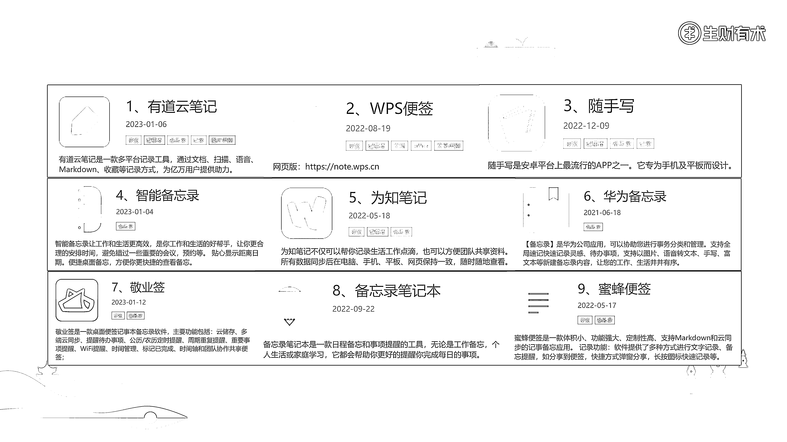
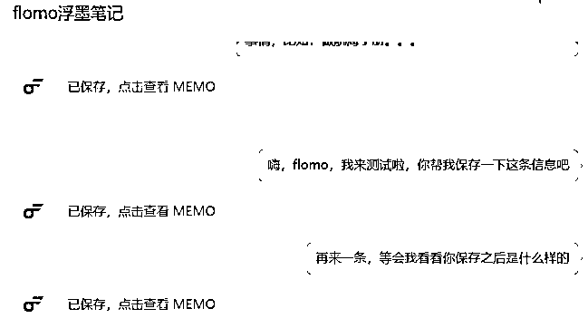
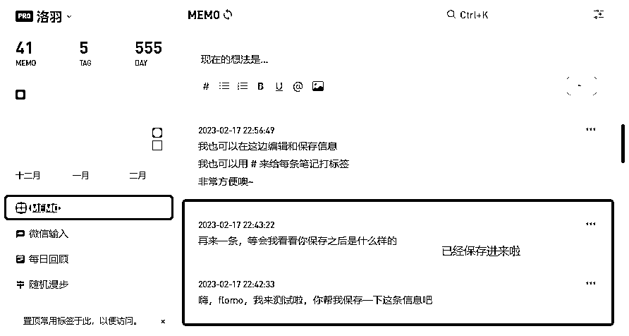
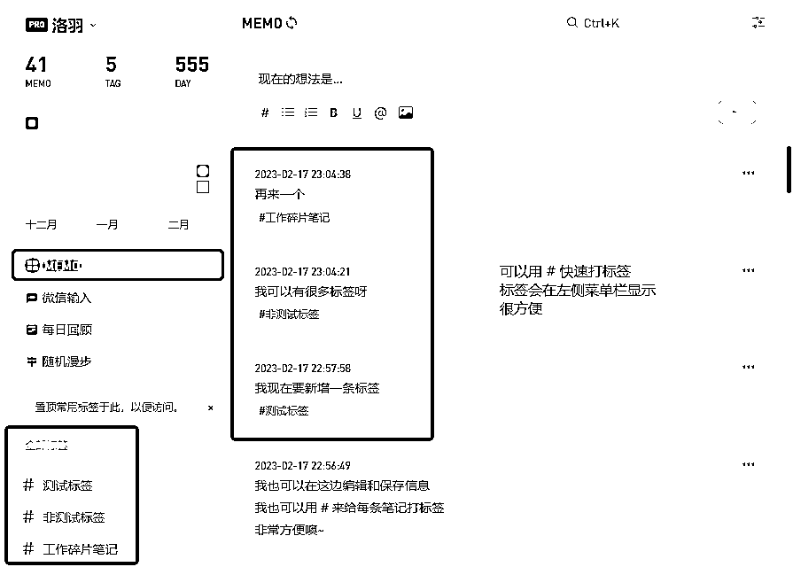
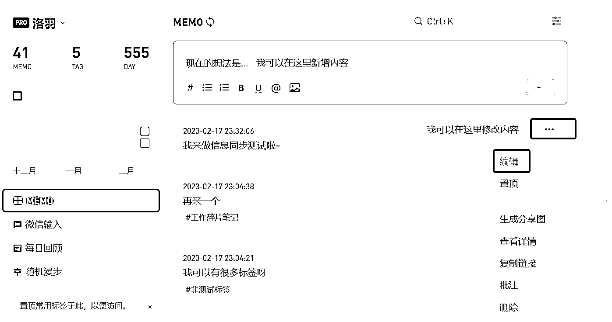
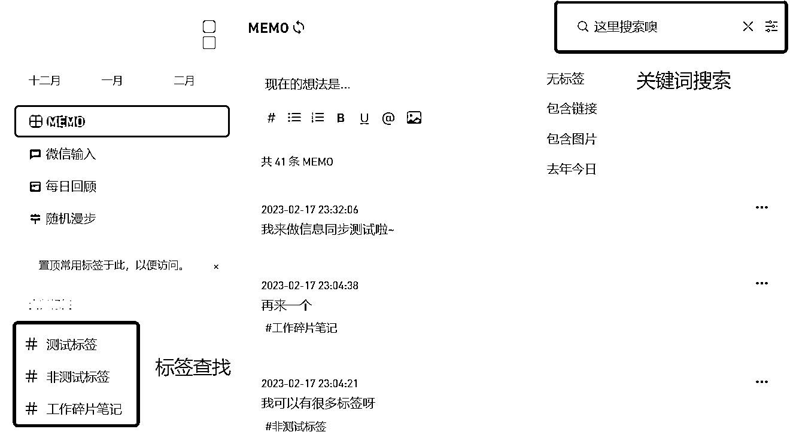
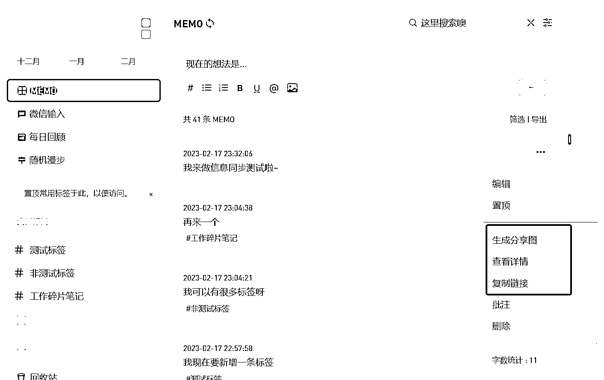

# 3.2.3 笔记工具：零散文字的好去处 ★★★

市面上的笔记应用一抓一大把，从有道云笔记、WPS 便签，到随手写、智能备忘录、为知笔记、华为备忘录、敬业签、白网路笔记本、蜜蜂便签等，选择相当丰富。

如果让我给笔记类工具在资料管理中的表现打分，我会给 70 分（满分 100 分）。使用上，更适合把它当作碎片文字的收件篮，同时搭配其他工具一起用。

这类产品的基础功能大差不差，通常都包含快速收集、添加标签、对外分享等，这里就不逐项展开了，感兴趣的朋友可以去各自官网了解。

这一节重点聊一个近两年热度较高的笔记工具——flomo 浮墨笔记。

一句话概括：flomo 是一款全平台的卡片笔记，核心定位是聚焦记录想法与灵感。它接入了🛰️，使用时可以像给自己发消息一样，随手把内容转给 flomo，后台会逐条沉淀下来。

详细说明可以去官网查看：[`help.flomoapp.com/`](https://help.flomoapp.com/)。

下面以 flomo 为例，说说我对笔记类工具的使用感受：

1）文字收集

•笔记类工具最突出的作用，是把文字和个人想法迅速收进来，其他格式的资料并不适合用它来收集，flomo 也是如此；

•和一些同类产品相比，flomo 在收集上的明显优势是与🛰️打通。它的发送入口就在🛰️聊天界面里，平时发给自己的材料可以直接转给 flomo，后端会自动收录；

•总体来看，收集文字类资料时，flomo 相当顺手。

2）内容呈现

•flomo 当前只围绕文字资料做管理，方式主要是标签化；

•展示形态不算丰富，换个角度说，也比较简洁。

3）内容编辑

•在 flomo 里，随时可以新增内容，也能随时修改和调整文字；

•整体编辑体验比较轻便。

4）结构管理

•flomo 的结构化管理主要依靠标签分类，标签之间是并列关系，没有更细的层级：

5）存储空间

•flomo 主要承担文字资料的收集与整理，容量对日常使用来说足够；

6）检索查找

•入口方面，既能在🛰️界面搜索，也能从🛰️聊天栏直接打开，比较省事；

•在 flomo 内查找笔记，可以通过标签和关键词检索；

•只要前期把分类和命名做清楚，查找就会比较顺畅；

7）跨平台使用

•flomo 与🛰️绑定，只要能登录🛰️，就能查找到已存档的内容。

8）资料共享

•flomo 可以通过链接和图片的形式共享资料；

•和网盘分享类似，这种共享更多是单向传递，无法实现多人协同操作；

归纳一下，用笔记类工具做资料管理，优势在于文字资料收集快捷、编辑灵活高效、搜索查找方便、不会占用较多本地空间，并且可以多平台协同；短板则是不适合收集整理其他类型的资料。它更像一本私人记事本，把日常所见所闻、所思所想零零散散地记录下来。

因此：

•综合评分：70 分（满分 100 分）

•使用建议：作为碎片文字的收件篮，并与其他工具搭配使用

