# 3.2.4 资料管理利器：85分，值得长期押注 ★★★★

在素材与信息的打理上，知识库类产品一直排在我的第一选择；到如今，它依然是我操作最顺手的工具。一个重要原因是，我对信息、知识与素材有一套体系化理解，且知识库内的整体框架早已成型。因此，每当新内容出现，我通常能迅速判断它该归入哪个分区，并立刻放到相应位置。

我的总体评价：

💡打分：85/100  
建议用法：作为资料大本营与线索归口，搭一次便可长期复用。

市面上可选的产品不少，印象笔记、Notion、语雀、飞书都有人用。

我2020年开始用印象笔记。平时喜欢搜罗、记录、琢磨，一年下来攒了四千多条笔记。后来接触飞书，发现它的云盘空间与知识库在体系化整理上更合我意，于是2022年把主要阵地逐步迁到了飞书。

若想了解两款产品的全貌，可去官网：印象笔记（https://www.yinxiang.com/），飞书（https://www.feishu.cn/）。

下面分享我的实际感受：

1）素材归集

① 印象笔记

• 它的收集逻辑和flomo有几分相似，微信及常见浏览器都能连通；  
• 在微信聊天窗口把文章或素材发给“我的印象笔记”，后台会自动同步；  
• 常用浏览器装上剪藏扩展，看到好内容一键就能留存；  
• 文本、图像、文件、音频与视频都在支持范围内；  
• 整体体验算省心。

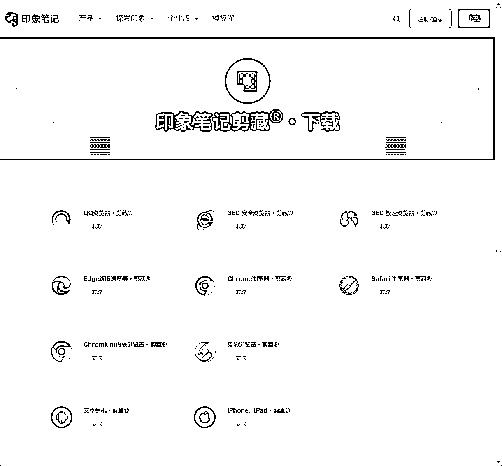

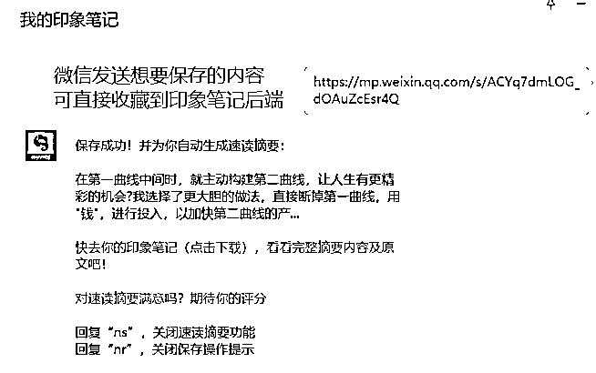

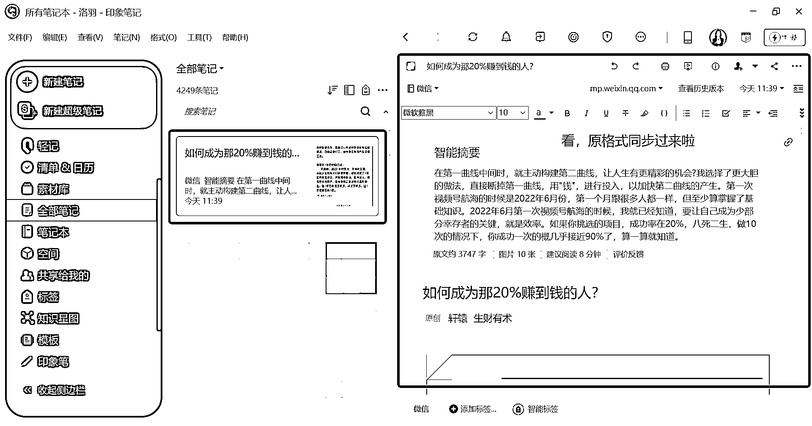

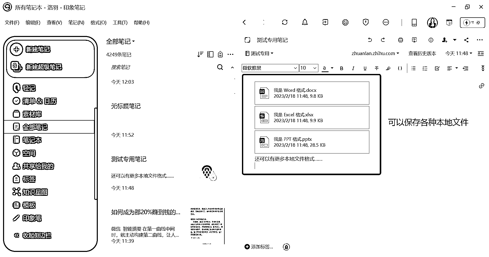

② 飞书（云空间 & 知识库）

• 飞书收料有两条路：云空间或知识库；  
• 云空间更像网盘，步骤偏多，效率一般；  
• 知识库的用法接近印象笔记，但内容要手动复制、上传，也谈不上省事。

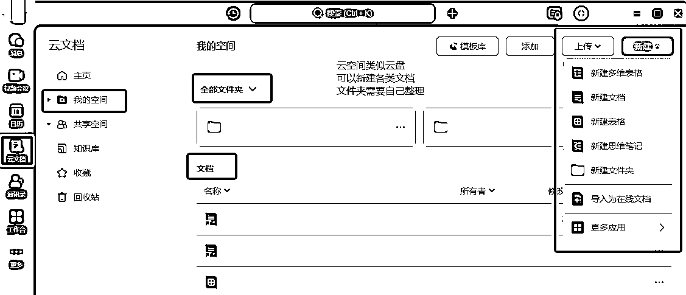

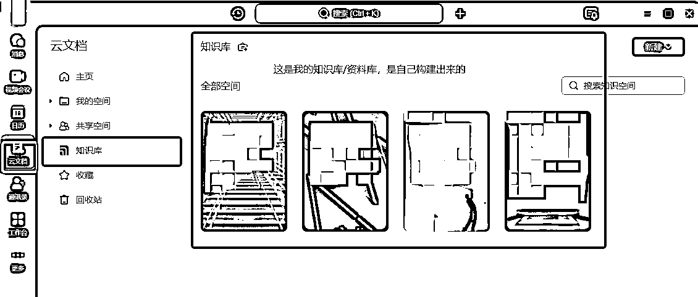

2）内容呈现

① 印象笔记

• 可归档范围包括文件、图像、音频视频与压缩包等；  
• 呈现方式以三级笔记为主，自左向右逐层打开，具体长什么样取决于存档时的格式；  
• 排列可按创建时间、更新时间、标题、来源网址、大小、位置、作者等维度；  
• 方式比较丰富，不同需求基本都能接住。

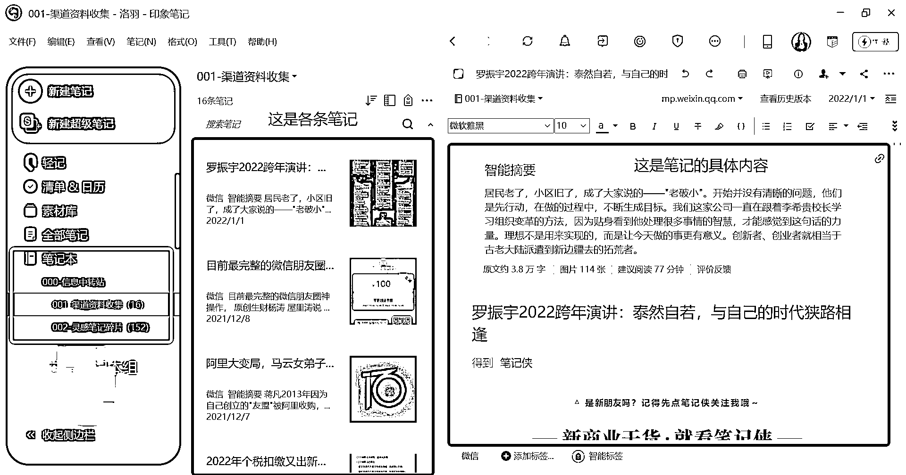

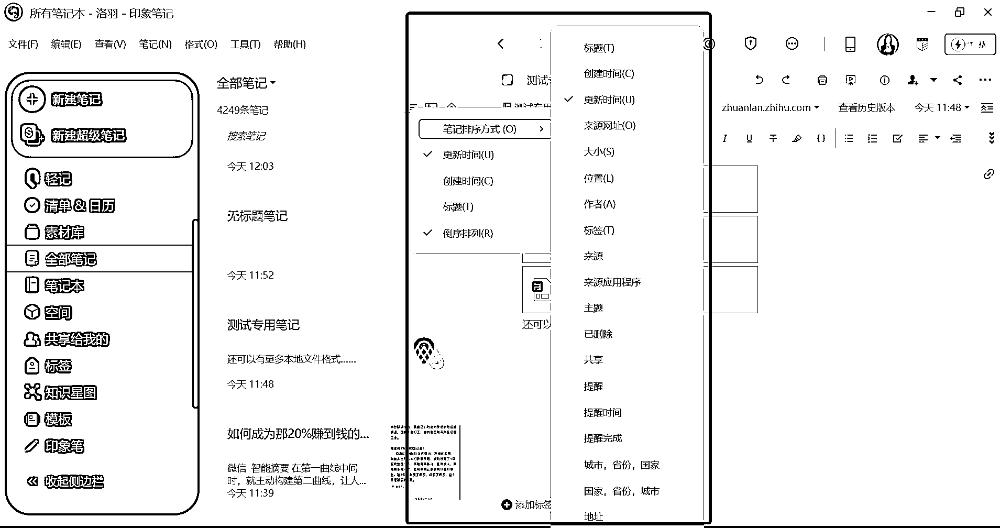

② 飞书（云空间 & 知识库）

• 飞书同样能管文件、图像、音频视频与压缩包等；  
• 云空间展示类似网盘，知识库展示接近印象笔记，此处不细说；  
• 不过飞书知识库有个突出能力：文档、表格、PPT、思维导图等可以放在一起综合呈现，这是印象笔记做不到的。

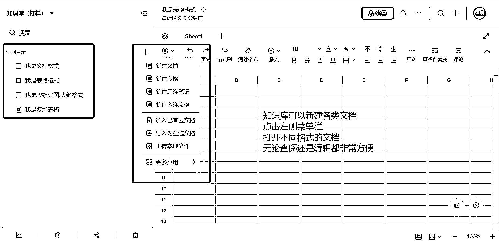

3）内容编辑

① 印象笔记

• 界面按“笔记本组—单条笔记—正文”展开，查找与修改都比较顺手；  
• “新建笔记”的编辑区不算好用，功能覆盖不够全；  
• 后来有了“新建超级笔记”，体验改善明显，模板、智能表格、大纲、列表等都有了；  
• 整体看，它的编辑能力已比较完整，但和飞书文档比仍有差距；飞书文档的编辑手感堪称一流，谁用谁知道。

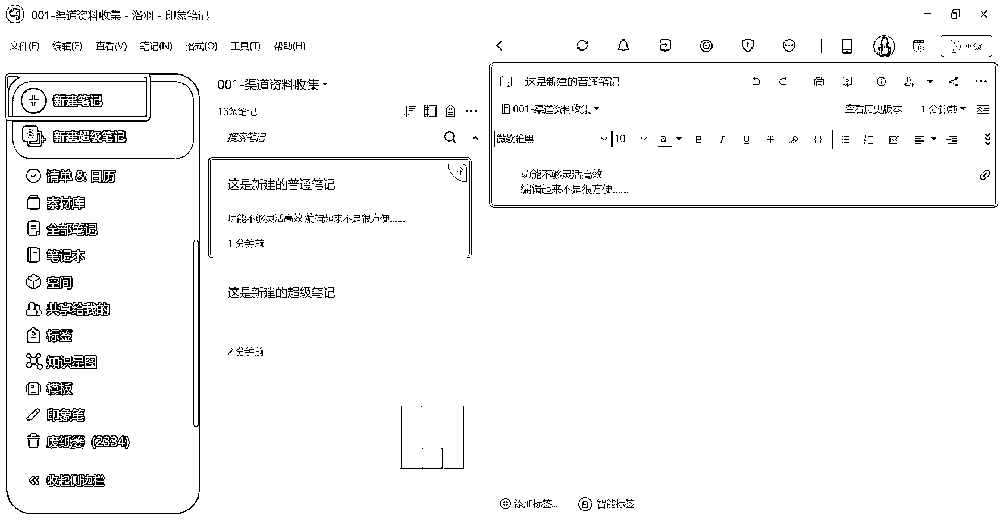

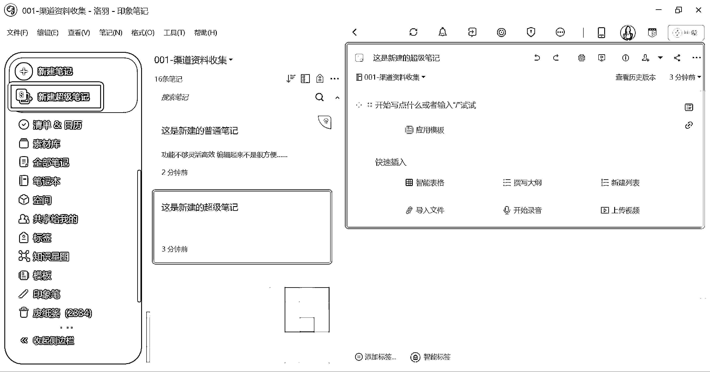

② 飞书（云空间 & 知识库）

• 想改云空间或知识库里的内容，既可以逐层点开目录，也能直接搜关键词再改；  
• 尤其要注意，这两处大多数内容本质上是飞书云文档；而飞书云文档的编辑体验，在我用过的编辑器里排第一，没有之一。

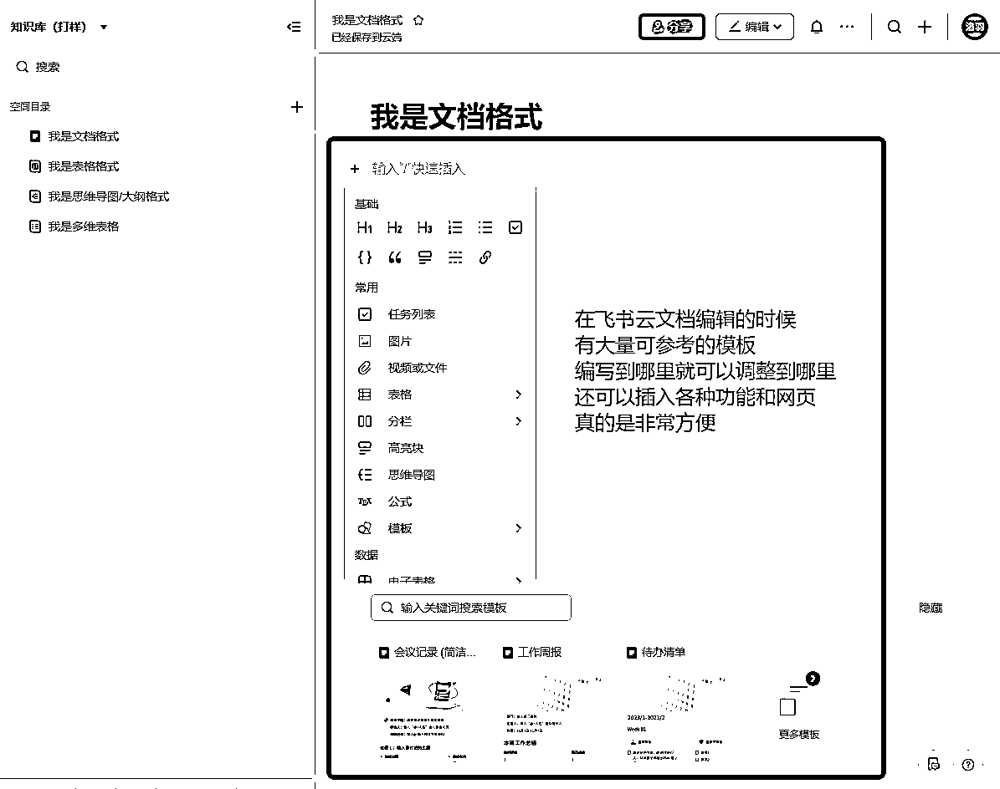

4）层级组织

① 印象笔记

• 横向结构靠“笔记本组—笔记本—单条笔记—详细笔记”三级加详情页，思路是压缩层级；对资料管理来说三级够用，但使用者得自己把分类做瘦，门槛不低；

• 纵向结构则提供清单&日历、素材库、全部笔记、笔记本、空间、标签、知识星图、模板等入口；多数功能其实用不上，能把“笔记本+标签”玩明白就算不错；

② 飞书（云空间 & 知识库）

• 云空间的层级组织体现在文件夹上：文件夹里还能建子文件夹，一层层往下管；

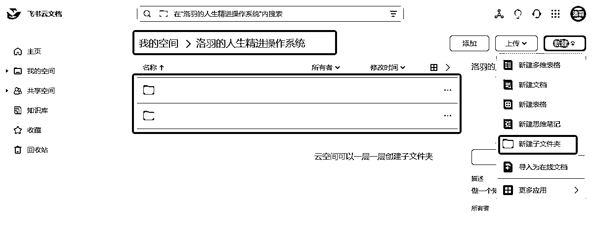

• 知识库同样分横向与纵向；  
• 横向是“目录—子目录—文档”，层数可按需设置，这一点与印象笔记的三级不同；  
• 纵向没有花哨入口，分类体系要自己从零搭，我个人反而觉得这样更清晰；  
• 综合来看，飞书的层级组织最清爽，也最称手。

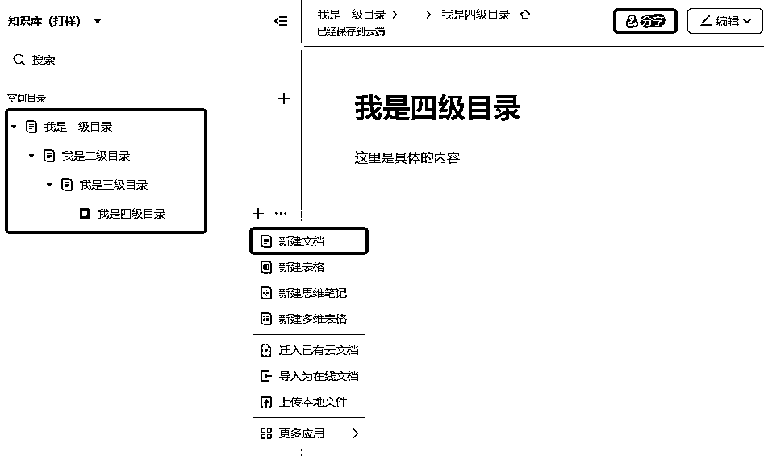

5）存储容量

• 印象笔记属于老牌产品，商业化起步早，容量不够时可付费升级；

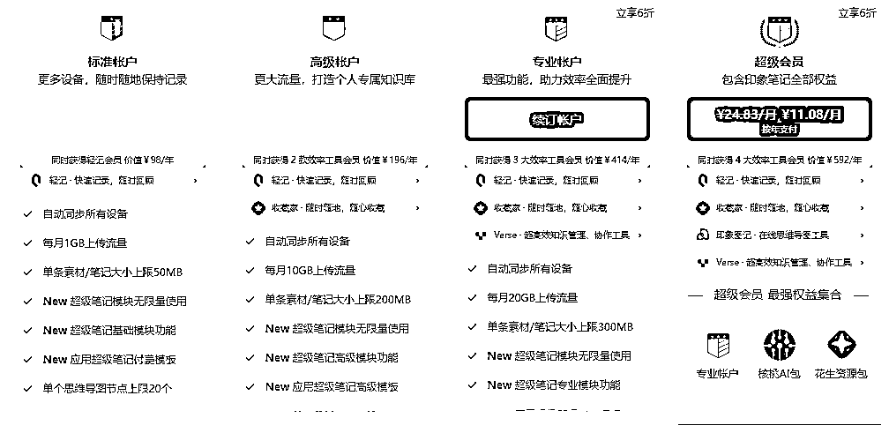

• 个人版飞书云空间和知识库合计10G，眼下无法扩容；有个细节值得注意：飞书只在存放图片和本地文件时计空间，新建云文档或在云文档里写文字，写多少都不占容量。所以除非要囤大量文件，个人版通常够用；  
• 企业版若容量不足可付费扩容，但考虑到资料私密性和日后迁移成本，我不主张拿企业账号做个人资料管理。

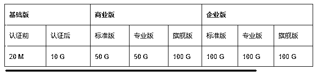

6）检索定位

① 印象笔记

• 高效检索的关键，其实不取决于工具，而取决于分类和命名；  
• 只要分类、命名做到位，印象笔记的查找还是顺手的。

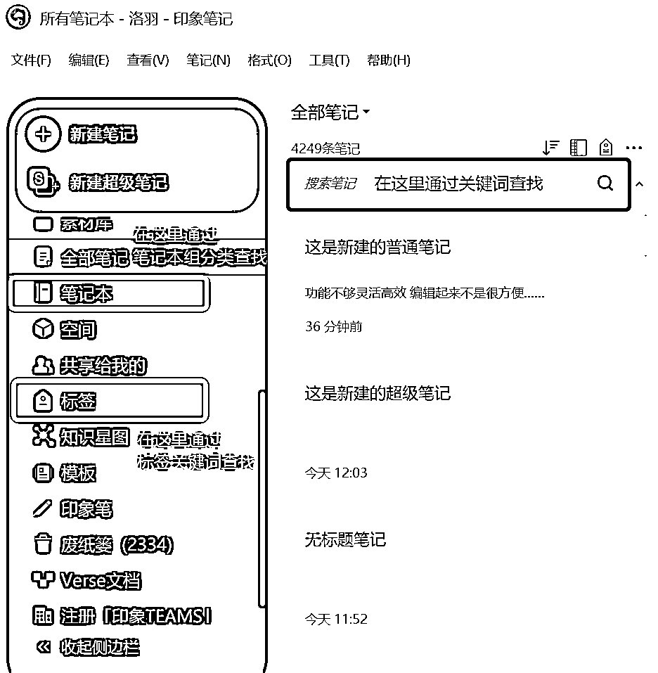

② 飞书（云空间 & 知识库）

• 在飞书找东西，可以按云空间与知识库的分类逐层翻，也可以直接搜关键词；  
• 关键词检索覆盖飞书内的消息、云文档、文档正文等内容，基本都能定位；  
• 整体而言，飞书的检索能力很强。

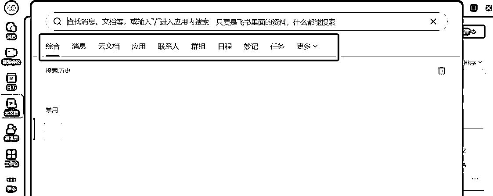

7）多端协作

• 印象笔记也能共享和协作，但操作略显繁琐：有时分享链接发不出去，有时对方收到后不清楚怎么配合；

印象笔记分享路径：

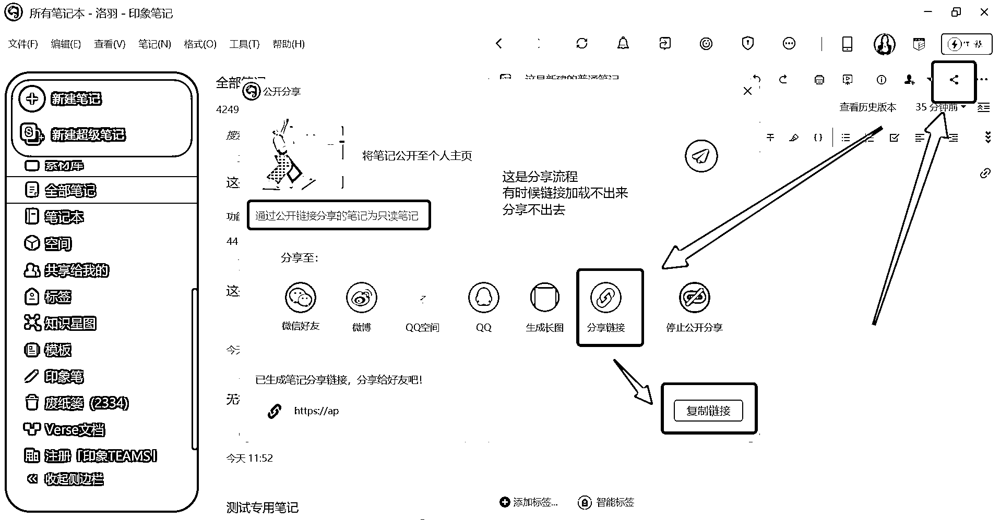

印象笔记协作路径：

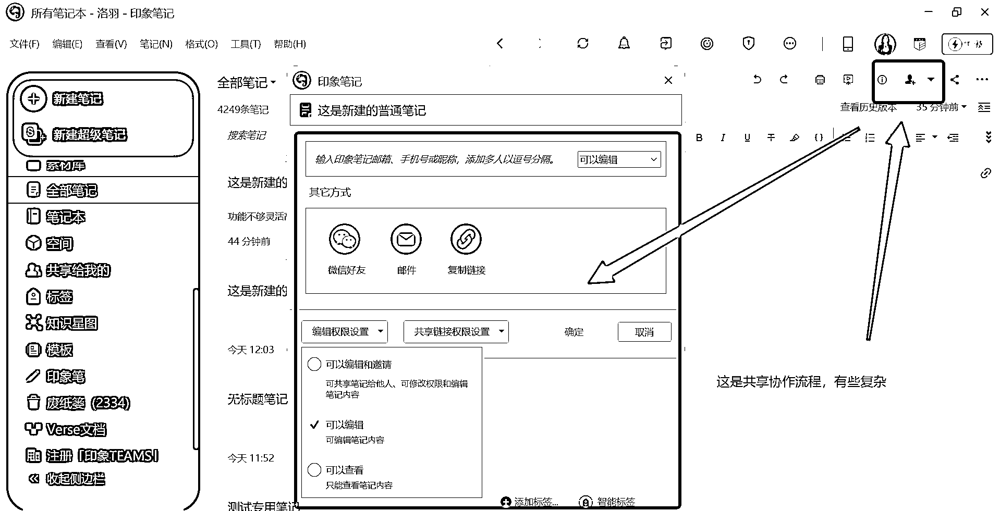

• 飞书的共享与协同，在所有协同办公产品里也属于第一梯队；我们不少工作对接都直接放在飞书文档里；  
• 提醒一句：需要对外分享或协作的文档，最好单独新建，再归档进云空间或知识库；若是在云空间/知识库里创建的文章要对外，务必留意父子页面的权限设置。

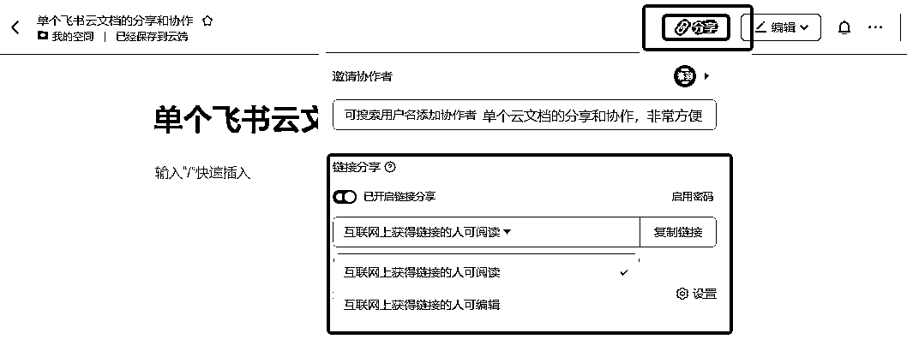

收个尾：印象笔记资格老，但功能偏板正，灵活度不够；飞书云空间像网盘，知识库像印象笔记，整体长在办公软件底座上，轻巧且高效。若让我选，我更偏向飞书知识库。它在收集环节略输印象笔记，但在层级组织、检索、共享等维度，堪称目前各类空间与文档产品里的佼佼者。

综上：

• 给这类工具打分：85/100  
• 建议这样用：优先考虑飞书（云盘与知识库一体），在飞书上搭一个资料管理主库，把其余散落内容与线索统一归拢进去；搭一次，长期受用。

