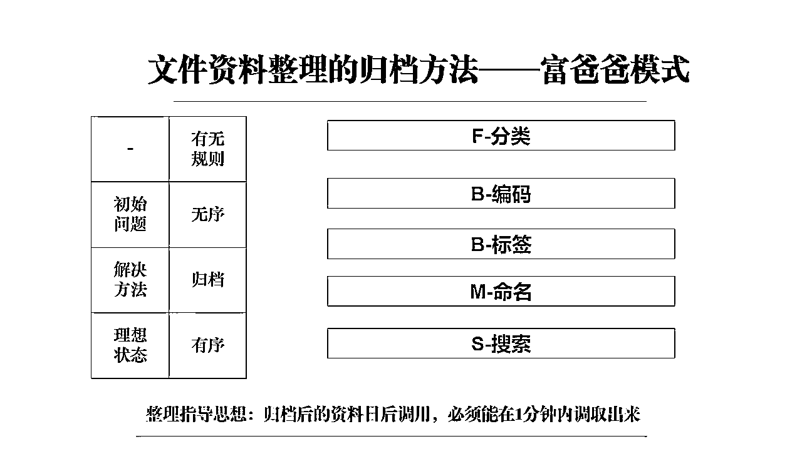
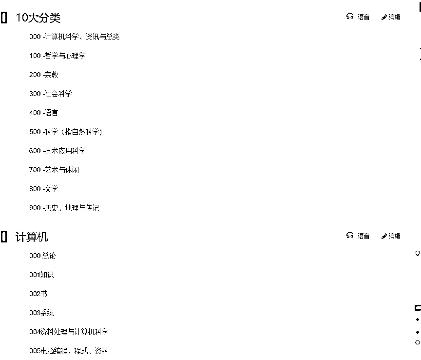

# 方法二：富爸爸模式 FBBMS，归档快人一步 @七小

本地文件越堆越多，云笔记也越来越乱？可以试试 FBBMS，我管它叫富爸爸归档法。它是一套通用的整理心法，电脑本地文件、电子云笔记都适用。FBBMS 这个名字，是从“富爸爸模式”的拼音首字母里来的。

拆开来看，F 对应分类，第一个 B 对应编码，第二个 B 对应标签，M 对应命名，S 对应搜索。这五件事的优先级并不固定：换个软件、换个人，重点就变了。分类做得好，标签可以不玩；标签够精准，分类可以不要；命名够直白，前两样省掉也无所谓；碰上标签筛选能力很强的应用，分类自然退居二线。

说到底，资料管理只有一个验收标准——所有存进去的内容，60 秒内翻得出来。五要素都是路径，不是终点，别为了流程而流程。

## 1、分类：先定规矩再分拣

分拣的动作很简单：把内容送进不同的目录里。真正难的是动工之前有没有想好规则，规则不成立，文件就不知道该去哪。

可参考的分类思路有四种：

① 按进展：已收尾、进行中、还没启动、已取消、顺延。尤其适合工作档案，分完后精力会更集中在“进行中”和“还没启动”上。

② 按时间 / 地点 / 对象：
- 时间能按年月切，也能按阶段切。比如复盘材料按“2021年5月复盘”“2021年6月复盘”存，相册按“初中、高中、大学”归类，实习资料按“2019实习”“2020实习”打包。
- 地点一般和阶段挂钩，比如日记按城市分：深圳的放一堆，广州的放一堆。
- 对象可以是个人或组织。🛰️收到的文件，就可以按来源建目录：某位朋友一个夹、复盘群一个夹、公司通知群一个夹。

③ 套现成体系：书、课程、资料往往自带分类，直接照搬最省事。

④ 自行发明：大框可以设成“学习、工作、生活”，也可以设成“修身 / 治国 / 齐家 / 平天下”。我自己用的是“学习、人、事、财”：学习下面放思维模型、知识体系搭建、阅读方法、信息整理；人下面放性格心理学、两性心理学、自我探索、社交策略；事下面放目标管理、时间管理、精力管理、做事工具；财下面放保险、股票、基金、债券、互联网项目。

分类没有万能模板，只有适合与不适合。

## 2、编码：给资料一个坐标

最简单的编码是按顺序排数字：文档从 01 编到 99；二级条目可以用 1) 2) 3)，也可以用 1 → 1.1 → 1.1.1，往下继续 2 → 2.1 → 2.1.1。

常见的编码形式有两种：纯数字、字母配数字。纯数字分类的经典案例，可以看看杜威的十进分类法。

我自己的用法是字母配数字：A 学习，B 人，C 事，D 财；再分一层就是 A1 思维框架、A2 知识体系、A3 阅读方法……

基础编码的价值在于排序整齐，并留下一个“搜索锚点”。比如你第一次靠标题找到某份文档，顺手记住编号 66，下次直接敲 66 就能翻出来。进阶编码则用于体现来源。做复杂研究时，从多个主题里各抽一两篇合成一辑，标上 A1、B2、C3，一眼就知道素材出处；只留标题，内容一多很容易混。如果你很少把大量不同主题的资料混在一起，进阶编码可以不用，基础排序已经足够。

## 3、标签：给内容打暗号

标签的做法是“记号+语义”，对文字型文档尤其友好。把标记放在标题或正文都行，整理完之后，想找内容只需要凭一个关键字。

想分细一点，可以定一套暗号：# 后接关键字，@ 后接相关人，T: 后接时间，P: 后接地点。不想分那么细，就统一用 #：#关键字 #相关人 #时间 #地点。

怕自己到时想不起来？初期归档时多打几个标签，十几二十个也不嫌多。甚至专门设一个 #想不起来，用来标记那些经常被遗忘的材料。

## 4、命名：让文件自我介绍

建议的命名公式是：内容概括 + 记忆点。记忆点可以是时间、地点、相关人，也可以是任何怕自己以后忘记的细节。

比如：
- 打造知识体系的矩阵 #L先生 #九宫格
- 知识体系四步法 #七小 #学习金字塔 #55字口诀

命名原则只有一条：看到名字，脑子里就能弹出里面的内容。反例也别再用了：“草稿”“待处理”“1”“新建文件”“资料”“2021年7月31日今日心得”——这种名字除了占地方，什么也说明不了。

内容来源：《资料管理的整理规则与工具》

