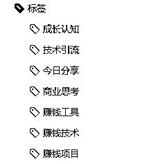

# 方法三：标签索引，让素材随取随用 @乔帮主

资料库越滚越大，真正让人头疼的往往不是收集，而是要用时能不能立刻找到。给素材加标签、搭索引，就是最常被采用的做法之一；不过想用得顺手，前提是按规范来。

1、规范要点：先把标签规则立起来

第一，先设计一套精简好用的标签体系。标签种类和数量别贪多，彼此之间的关联与层级要清楚，这样调用素材库时才不会绕晕。

第二，标签口径要统一。同一类内容尽量落到同一个标签上，大小写、单复数、缩写方式都按同一套规则处理，保证规范一致。

第三，控制标签数量。标签越多，维护越费劲，体系也越复杂，检索反而变难。

第四，标签要落到具体对象上。电影素材别只贴“娱乐”“影视”这类宽泛词，用“动作电影”“科幻电影”这样的具体标签更管用。

第五，定期巡检标签库。查错误、补遗漏，保证标签准确完整，发现问题及时修正。

第六，引入自动标注来提效。可以借助机器学习、自然语言处理自动抽取关键词并生成标签，提高效率与准确性。

2、打标签的方法与技巧

可以按分类体系来打：先搭分类框架，比如行业分类、内容类型分类，再把每份素材归到对应类别并贴上分类标签。

也可以用关键字来打：从素材中提炼描述性关键词，检索时更快命中。这是最常用、也最顺手的方式。

还可以加描述性标签：按对象属性设置概念、颜色、方向、时间、地点等标签，让素材特征更鲜明。

工具辅助同样可行：Evernote、Onenote、Zotero 等能自动提取标签信息，省力不少。

3、用关键字打标签的实战

灵感闪现时，本质上就是先抓关键字，再拿它去搜索对应素材，把想法推进落地。关键字提取既是建标签的常用策略，也是阅读的重要功夫。眼下热门的 AI 绘画与 ChatGPT，底层逻辑同样绕不开关键字：会搜集整理关键字，会向它们提问、训练它们，才能真正为己所用。有人读书慢，爱逐字抠；有人一目十行还能记住，核心阅读技巧正是抓关键词。

抓关键词的能力有五个用处：快速把握文章主题和重点；把信息有条理地组织成知识框架，便于记忆复习；需要特定信息时快速定位，并联想此前看过的内容；把关键词当笔记更精炼、有针对性，日后也容易回忆；写作时梳理思路、明确论点，提高效率和质量。

提取步骤也不复杂：先通读，梳理核心概念与关键词；再挑最能表达主旨和核心内容的词做标签；最后把文中反复出现的关键词也纳入标签。

我👸号和为知笔记里的常用标签示例：

另外，实际提取时可用分词工具辅助，如 NLTK、jieba 分词、词云分词工具等，对文章分词、词性标注，从而提炼关键词。

4、没有标签功能时，怎么搭索引

印象笔记、为知笔记等笔记平台自带标签功能；飞书没有标签功能，本地磁盘里存的文件也没有。那怎么用提取出的关键字做索引？答案是用文件夹分类、文件命名、文件描述三层来搭。

拿书作比：文件夹分类像目录里的“章”，文件命名像“节”，文件描述则对应书中的具体内容。要把提炼出的关键字落实到这三层里，后续直接用关键字搜索，就能又快又准地调取内容。

从技术角度看，本地磁盘文件系统和飞书内容系统不用标签，是因为内容存储采用全文索引方式。只要关键词整理到位，本地磁盘与飞书系统就能通过搜索高效链接到目标内容。

实践中，可在文件夹名、文件名里放入关键词和特殊字符来建索引。常见做法是在文件名中使用特定标记或关键词，比如把项目名称、主题、文件类型作为关键词，再用特殊字符表示：用下划线（_）或连字符（-）分隔关键词，或用方括号（[ ]）、大括号（{ }）把关键词括起来。

若是本地磁盘文件，也可借助文件管理器或专业文件索引软件。文件管理器一般带搜索，可用关键词搜文件，也能按标签或属性筛选。需要更强索引能力时，可用 Everything、Agent Ransack 等专业软件，快速扫描硬盘，支持多种搜索条件和高级筛选。

最后，关键词还能写进文件内容描述（通常指文本；图片、音视频不可编辑）。核心目的是给文件做标记，方便后续搜索读取。若文件内容已覆盖关键词，就不必重复编辑；若没有覆盖，可在文首和文尾加标签标记。

不管用哪种方法，建立索引的关键是在文件内容管理上投入足够时间和精力，确保每个文件分类正确、标记到位。这样检索和使用效率会大幅提高，也能为持续内容创作提供强劲火力。

内容来源：《利用技术思维，高效打造资料&素材军火库，持续提升你的内容输出火力》

