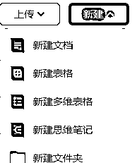
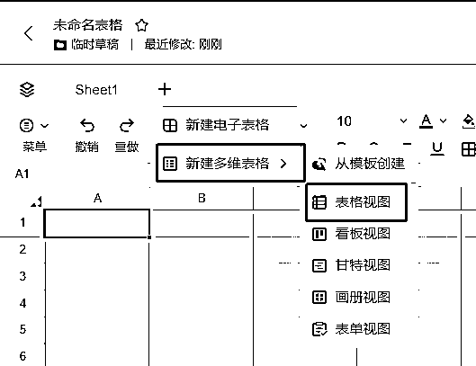
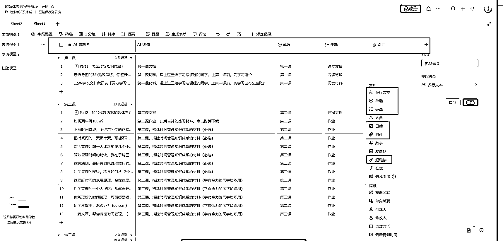
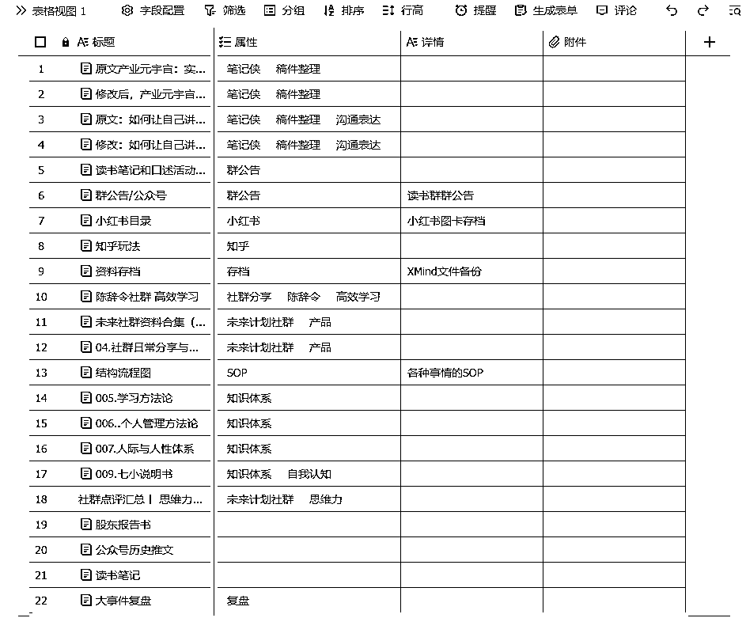
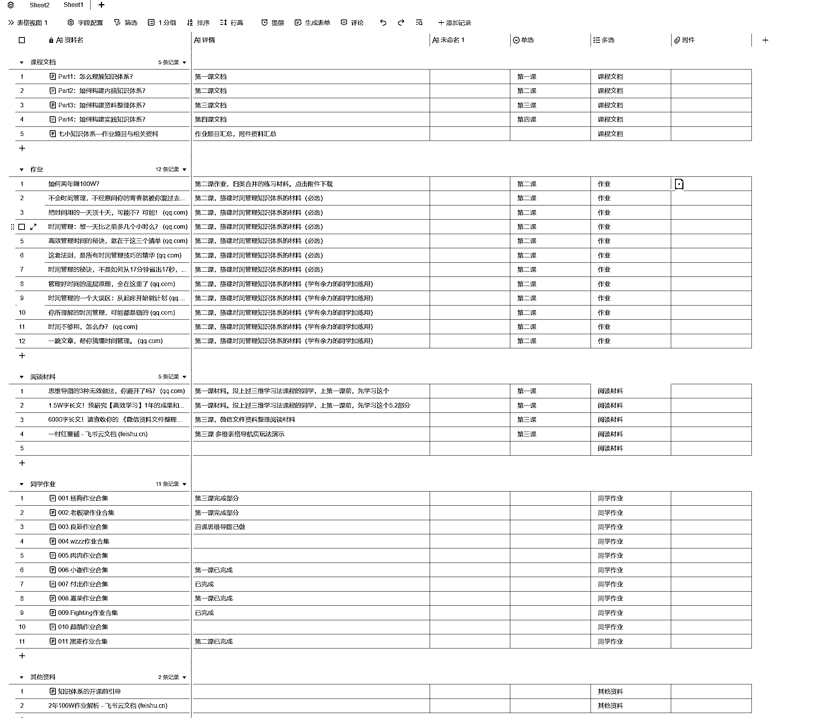

# 方法四：多维表格，让资料随取随用 @七小

想把零散材料收拢，又不想被层层目录拖住？可以试试多维表格。

1）创建方式

建表有两条路径：

• 直接新建一张多维表格。

• 先在普通电子表格中插入多维表格。

后一种的优势在于：同一份电子表格能容纳多张 sheet（工作表），每张工作表都可独立成表，分别记录不同主题。比如企业材料一张、个人学习一张、日常输出一张……而直接新建的那种只装一套内容。因此，个人资料若想集中存放，建议选后一种；若表格专门服务某项事务、或主要供他人浏览，则前一种更合适。

2）常用功能

管理材料时，重点会碰到这些功能：

• 多行文本：填写标题、简介、备注等内容。

• 多选：拿来当标签。把关键信息，如关键词、日期、地点、关联人写进去，日后查找更轻松。表内自带【筛选】，勾选标签，就能列出相关材料，还能同时选多个标签。

• 单选：用于信息大类划分。可以自上而下，按“人生书架”的思路设置；也可以从具体材料出发，归纳后再提炼总括词。要是多选标签已足够定位内容，这部分可省去。

• 超链接：用来放网址。多行文本同样能贴链接，所以按需使用即可。

• 附件：可存图片、视频、Word/PPT/Excel 等。以小文件优先；上百 M 的文件更适合放网盘，再把网盘地址复制回表中。

• 时间：记录材料创建或录入的日期，按个人偏好填写。

• 示例效果：

资料管理表：

训练营目录页：

3）适用范围与提醒

这些场景比较适用：

• 汇总型材料，如课程入口页、社群和训练营的素材集合。

• 难以归入某一类的材料：先把链接录入表格并打标签，原文件移到【杂物堆】，之后通过表格检索。

• 凌乱的文件夹：若某个电子笔记里主题材料过多、秩序很差，不必逐份搬进对应目录；改用表格加标签整理，以后从表里打开，不再翻找原文件夹。

• 当电子笔记自带的文件夹与目录不称手时，可用多维表格充当索引。比如飞书云文档的文件夹偏传统；知识库的页面树则更顺手。

要强调：整理的目标是快速取用。分类、标签、编码、命名、检索等处理，是让材料从无秩序转为“乱中有序”。注意，是乱中有序，不是彻底整齐。毫无秩序，调用会非常慢；彻底整齐，例如全部归档进表格、目录里没有一份未归类文件，维护代价会很高。保持适度松散，把分类、标签、编号命名、检索混着用，哪个顺手选哪个，才是低成本、高效率的整理方式。

内容来源：《资料管理的整理规则与工具》

