# 方法五：XMind 思维导图快速上手 @熊孩子不差

想把零散想法收拢，XMind 是个很顺手的工具。

1）XMind 是款什么工具

XMind 是一款用来绘制思维导图的软件，知名度高、功能齐全。国内不少同类产品的功能，多少都能溯源于它。

它内置逻辑图、组织结构图、时间轴、鱼骨图、树形图、表格图等十类思维结构；同一张图里还能混搭多种结构，这也是它最出彩的地方。

官网：[`xmind.cn/`](https://xmind.cn/)

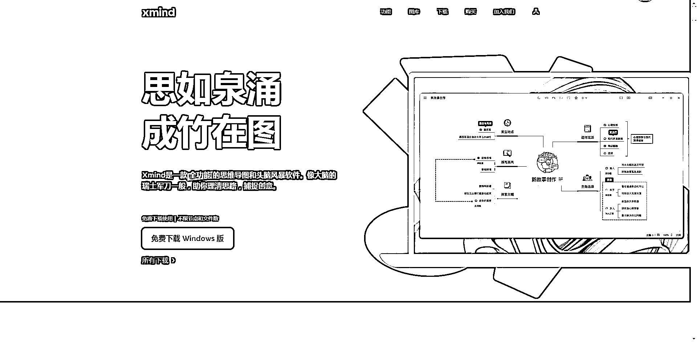

2）XMind 的亮点在哪

它提供多种思维结构，而且能自由组合。无论什么使用场景，都能迅速匹配到合适的版式。传统导图那种单调感被打破了，每个念头都能直观呈现，人也会更愿意继续想下去。

做完图后，一键就能进入演讲者模式；转场动画好看，布局也实用，讲起来更有沉浸感；

线条、贴纸素材很多，重点位置可以用不同标记突出，读者一眼就能抓住并记住关键内容；

自带智能配色，少花时间也能配出不错的效果；

能导出 PNG、EXCEL、WORD、PDF 等格式。

刚上手不必急着开会员；软件越做越完善，免费版已经够用。

3）XMind 界面与功能怎么用

① 从官网下载并打开软件，会看到对应界面。

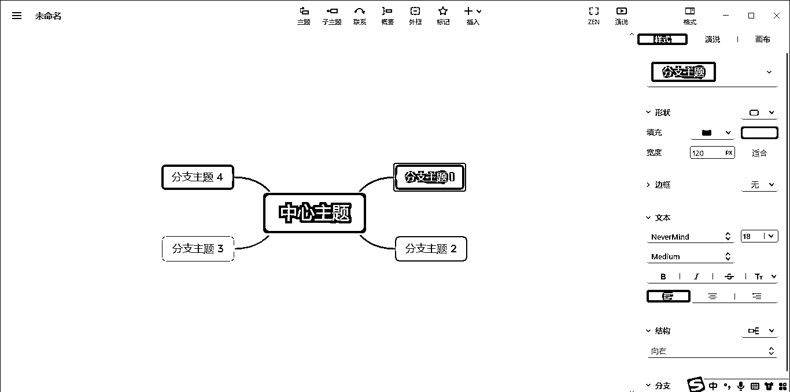

② 进入后，先熟悉几个基础按键：

• 左上角三横线，是基础功能的重要入口。

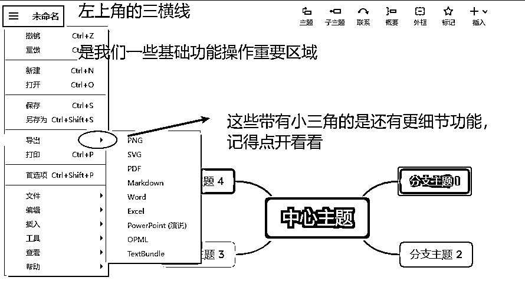

• 顶部有常用功能的快捷操作。

• 右侧区域负责版式、颜色、字体等美化。

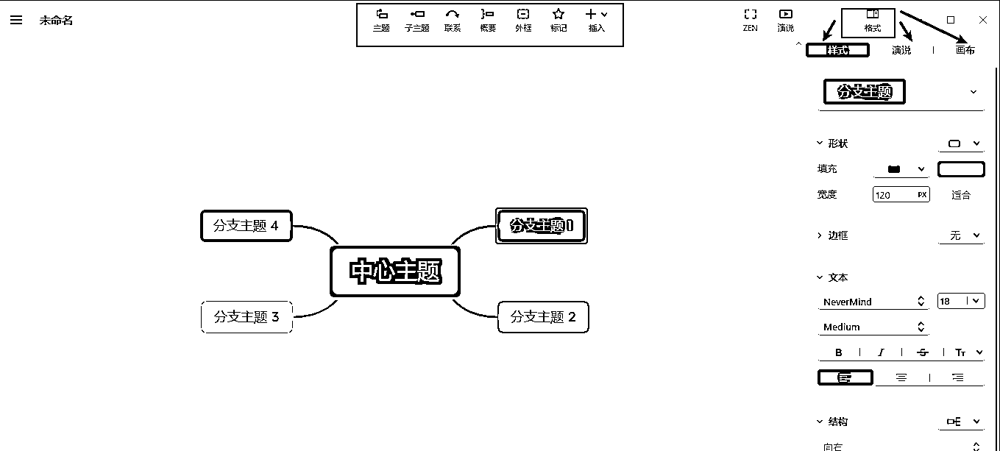

• 快捷键：常用组合可参考下图。

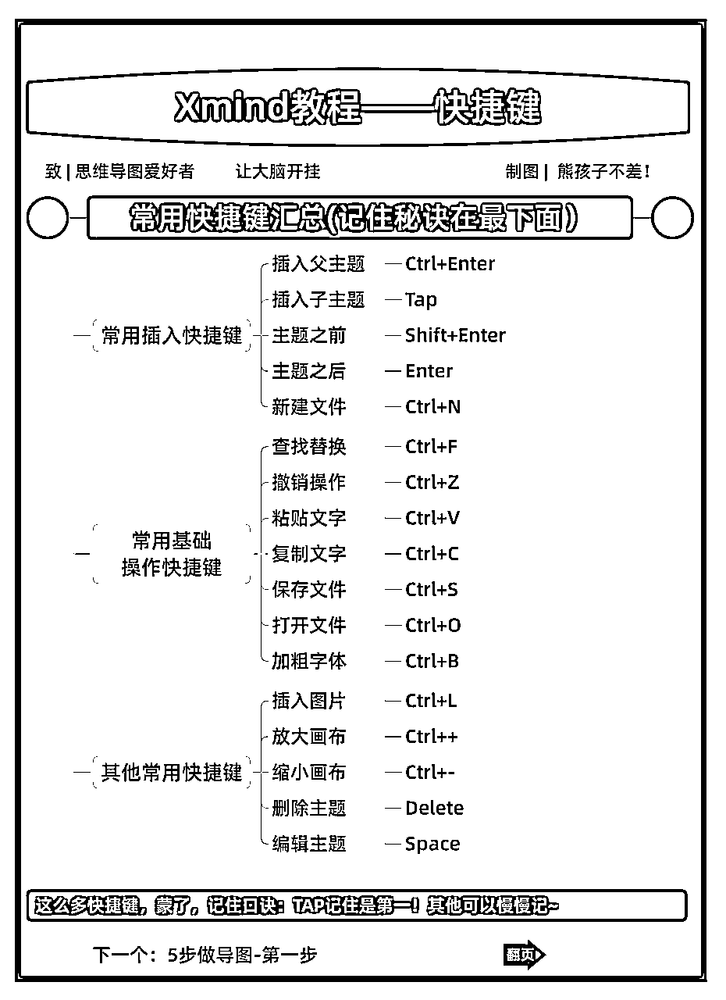

快捷键很多，先记口诀：Tab 排第一。其他可以慢慢补；要给哪个主题添子主题，先点中它，再按 Tab。

4）XMind 操作五步走

① 建：新建主题。

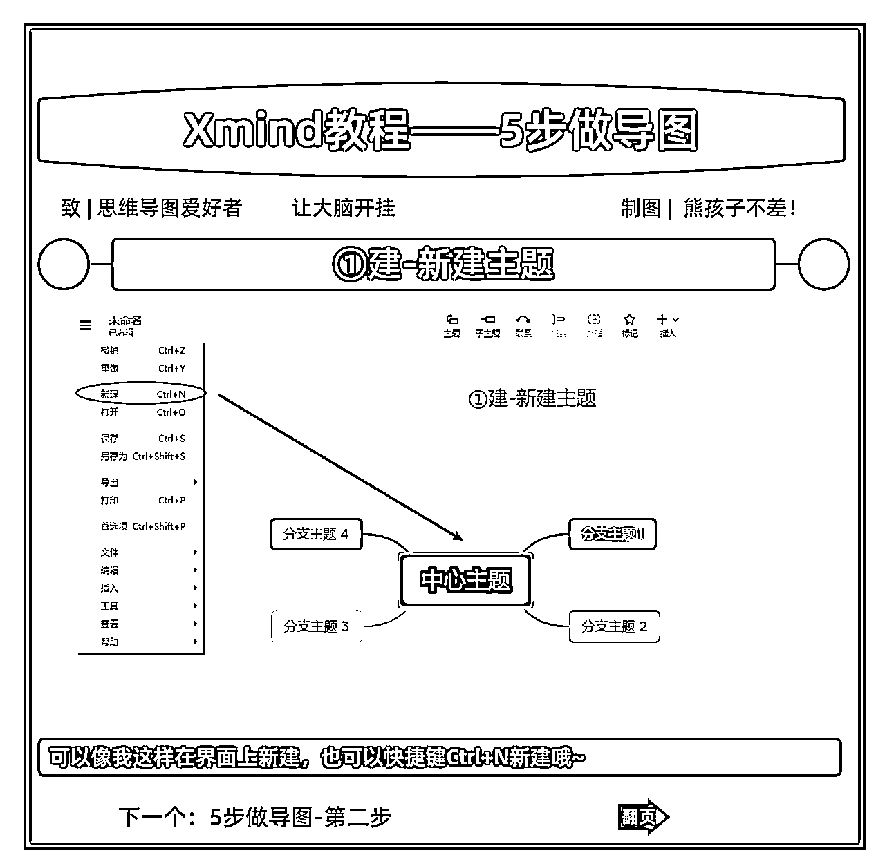

② 调：调整结构。在 9 大结构里挑一个喜欢的版式。

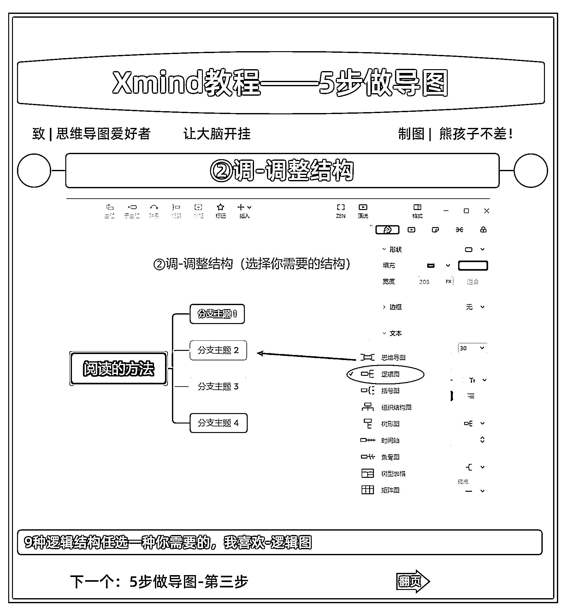

③ 炼：提炼关键词和关键要素。

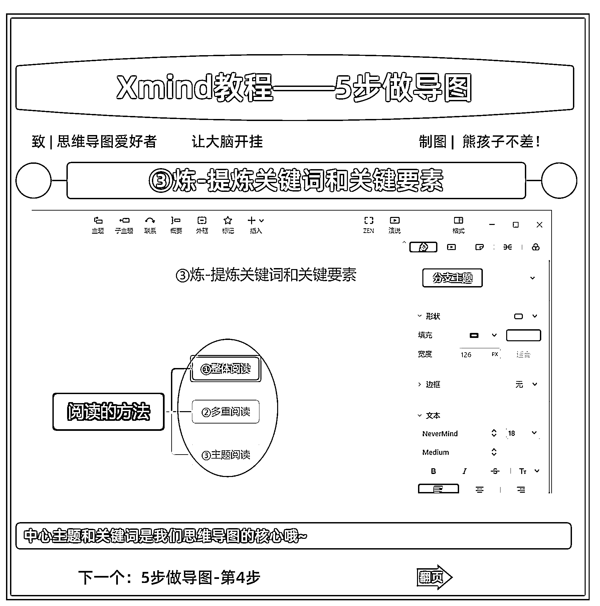

④ 增：新增子主题并补充具体内容。选中目标后按 Tab 加子主题，再继续完善。

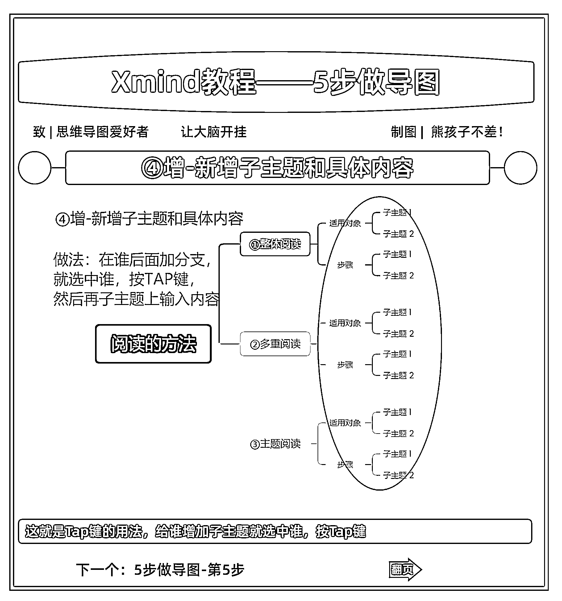

⑤ 美：美化导图。配色、文字、字号等都可以调。

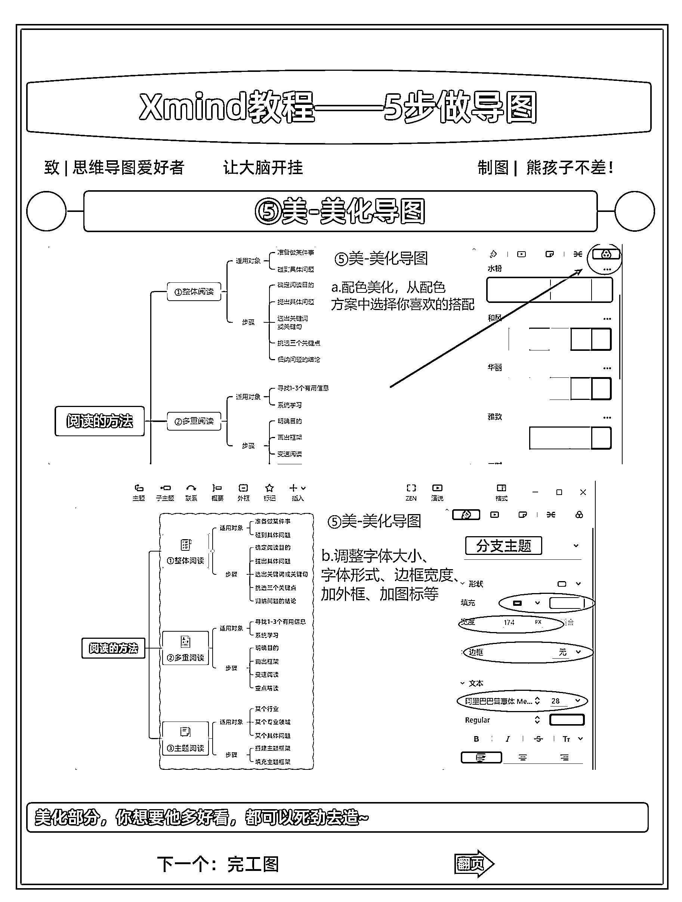

完整案例图：

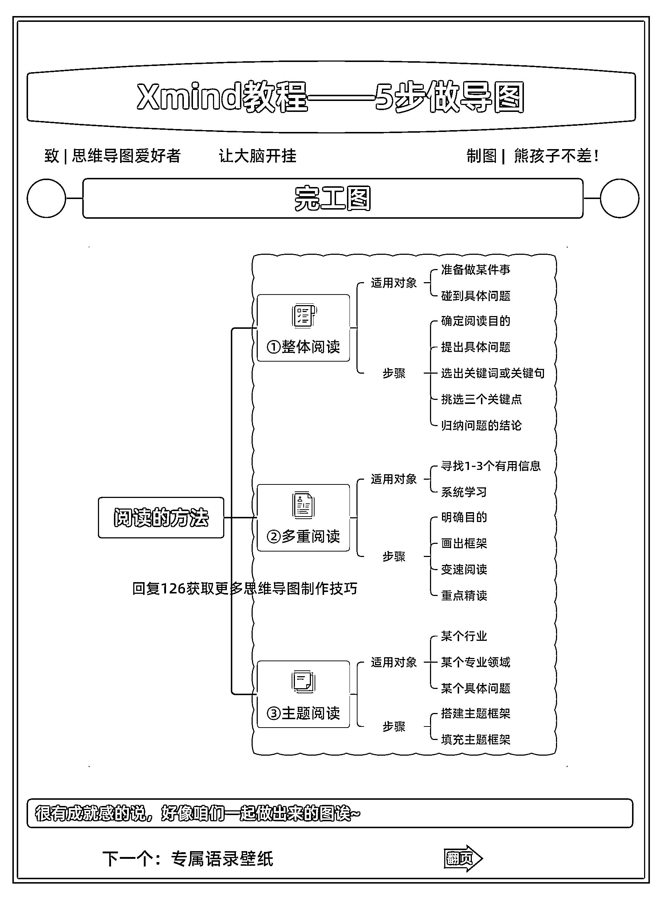

内容来源：《如何用 XMind 助力资料整理并打造第二职业曲线？》

