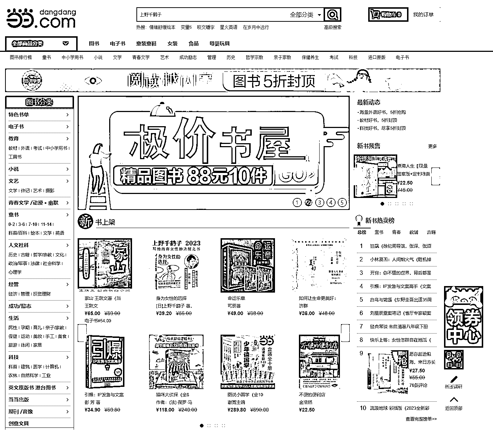
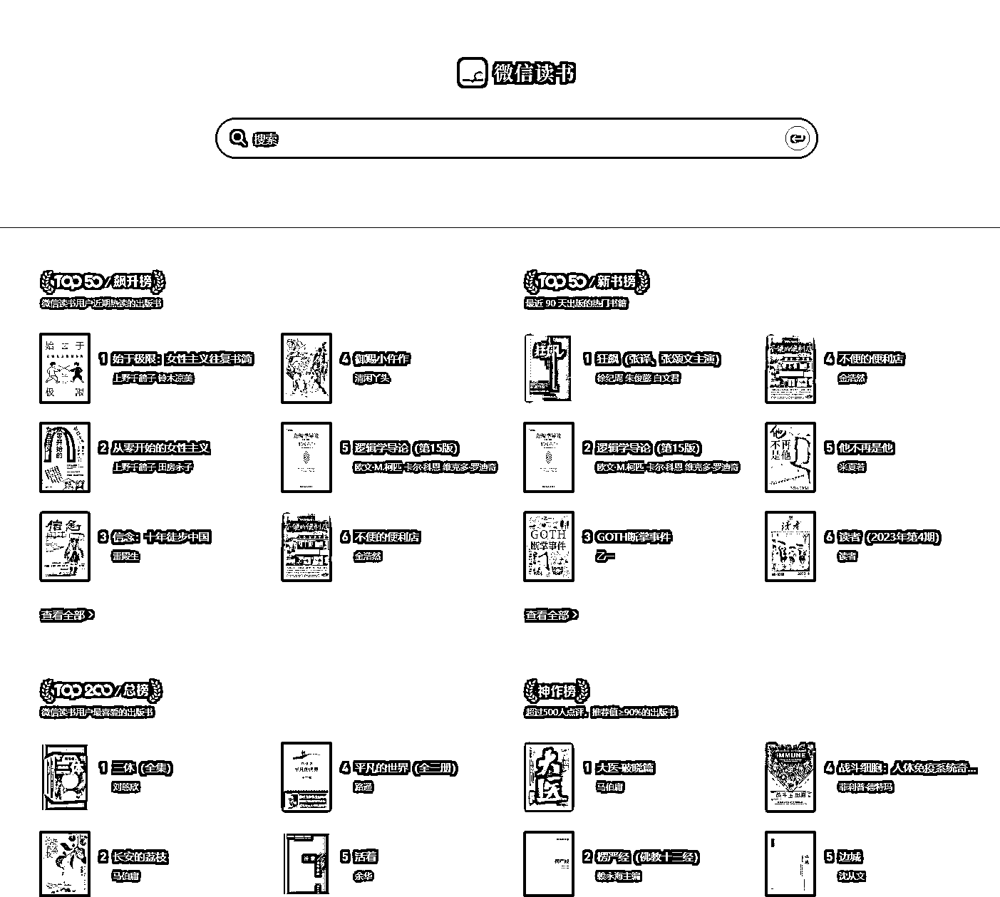
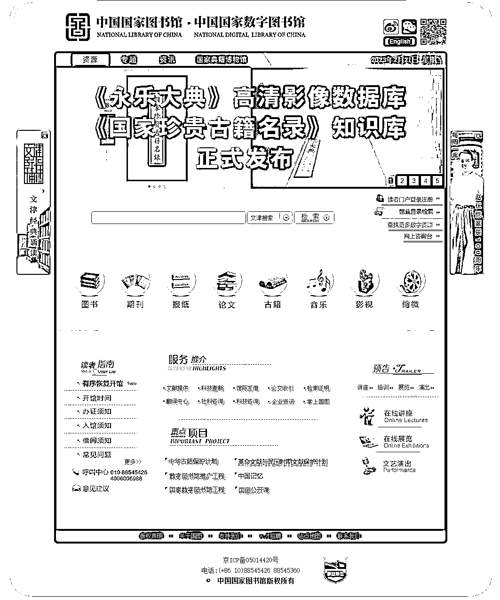

# 渠道一：教材与专著

想快速摸清一个领域的知识框架，最省力的路径就是啃透几本专业书。这些内容经过系统化梳理，一本书往往就是一套完整知识体系。

如果偏好纸质书，京东、当当、淘宝、闲鱼、八爪鱼二手书、孔夫子旧书网等平台都能入手；也可以直接去线下图书馆翻阅。

电子书的话，🛰️读书官网（[`weread.qq.com/`](https://weread.qq.com/)）或客户端都很方便；此外，中国国家图书馆（[`www.nlc.cn/`](http://www.nlc.cn/)）等线上图书馆也能满足需求。

如今大部分资料都已数字化，检索起来相当容易。不过，要是遇到特别珍稀冷门的材料，网上找不到，那恐怕还是得跑一趟大型线下图书馆才能解决。