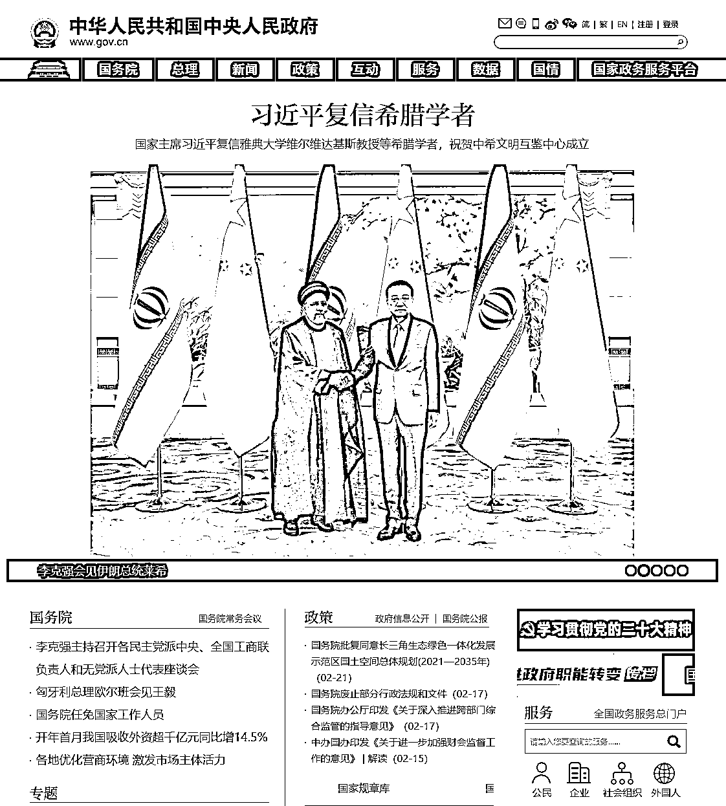
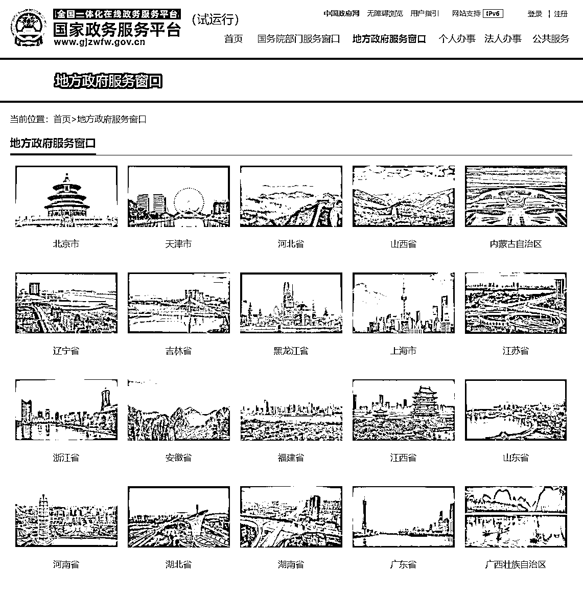

# 渠道四：查政策、找文件，官方站点收藏好

做决策参考，离不开中央到地方的会议动态、政策条文、公开文件、研究报告和制度规定。与其全网翻找，不如把下面这些官方入口收进书签，需要时直接点开。

**1）中央层面**

- 党中央入口：cpc.people.com.cn
- 国务院入口：www.gov.cn
- 立法机关入口：www.npc.gov.cn（人大）
- 协商机构入口：www.cppcc.gov.cn（政协）
- 国防与军委入口：www.mod.gov.cn
- 审判机关入口：www.court.gov.cn（最高法）
- 检察机关入口：www.spp.gov.cn（最高检）

**2）地方层面**

- 地方办事服务总入口：gjzwfw.www.gov.cn/col/col486/index.html

