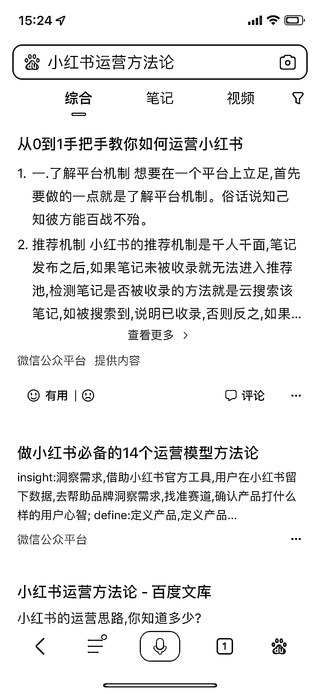
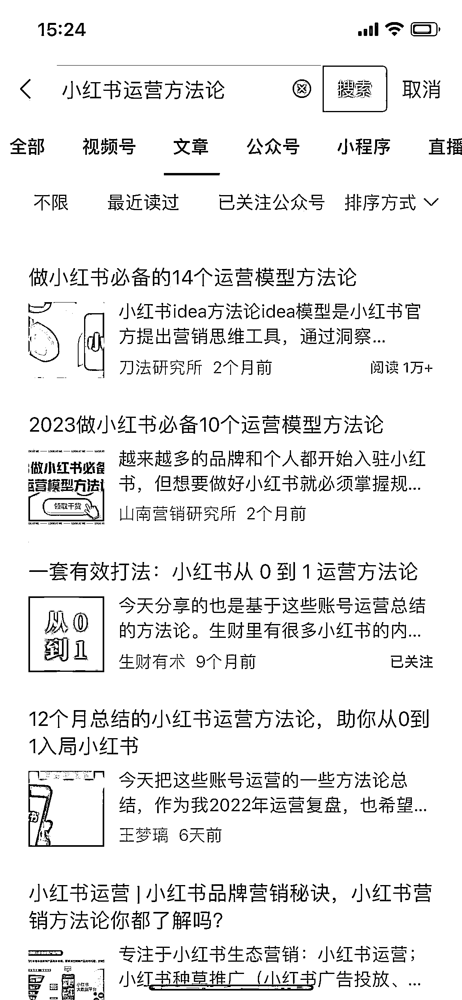

# 渠道三：善用搜索引擎

在资料获取的诸多途径中，搜索引擎算是最为稳妥、也最常用的基础打法。图文信息的检索，可以借助谷歌、维基百科、百度、知乎以及各大👸号等阵地；与此同时，抖音、B站、📕这类以音视频和笔记分享为主的新兴平台，如今同样成为不可忽视的搜索入口。

这些渠道经过长期的内容积累，早已蕴藏了极为丰富的信息宝藏，只要善于利用，便能在短时间内高效锁定所需资料。但值得一提的是，检索过程中不能只盯着结果的数量，更要留意不同平台的调性与内容风格各有侧重，同时也要对信源保持一份审慎，学会甄别信息的质量与真伪，避免被表象误导。

