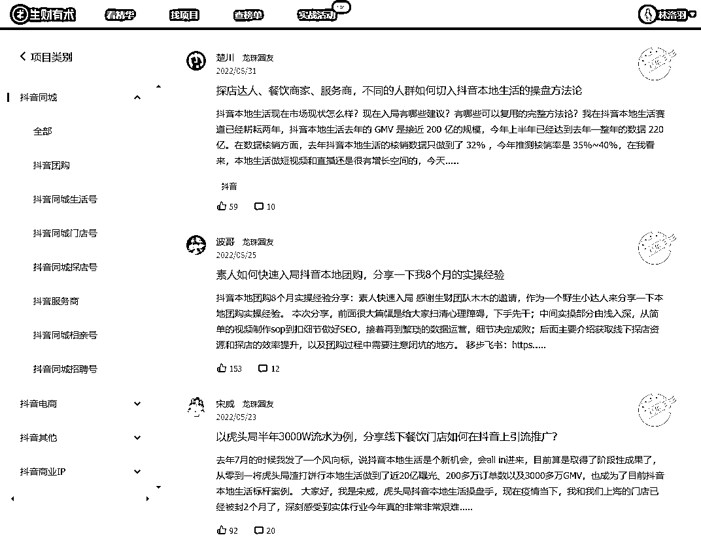

# 渠道七：垂直社群，干货集中地

在知识付费盛行的当下，各类社群层出不穷：既有免费开放的，也有付费才能进入的。它们经过长时间经营，通常会积累下大量有价值的材料。其中，微信社群和知识星球是两种很典型的形式。

想获取某个垂直领域的知识或资料，加入相应的社群、社区就是一条现成路径。若遇到不清楚的问题，还能在群里向有经验的人请教。

上面这些，便是专业向与通用向资料获取的12种渠道，希望对你有所助益。

