# 平台一：公众号文章采集，两套工具怎么挑

## 1、免费方案：批量抓取公众号文章

下载入口：[`pan.baidu.com/s/1D8dcntsBgxMaNTbOWPcuBg?pwd=kjtr`](https://pan.baidu.com/s/1D8dcntsBgxMaNTbOWPcuBg?pwd=kjtr)

这款工具自 2020 年起就不再维护，但目前市面上能免费用的同类工具已经很少见。

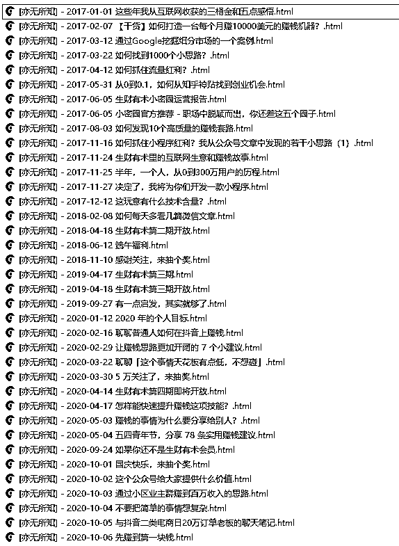

### 1）使用前提与注意事项

• 它只认微信 2.8.0 客户端，无法搭配最新版微信使用。要运行该工具，得先卸载电脑上现有的微信，再安装压缩包中附带的对应版本。

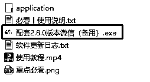

补充一句：某宝上花几十元买到的 wetool 破解授权，同样只支持微信 2.8.0。

• 使用旧版微信时，偶尔会遇到无法登录的情况，这时用低版本修复器处理一下即可。

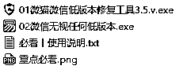

### 2）配置与上手流程

• 正式操作前，建议先看一遍视频教程。

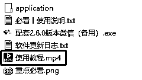

• 运行程序：启动 `application/WechatDownload.exe` 后，浏览器会自动跳转到 [`i.ijrou.com/`](http://i.ijrou.com/)。这是因为工具长期未维护，内嵌了一个广告异常页面，直接关掉就行。

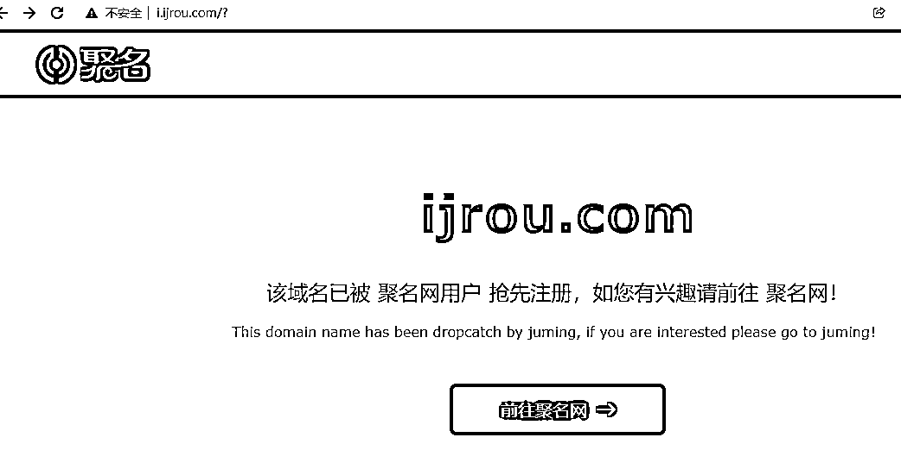

### 3）参数设置

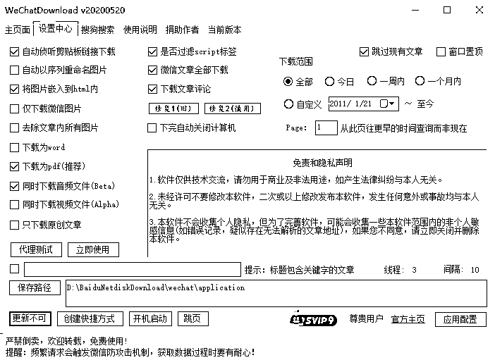

• 勾选“跳过现有文章”，可避免重复下载。

• 勾选“侦听剪贴板链接下载”后，只要复制微信文章链接，工具就会自动开始下载。

• 重新设置“保存路径”，因为软件默认使用的是本机目录地址。

• 其他选项按自己的使用需求调整即可。

### 4）抓取文章

在微信客户端里找到要采集的目标公众号，这里以“点金乔帮主”为例，

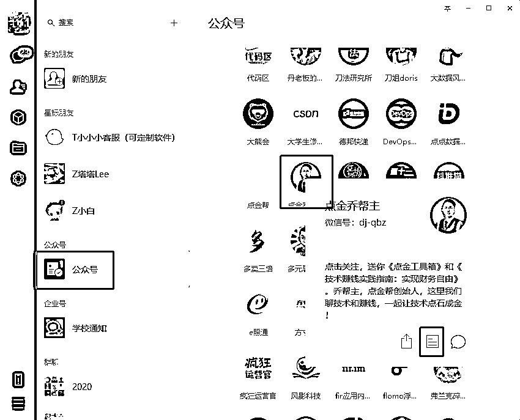

然后点击“查看历史记录”，进入该公众号的历史页面。

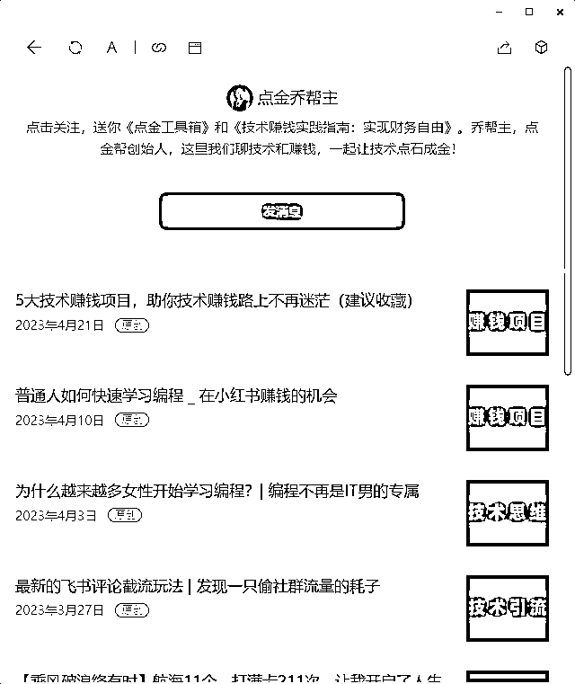

此时工具会自动获取历史下载页面，并进入自动下载模式：

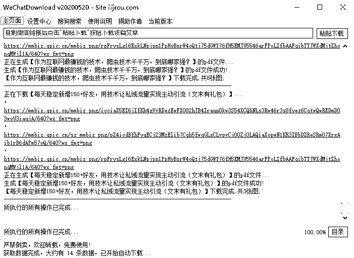

下载结束后，可以到保存目录核对具体内容明细：

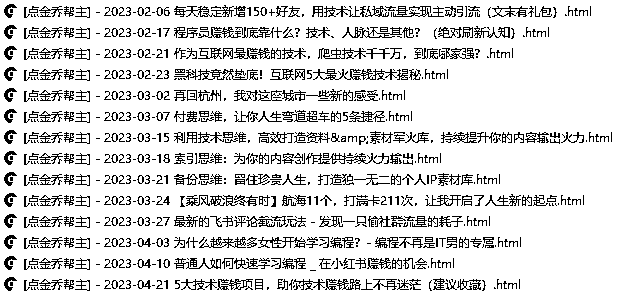

需要注意的是，每个微信号每天下载 1000—2000 篇文章后，容易触发微信风控，出现“操作频繁”的提示。想继续下载，可以准备多个微信号轮换登录，或者把时间线拉长：今天被提示频繁，明天再接着下。

### 5）局限说明

• 只能配合老的 2.8.0 版微信使用。

• 无法获取文章的阅读数、在看数和评论数。

## 2、付费方案：批量抓取公众号文章

下载入口：[`pan.baidu.com/s/1AUOpoeCuYlBKnQu_cqQBhA?pwd=nfie`](https://pan.baidu.com/s/1AUOpoeCuYlBKnQu_cqQBhA?pwd=nfie)

相比免费版，付费版功能更完整，使用体验也更好，免费版的那些短板基本都规避了。

费用方面：年卡会员 49.9 元，永久会员卡 299.9 元。阅读数、在看数、评论数的下载属于会员费之外的按次付费项目，1000 篇文章 25 元，可按自身需要购买。

### 1）安装与更新

软件最新版本为 2023 年 4 月 1 日更新的 1.6.5 版。运行主程序后，将其更新到最新版本即可。

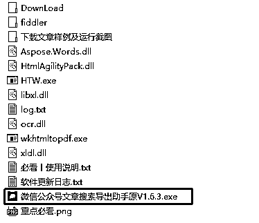

### 2）核心能力一览

进入软件主页面后，点击头像位置用微信登录。软件主要有三个核心功能：文章搜索（公众号全网搜索）、号内采集（针对某个公众号采集）、本地搜索（对已下载内容进行搜索和导出）。

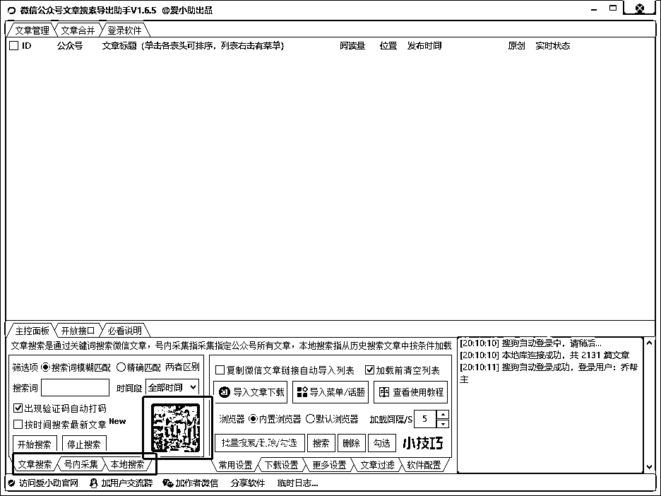

### 3）单号采集怎么设

操作顺序是：号内采集 > 获取历史文章链接 > 把目标公众号中任意一篇文章的链接复制到下方编辑框 > 复制成功后，将链接粘贴发给任意好友并打开 > 开始采集。

更多配置细节，可以直接点击软件界面上的“务必点我查看自动抓取教程”。

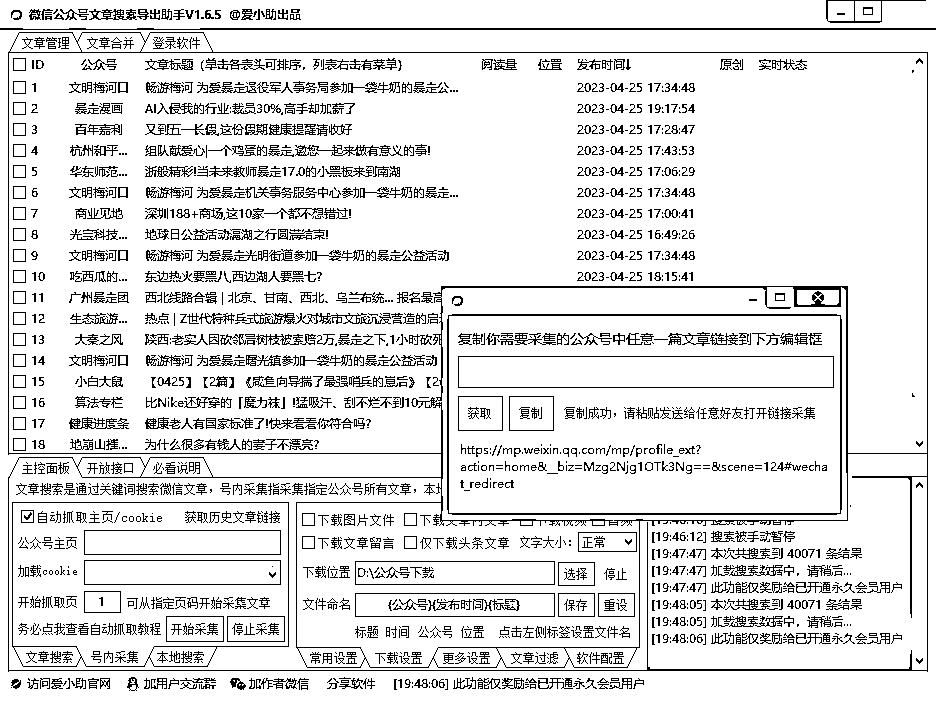

等待采集完成：

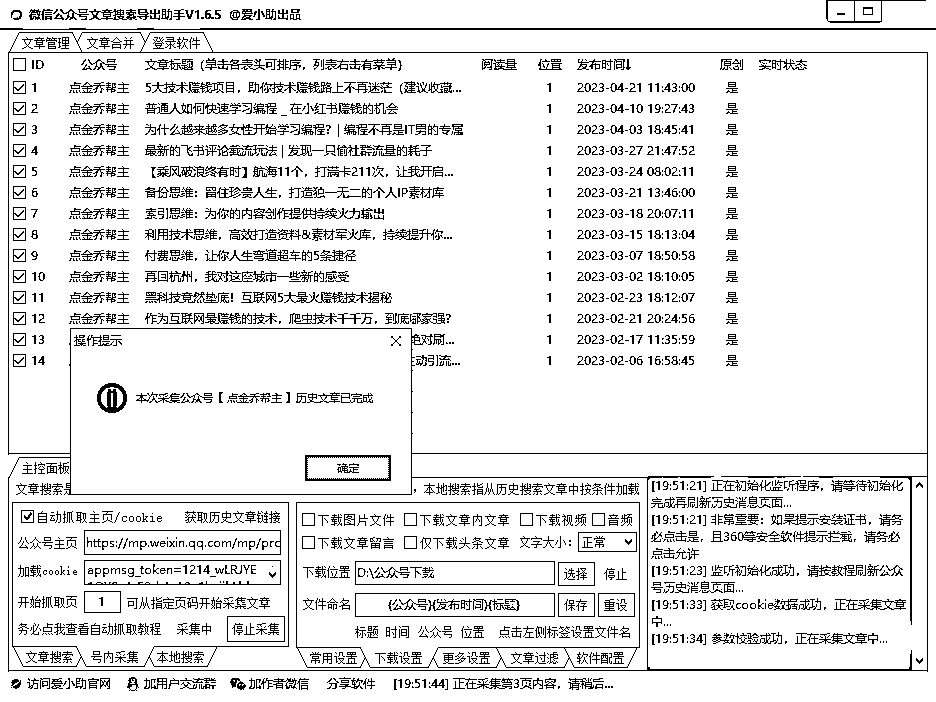

勾选需要导出的文章，导出内容的格式可以自行选择。

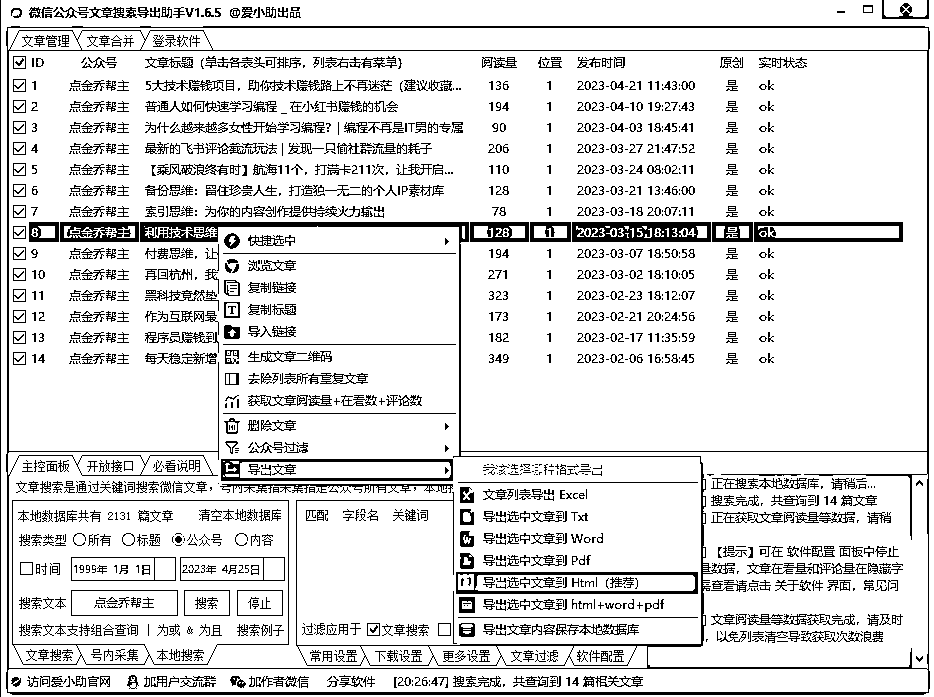

### 4）抓取阅读、在看与评论数据

该功能调用的是第三方付费接口，需要在会员费之外单独付费：1000 篇文章 25 元。

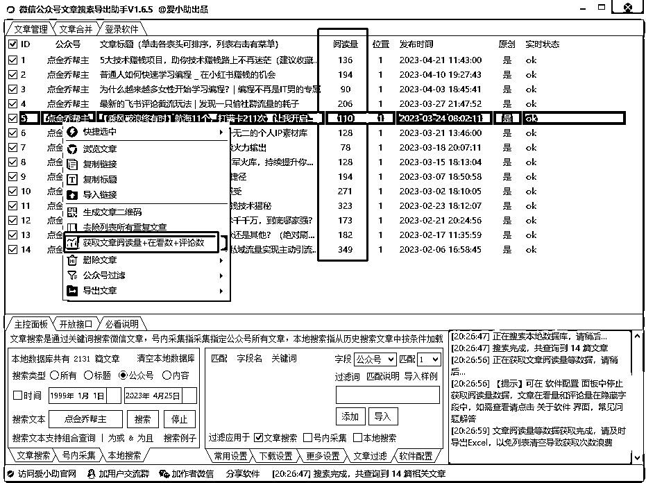

文章列表可导出为 Excel，每篇文章的阅读数、评论数、在看数都能清楚看到，对分析同行公众号的运营数据有一定参考价值。

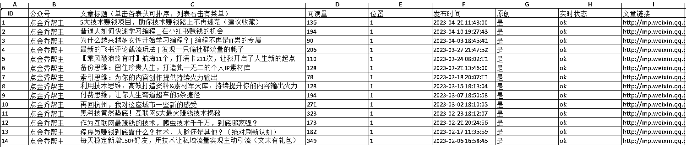

