# 平台二：素材批量抓取实操

工具包入口：[`pan.baidu.com/s/1l8XVonD7ebLN8bIVCTD7MQ?pwd=2fd7`](https://pan.baidu.com/s/1l8XVonD7ebLN8bIVCTD7MQ?pwd=2fd7)

动手之前，先备好两类网址：目标账号的个人页地址，或你只想拿下的那条视频地址。把它们拷进程序，后续就能走批量流程。

1）拿到账号个人页网址

在电脑浏览器里打开 https://www.douyin.com/ ，检索并进入目标账号的个人页，然后从地址栏拷贝网址。

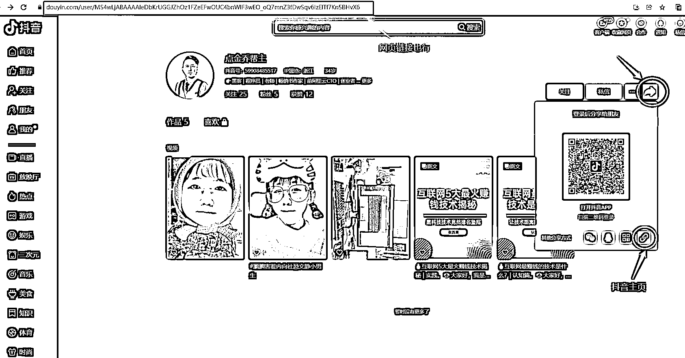

在手机抖音 App 里搜索目标账号，进入其个人页，再把该页地址存下来。

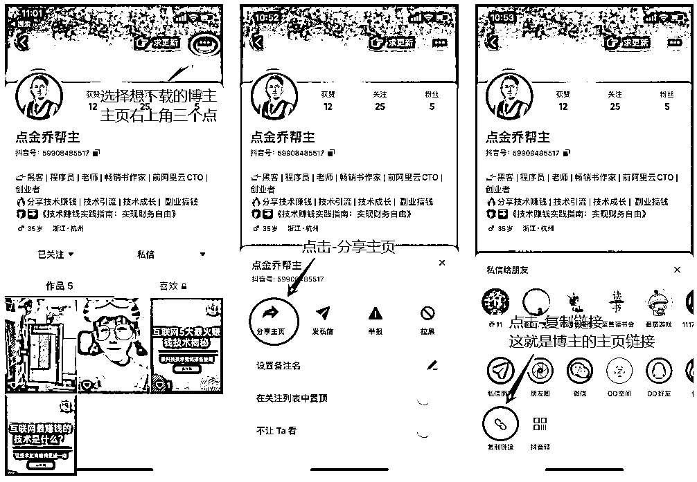

2、拿到单条视频网址

电脑端：在官网检索账号并进入个人页，点开想保存的那条视频，进入详情页后拷下地址栏内容。

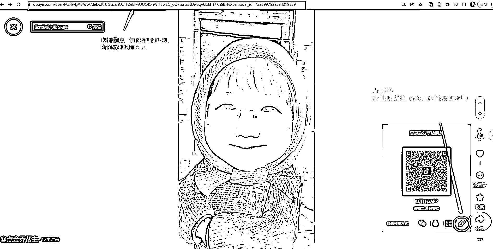

手机端：在 App 里找到账号，进入个人页，打开目标视频，再拷贝它的链接。

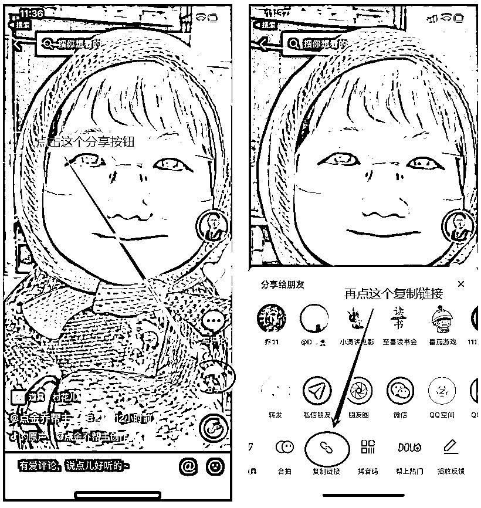

3、整号视频批量抓取

启动路径：抖音批量采集+直播录制二合一神器（不要更新） > 抖音工具 _x64_20230322.exe

这个免费版本的能力边界要清楚：它只覆盖某个账号个人页下的全部视频，单条视频不在范围内；另外附带直播录制。若启动时冒出升级提示，直接忽略，别点更新。

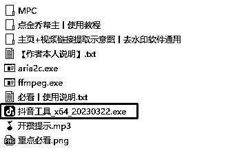

配置账号页抓取：先拿到个人页地址，再切到项目管理区。

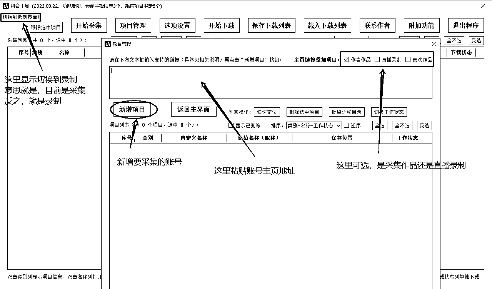

把地址贴进去，按「新增项目」完成条目创建。

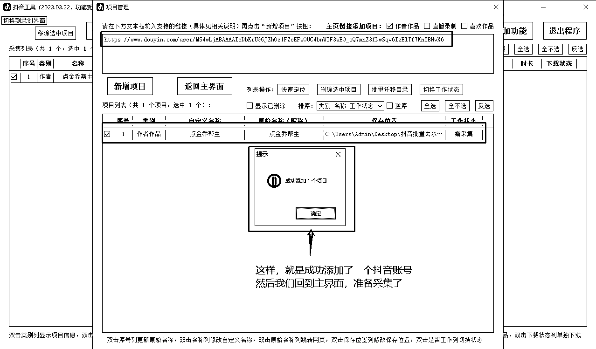

开始抓取：在清单里给目标项目打钩，再按「开始采集」。

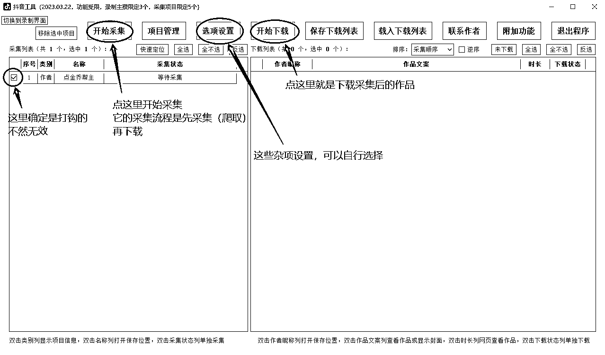

实际跑起来后，若账号视频量很大，耗时会比较久，耐心等它完成。

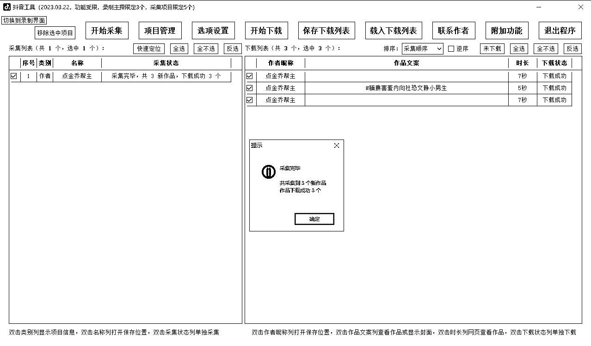

程序窗口底部有一行功能提示，是作者留下的隐藏说明和彩蛋，别忽略：

- 在「类别」栏上连点两下：查看项目信息
- 在「名称」栏上连点两下：跳到输出文件夹
- 在「采集状态」栏上连点两下：只抓这一项
- 在「作者昵称」栏上连点两下：跳到输出文件夹
- 在「作品文案」栏上连点两下：看作品或封面
- 在「时长」栏上连点两下：用网页打开作品
- 在「下载状态」栏上连点两下：只导出这一条

抓取结束后，根目录下会自动出现一份视频清单，条目信息相当完整。

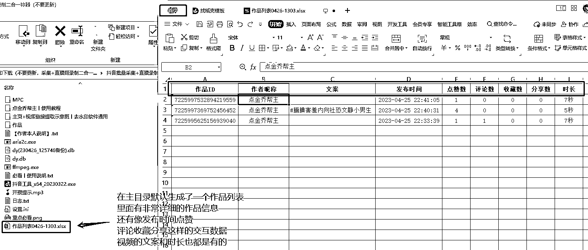

4、单条视频保存

这个操作很直接：只处理一条，把网址填进去即可。

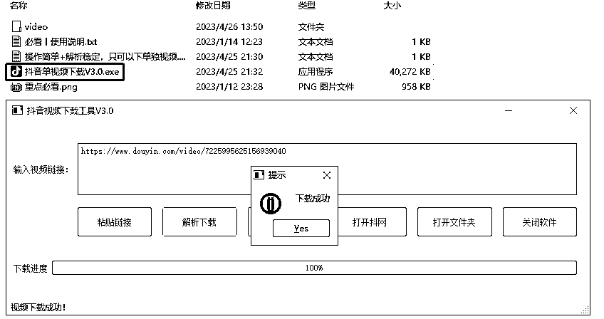

5、多条单视频批量保存

- 启动：抖音无水印解析（可批量但不支持主页） > 抖音无水印直链解析下载.exe
- 先指定输出文件夹
- 把视频网址拷进去，按「开始解析」
- 在解析结果里打钩，再按「下载选中」即可导出

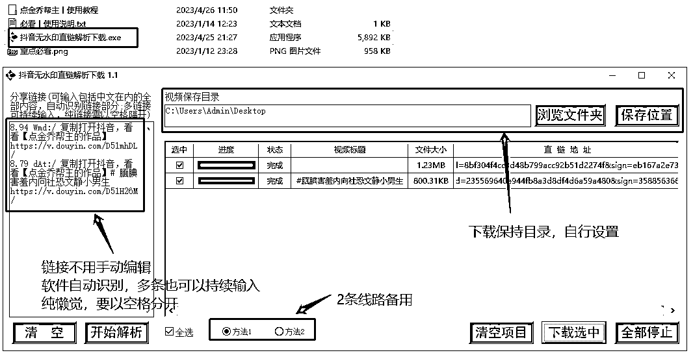

6、视频文案在线提取

入口：http://cs.pdfwx.com/

这是一个收费的在线文本提取站点，年费 99 元，半年 58 元。

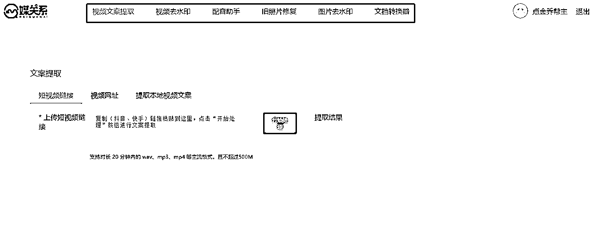

该站还附带视频去水印、配音助手、旧照片修复、图片去水印、文档转换器等功能，按需选用。

需要一次处理很多条时，可多开几个浏览器标签页，各自打开该地址并行操作。

