# 平台三：📕素材怎么批量抓

安装包获取入口：[`pan.baidu.com/s/16SuOCxzf9SFMMqUsBTyvbg?pwd=nacu`](https://pan.baidu.com/s/16SuOCxzf9SFMMqUsBTyvbg?pwd=nacu)

先提醒一个硬性条件：🛰️版本别乱用。这套采集并不是脱离🛰️单独跑，而是借🛰️客户端里的📕小程序接口来取数据，所以软件必须和🛰️配合使用。再加上🛰️小程序后续升级，新版🛰️反而拿不到采集所需参数，因此要换成安装包里附带的 3.4.5.27 版🛰️。

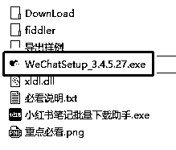

1）程序运行

启动程序后，先把它更新到最新版本：

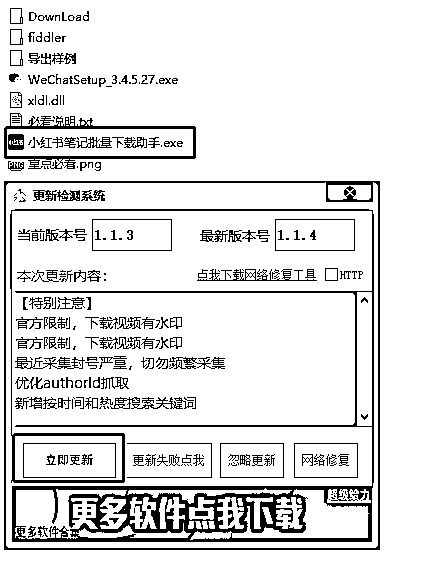

它可能会改动浏览器的代理设置。要是浏览器上网出现异常，就去确认代理服务器相关配置，并把它关闭。

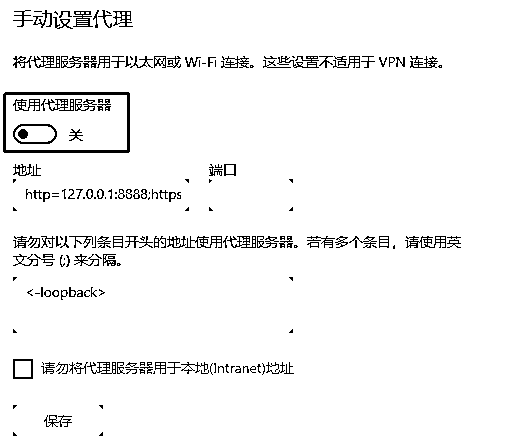

2）软件配置

• 在“关于软件”里选择🛰️账号扫码登录。

• AuthorId 设置：这一步是让软件和🛰️客户端中📕小程序里的接口对应起来。先点“基本操作”，再点 AuthorId 这一行右侧的“抓取”。

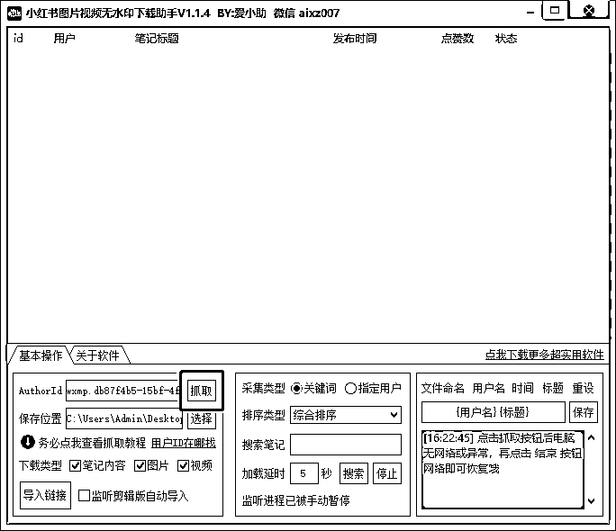

接着打开🛰️客户端，从小程序面板进入，点击放大镜搜索图标：

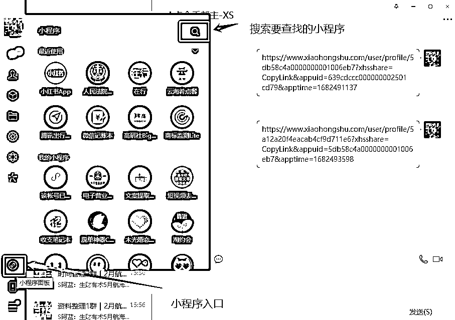

输入关键词“📕 app”，然后点进去：

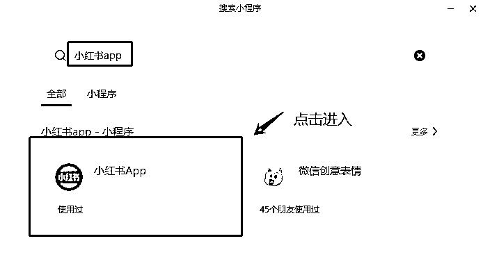

看到下面这个提示，就说明配置成功了：

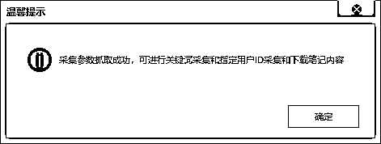

• 用户 ID 号设置：只有需要采集某个指定📕账号时才填这一项；如果只采单条链接，或者按关键词搜索内容，可以直接跳过。

操作时先打开📕 APP，在账号主页右上角点“...”，取得要采集账号的主页链接。获取方式和前面拿抖音账号主页链接一样。

示例：

[`www.xiaohongshu.com/user/profile/`](https://www.xiaohongshu.com/user/profile/)5db58c4a0000000001006eb7?xhsshare=CopyLink&appuid=639cdccc000000002501cd79&apptime=1682491137

问号前那一段就是用户 ID。把它填进软件后点“搜索”，就能把这个用户全部📕笔记、图片和视频导出并采集。

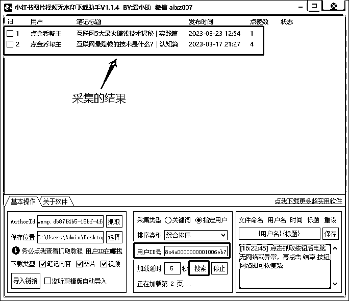

采集结束后，可以对结果执行下载（付费功能）：

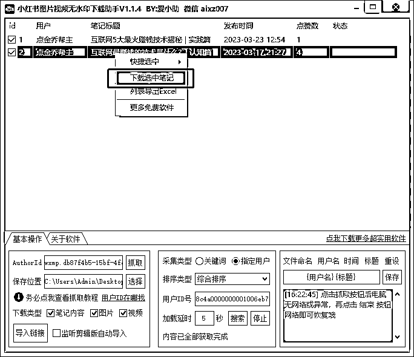

最后在对应目录中就能看到已下载的明细，而且是无水印的：

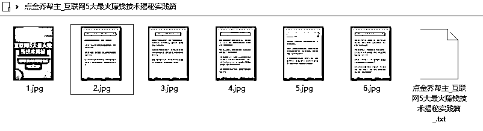

3）图片文案提取

入口：[`web.baimiaoapp.com/`](https://web.baimiaoapp.com/)

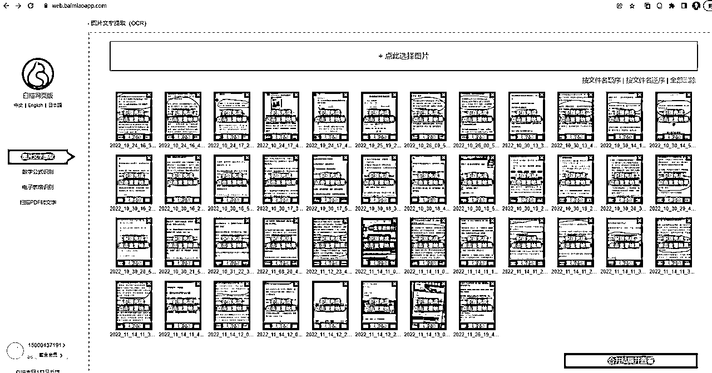

