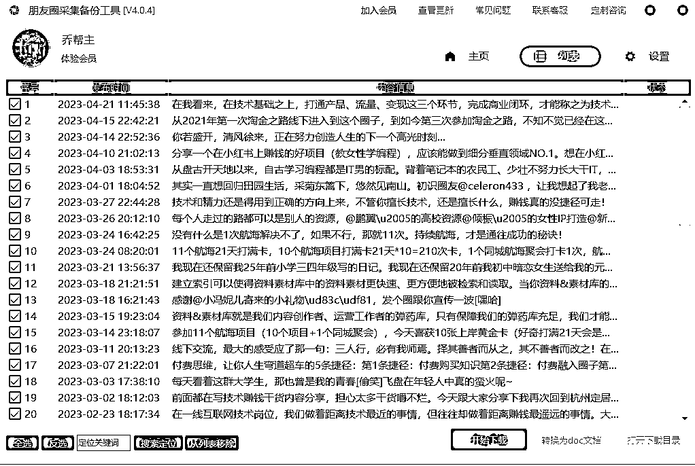
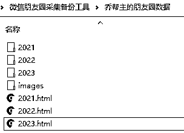
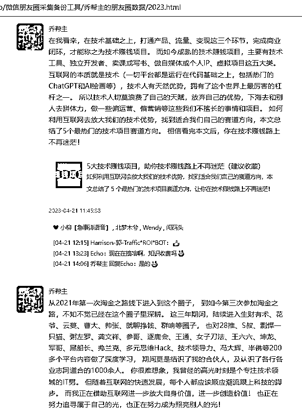

# 平台四：朋友圈数据轻松留存

想把朋友圈内容整理备份下来，可以试试下面这款工具。

下载入口：
[`pan.baidu.com/s/1fLxAHhxDBNiA60_DSfeTLg?pwd=9kbx`](https://pan.baidu.com/s/1fLxAHhxDBNiA60_DSfeTLg?pwd=9kbx)

使用提示：

- 在安装包中找到“🛰️朋友圈采集备份工具 > 朋友圈采集备份工具 V4.0.4.exe”，打开程序后，用🛰️扫码完成登录。
- 登录成功后，可按自己的需求选择采集范围：既可以备份本人发布过的朋友圈，也能采集指定好友的朋友圈内容。

- 选好要采集的内容后，点击“开始下载”。下载完成后，软件程序的主目录中会新增一个“乔帮主的朋友圈数据”：

- 导出的文件默认采用 html 格式；若有需要，也可将其转换为 doc 文档再导出。

- 想了解更多操作细节，可查阅安装包目录里附带的官网链接地址。