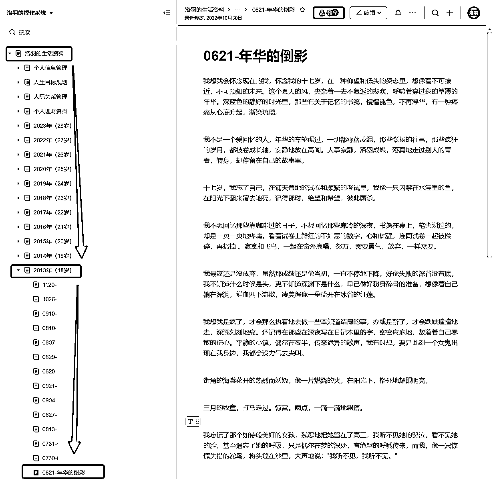

# 5.1 分类清楚，查找才快

如果你已经理解了前面讲的那套资料整体分类思路，并且能在实际操作中灵活运用，甚至把它调整成更符合自己习惯的模式，那么依靠分类来查找资料，对你而言就会变得很轻松。

原因在于，我们的大脑早就熟悉了自己资料库的分类结构。内部记忆与外部资料系统彼此呼应，就像内脑和外脑之间保持着顺畅连接。每一份资料放在哪里，我们心里基本都有数。

举个例子：想找回十年前写的那篇随笔《年华的倒影》，只需依次打开“洛羽的操作资料库”>>“洛羽的生活资料”>>“2013 年”目录，再按照时间顺序查找，很快就能定位到具体内容：

