# 案例一：让知识真正变成赚钱力的整理法 @闻小聪

我是闻小聪，在互联网公司做产品。这个岗位逼着我长期为知识买单，前后投入超过五位数。钱花出去后我才慢慢醒悟：成年人学习，关键不在囤了多少，而在有没有长出属于自己的知识骨架。2020 年我进了龙哥盟，翻了不少高手精华帖，也开始动手琢磨：怎样把里面的赚钱经验，真正沉进自己的知识系统。

1、背景交代

1）我为什么会开始做知识经营

聊具体做法前，先交代动机和收益。任何工具、方法都有边界，先弄清自己为什么出发，才容易判断它适不适合。

没做知识经营时，我常被这几件事困住：

• 每天两个小时以上泡在👸号、知乎里，一天不刷就心慌，总怕被新消息落下，焦虑越攒越厚。
• 输入看着不少，夜里复盘却讲不出今天到底收获了什么，东西没真正落进自己兜里。
• 收藏夹塞满好文，真到要用时翻不出来，等于白存。

后来碰上“知识经营”和“卡片写作”两套说法，我才明白症结：过去我只顾往仓库里堆，却没做消化。想通后，我开始认真打理自己的知识库。

2）做知识经营后，我得到了什么

一年下来，我的库里躺着九百多篇精华，覆盖十来个方向。印象笔记是我的外脑书库，笔记本加标签撑起整体骨架。好处很直接：刷到陌生内容，我能马上判断它该挂在哪根枝上、跟哪些旧知相连，心里就不慌了。

比如截图里，我的专业兴趣集中在需求调研、产品设计、交互设计；学科上偏重经济、管理、心理；个人爱好则落在手账、音影、家居和旅行。

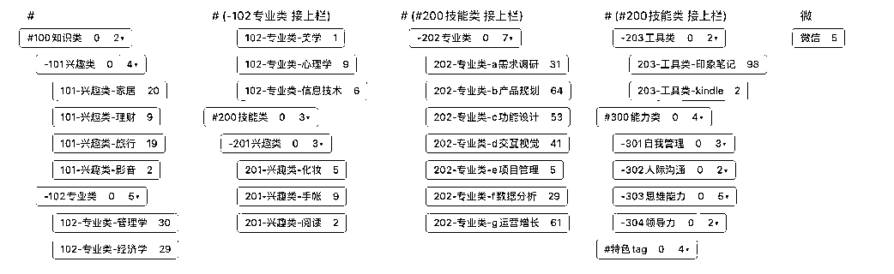

笔记一多，印象笔记自动画出的知识图谱显示，我涉猎最多的是科技、传媒、社会、房产。

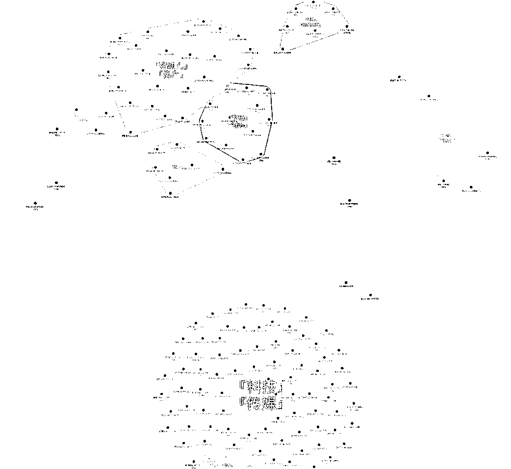

这套骨架让我看清自己主要盯哪些信息。也正因如此，我发现理财、金融方面的渠道和关注点偏少，下一步该往哪补，一目了然。是不是挺有意思？

2、先纠正几个误区

谈方法前，得先把一个常见误解拆掉。

知乎上“笔记怎么记”常年有人答，各种格式、精美截图满天飞，却很少有人先问：记它的理由是什么。明白老师星球里也有人问学习笔记怎么做，他只回了两句：你为什么要记？你为什么要抓主要信息？

应试教育待久了，我们容易把学习等同于“抄下来”，忘了记录只是手段。记，是为了以后能放心忘；需要时一搜就到，才是目的。

还有人把知识经营当成文件归档：资料按文件夹码整齐，就以为完事。其实分类只是最浅的一层，真正的价值在调用——要用时能立刻取出来。

3、个人知识骨架怎么搭

把信息按某种方式组织起来，这个组织方式就是你的知识体系。它因人而异，跟兴趣、习惯、目标都有关。体系不是凭空长出来的，它是在反复处理信息的过程中慢慢成形。

处理流程大致分四段：

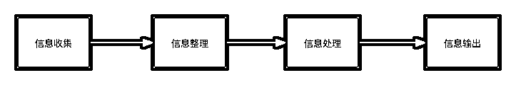

• 先把入口管住——用笔记本结构承接信息流。
• 再贴标签、起标题，把关键点压缩成可检索的分类。
• 接着动脑加工，写成一张张思考卡片。
• 最后围绕主题把卡片缝成文章，发出去。

1）先管入口：承接信息流

这是日常动作：把当天遇到、觉得以后可能派上用场的内容，先收进一个池子。我全放进印象笔记，搜索时只开一个入口，不必满互联网翻；定期清理也只清一处。

我借用 GTD 的收集—处理—归档思路，在印象笔记里用文件夹落地。

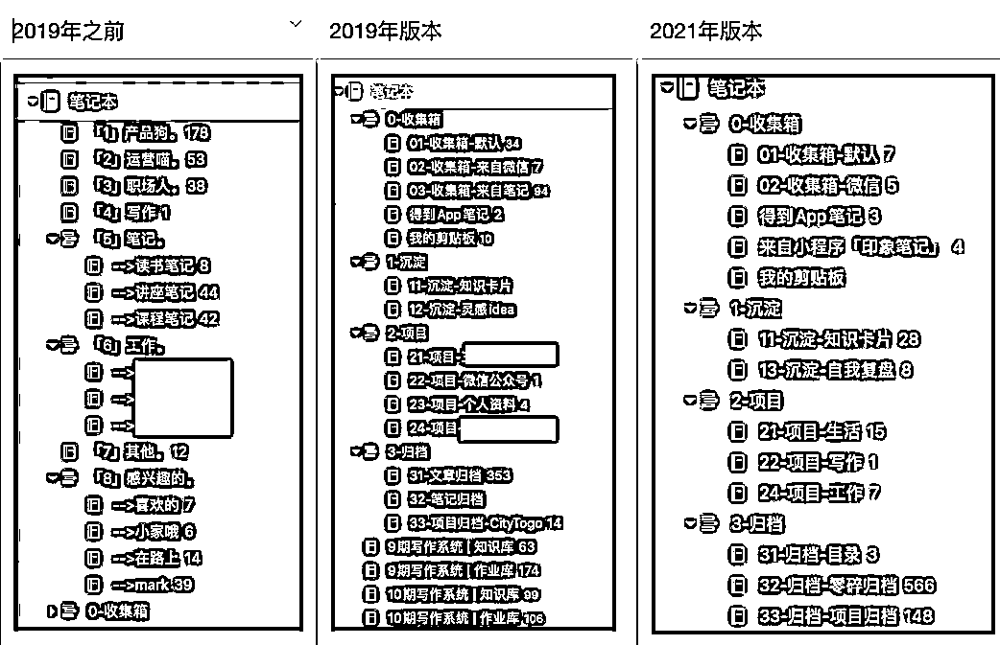

2019 年以前，我按内容主题设了九个大类，像树一样分叉。后来改成按流程走，只留四个大文件夹：

• 收集箱：还没细看的候选信息。
• 沉淀：已经过我个人咀嚼的笔记。
• 项目：正在进行、需要频繁翻用的内容。
• 归档：处理完的历史笔记。

文件夹控制在四个以内，整理时不用反复纠结“该放哪”，分类的重活交给标签。原因后面说。

我的日常节奏是：通勤或上班间隙看到好内容，先丢进收集箱；周末抽一两个小时回看，补标签、改标题、划重点，有感觉的摘到沉淀里写几句；处理完就挪进项目或归档。没有硬性压力，按自己的节奏来。

2）再理分类：让内容可检索

整理不是为了好看，是为了找得到。我选标签，不选树状文件夹，因为一篇文章常横跨多个主题，硬塞进一个文件夹会纠结，标签可以多贴几个。

2019 年那版，我按“工作、生活、学习”分。用起来发现工作和学习很难切开，我大多数学习都是为工作服务。2020 年接触“冰山理论”后，我把标签改成“知识、技能、能力”三层，这样能看清自己目前的能力分层。

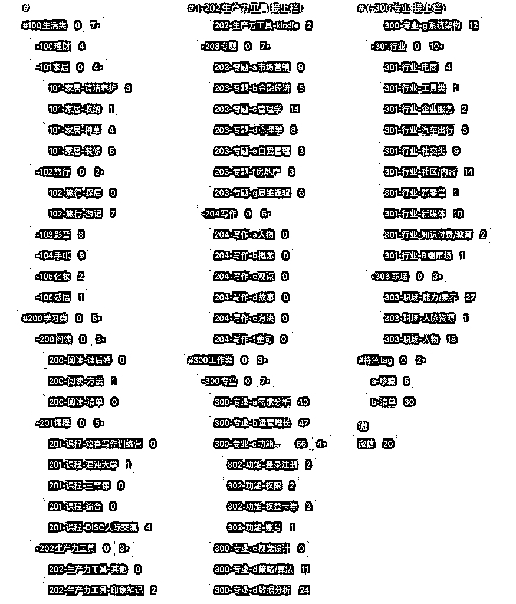

2019 年版标签结构

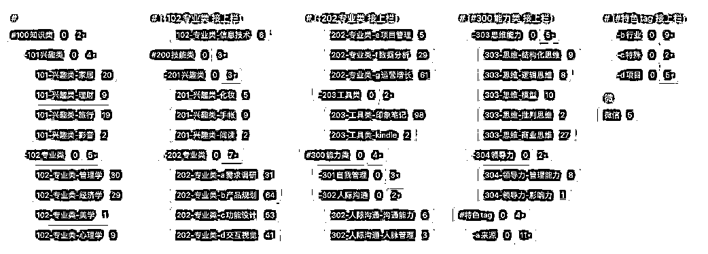

2021 年版标签结构

更关键的是，进新领域时，标签能帮你迅速搭出能力框架。拿产品岗举例：技能层面要懂需求分析、产品设计、功能设计、交互视觉、项目管理、数据分析、运营；知识层面会碰到管理学、经济学、金融学、心理学、信息技术；能力层面则是结构化思考、逻辑思考、批判思考。

有了框架，进陌生领域先有一张地图，后面信息再多，也知道该放哪一格。

另外，我还建了一组特色 tag，用来装前面三类之外的标记。

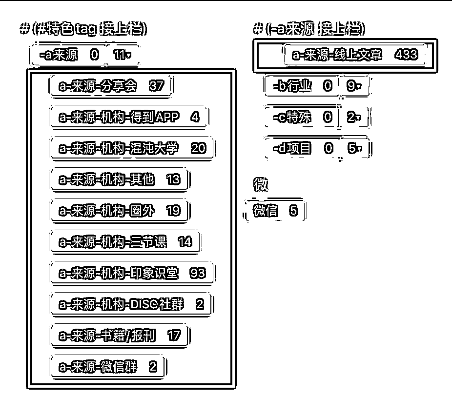

• 来源：标记信息从哪来，用来复盘渠道质量，决定时间该往哪投。
• 行业：同样讲📕运营，美妆和家居的底层技能相近，落地细节不同，行业标签用来区分。
• 特殊：清单类便于检索，珍藏类提醒回看。
• 项目：进行中的项目用文件夹，方便高频打开；结束后转成标签，相关笔记归入归档，避免层级越叠越深。

上面就是我的标签逻辑。它只是个人样本，每个人按自己顺手的方式来就好。搭之前别追求完美：拿张 A4 纸，先把你能想到的笔记范围和内容一股脑写下来，再按逻辑归拢。先跑起来，后面边用边调。

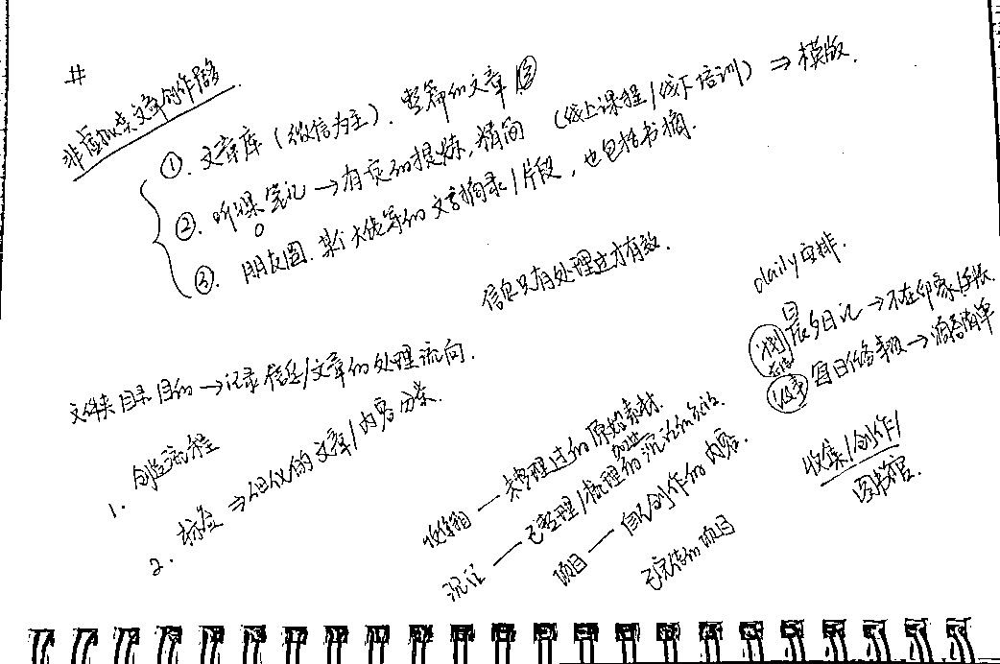

整理标签与文件夹时画的手绘草图

3）动脑加工：把输入变成卡片

原料有了，接下来是切配。加工不是复制全文，而是把触动你的段落摘出来，加上自己的反应，做成卡片。

卡片笔记法来自德国社会学家尼克拉斯·卢曼。据说他攒了九万多张卡片，很多论文灵感都从这些纸片里长出来。

用法很简单：一张卡片只装一个知识点，再附一句你的想法。相比整本书摘抄，最小知识单元更容易被搜到，写作时也方便拼装。

一开始我在印象笔记里做卡片，后来嫌打开步骤多，转向 flomo。它足够轻，适合随手接住碎片念头，也支持标签归类。

我的桌面常常左边印象笔记、右边 flomo。看到心动内容，复制进 flomo，打 #摘录，再附上原笔记链接，方便回查。

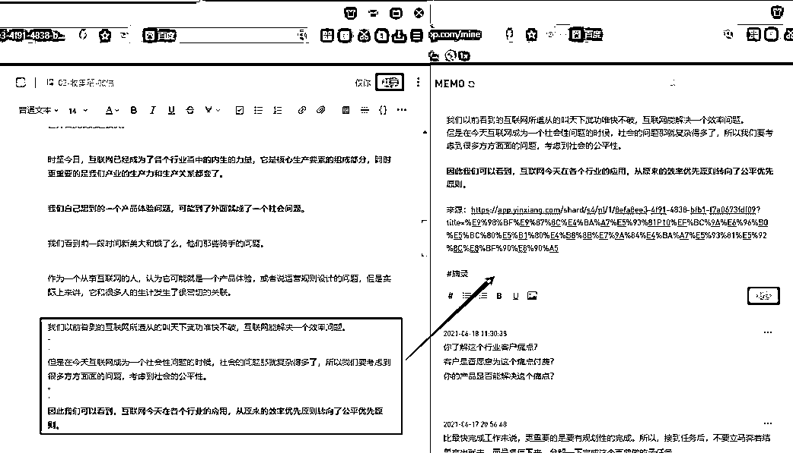

如果当下有想法，就用批注功能写下来，再给批注贴标签，两张卡片会自动连上。

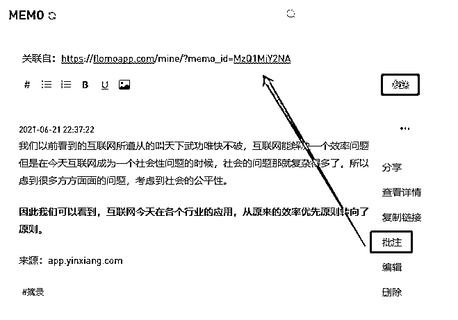

也可以在印象笔记里放 flomo 链接，点一下跳过去。

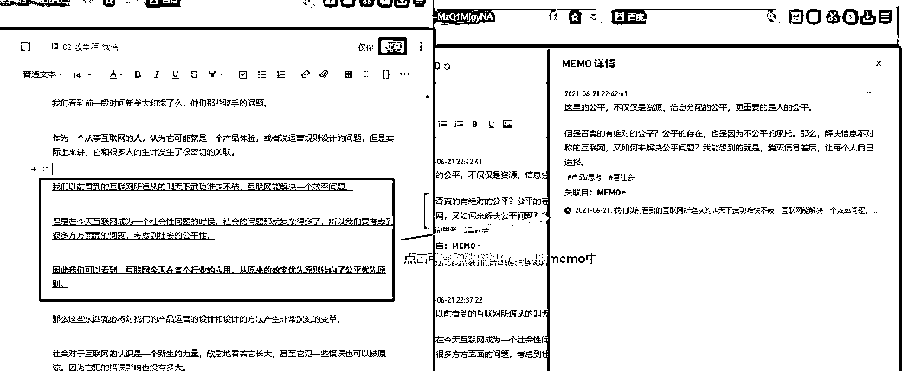

4）落成作品：把卡片拼成文章

卡片攒到一定量，就可以围绕一个主题集中产出。这一步才是知识真正变成作品的地方。过去定完题得满网搜资料，现在先在印象笔记和 flomo 里搜自己的库存，素材很快能凑齐。

这篇稿子就是先用碎片时间在 flomo 列框架，再到印象笔记搜相关内容，串起来后润色。不到三小时，三千多字初稿就出来了。

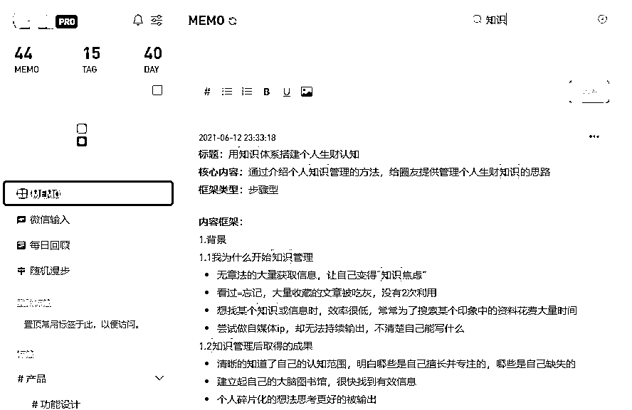

用 flomo 搭文章骨架

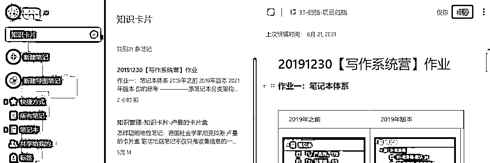

在印象笔记里翻找可引用内容

4、实操演练：外卖 CPS

前面偏方法，可能听着像作家的活儿。普通圈友怎么拿它来消化龙哥盟里的内容？拿外卖 CPS 练手。

我当初也是新手，站内相关帖一多就晕。用前面的加工方式，能较快搭出项目所需能力的框架，甚至整理出 SOP 开干。下面走一遍。

1）先搭框架

沐文老师讲过，写东西先搭骨架。进陌生领域也一样，先有框架再填肉。

我的笨办法是找目录。看书先看目录，能摸清作者的路数；做项目就找带目录感的汇总帖。龙哥盟的项目库帮了大忙，我翻到一篇外卖 CPS 资料汇总长帖，把市场前景、前期准备、工具准备、推广运营都列清楚了。你也可以多找几篇，把框架补厚。

对着汇总文回头看自己的标签，我发现做这个项目要用的运营、推广、营销、自媒体，原来的标签里基本都有。只需在来源里加“龙哥盟”，行业里加“广告媒体”，别的不用动。这也说明它适合当副业：多数技能能复用。

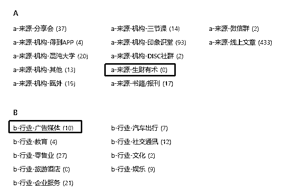

项目正在进行，我在“项目”下新建“外卖 cps”文件夹，方便随时翻。

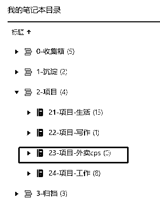

2）批量读帖

然后就是扫站内与外卖 CPS 有关的文章，先把可能有用的材料拢起来。

我用碎片时间读，遇到不错的先通读，再收进印象笔记等加工。效率上，先精华、再热门、最后其他。龙哥盟的好处是，高手已经替我们筛过一轮，精华帖优先看。

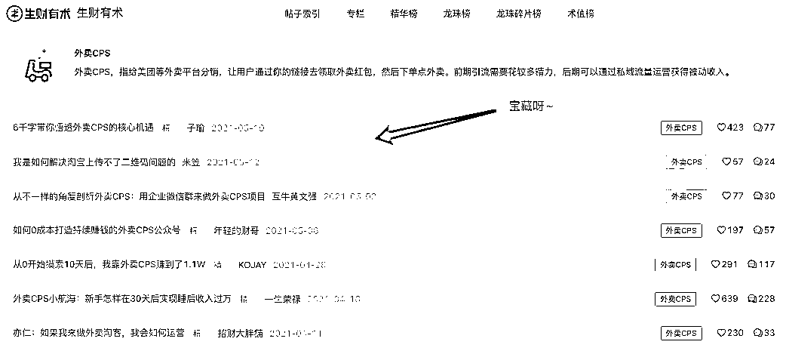

不够就顺着技能去搜：地推、营销、👸号转化，都能在站内找到。

3）二次精读与整理

材料不用贪多，看到后面你会发现大量内容重复。一般二十篇精华文打底，就可以进入整理。

挑个不赶时间的下午，二次精读收藏夹。边读边记重点，可直接在文中标记，也可用 flomo 摘。摘完务必写自己的反应；相关性强的文章用超链接串起来。最重要的是留下你的判断和对你有用的信息。

也可以把多篇合成自己的 SOP，每个节点挂上你觉得写得最透的那篇链接。这样执行时知道先做什么、卡点在哪，回头也查得到。

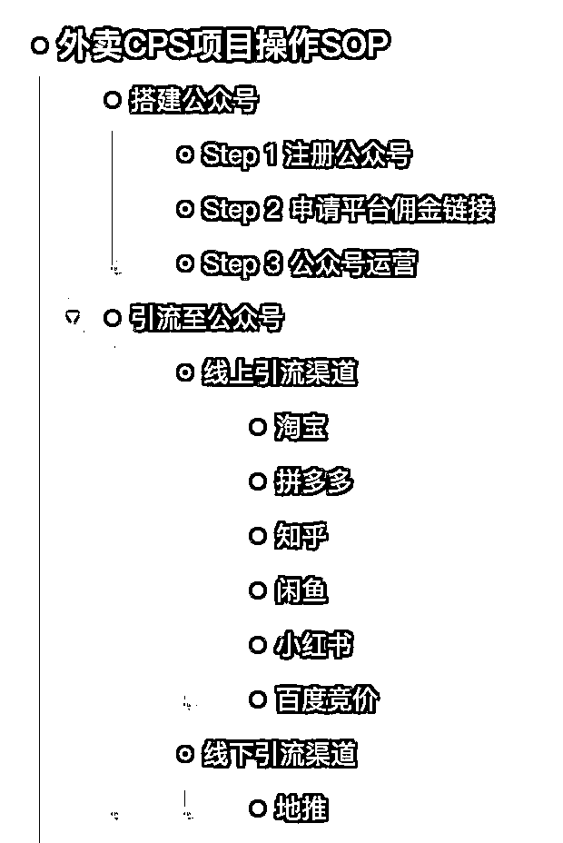

收集和加工会反复循环：整理一轮，吸收新东西，再回头补体系。站内文章逻辑普遍清楚，整理成本不高。

4）形成自己的 SOP 与输出

几轮收集加工后，你对这个项目的整体打法就有数了。接着按 SOP 拆时间点、定里程碑，每天做、定期复盘。

把整理结果重新组织，加上自己的体会，很快能写出一篇龙珠文。

比起随手看一篇，这套做法能让你在短时间内建立全局感；真上手时，知道自己站在地图哪一格。

以上只是我的个人做法，它还在随着工作和生活不断调整。若能给圈友一点启发，我会很开心，也欢迎交流。我仍然认为，愿意持续学习的人，正遇上一个不错的时代。

内容来源：闻小聪原帖《如何用知识体系搭建个人赚钱认知》

