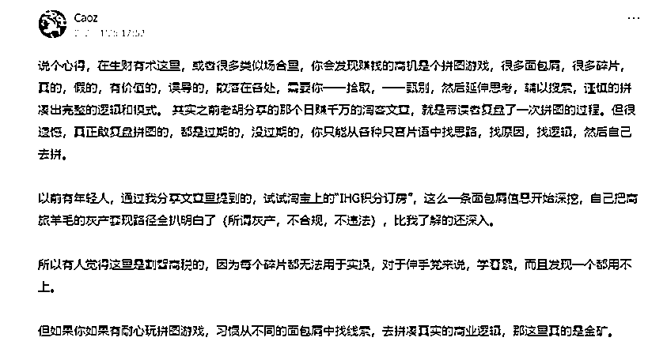

# 案例二：100+精华帖，搭出赚钱知识库 @七小

生财有术的朋友们好，我是七小。1999年出生、常居深圳，目前做自由职业。2021年毕业后，我先以学习博主的身份教大家怎么高效学习；到了2022年，开始慢慢转向互联网创业方向做内容。

加入生财之后，我反复问自己：在这个社区里，我该带走什么，又能留下什么？

有天刷到曹大的一篇帖子，里面的“拼图游戏”让我灵光一闪。我平时最拿手的就是梳理知识，又一直想搞清楚赚钱的底层逻辑，于是冒出个念头：不如先集中读100多篇生财精华帖，再把自己过去的经验揉进去，筛选、归纳、重组，试着搭一个属于自己的赚钱认知框架？

这么做，一来能满足我的好奇心，也为日后提升赚钱能力铺好底子；二来新人不用自己在海量内容里慢慢摸索，学习门槛能低一些，吸收精华也会更快。等于同时办成了两件事。

小编说明：

这篇内容偏长，又涉及不少星球帖子的整理；手册篇幅有限，想看全文可以点原文阅读：《看了 100+精华帖后，我梳理了一套赚钱的知识体系（超全新人指南！) 》

