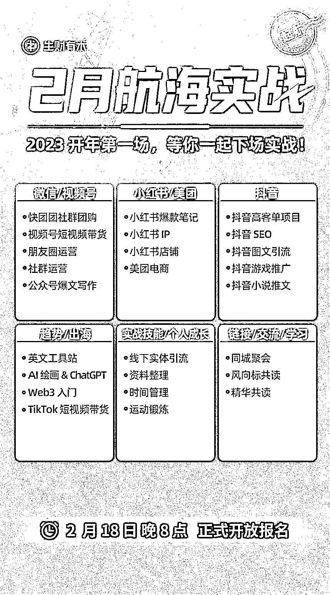
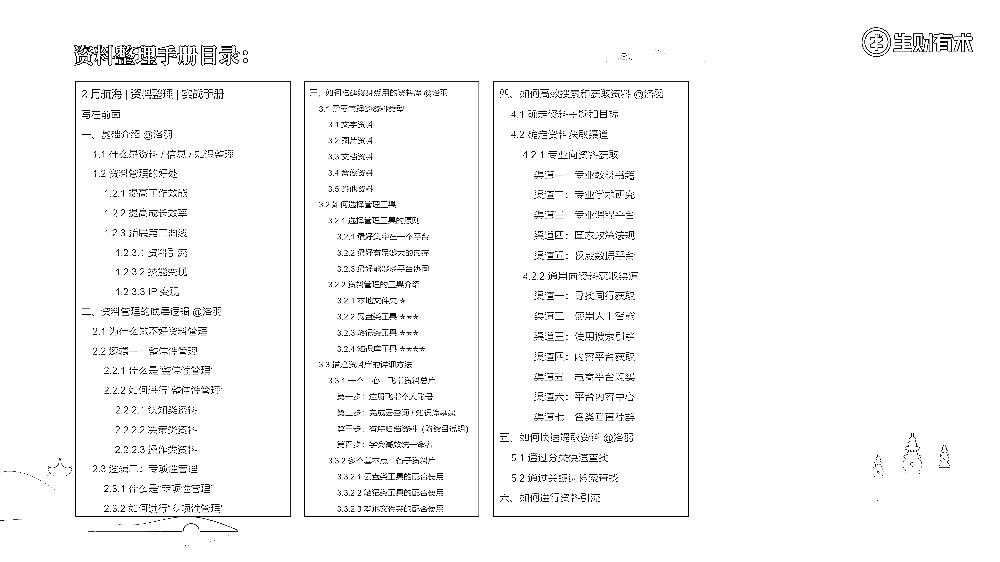

# 案例四：21个手册任务，用“道法术器用”拆解 @洛羽

2 月的生财有术航海一共设置了 25 个选题，其中 21 个需要制作手册。20 多个选题摆在眼前，如果由你来负责，会怎么思考和推进？

拿我主创的“资料整理”选题来说，它是否属于专项内容？要把一个专项讲透，让读者既能看懂背后的逻辑，又能亲自上手操作，其实并不轻松。这时候，可以用“道-法-术-器-用”模型来搭骨架。

“道”覆盖概念、定义、理念与目标，主要回答这个细分领域到底是什么、研究它为了什么、意义和价值在哪里。落到资料整理上，就要说明它是什么、为什么值得做、能带来哪些好处和价值。

“法”是在求“道”过程中，经过实践与思考归纳出的规则体系和方法原则，比具体做法更抽象，属于高度提炼的规律。落到资料整理上，就要讲清它的底层逻辑、核心原则与关键定律。

“术”是具体的操作方式，包括步骤、路径、手段和技术。落到资料整理上，就要讲明具体方法和步骤：内容从哪儿来、资料库如何搭建、后续怎样查找调用。

“器”是为了让“术”真正落地，在验证“法”和追求“道”时采用的一系列工具。落到资料整理上，就要介绍可能会用到哪些工具，以及各自怎么使用。

“用”是实际使用场景和可参考的案例。落到资料整理上，就要展示细分领域里已经跑通的案例，以及大家具体如何思考、如何操作。

有了这套思路，再回看资料整理的目录逻辑，就会发现它正好对应这个模型：第一部分是“道”，第二部分是“法”，第三、四、五部分则是“术”“器”“用”的结合。

以上讲的是资料的整体性与专项性分类管理方法，不知道大家是否理解？

内容来源：《做好资料管理，实现人生三倍速增长》

