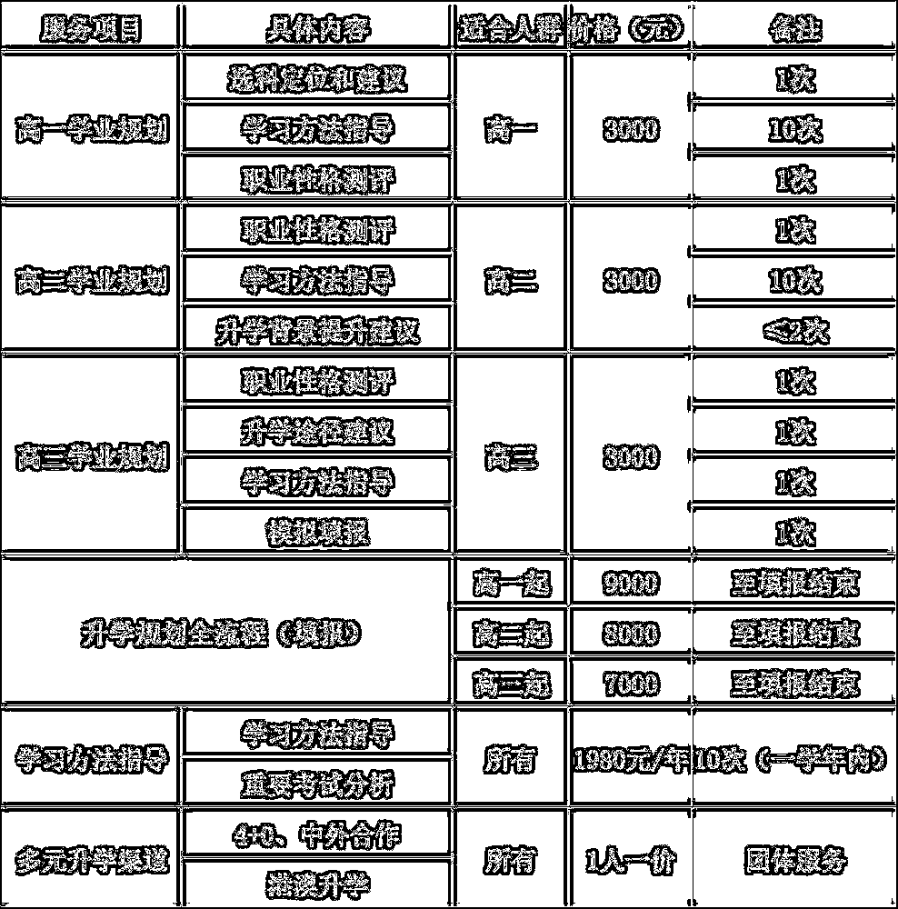
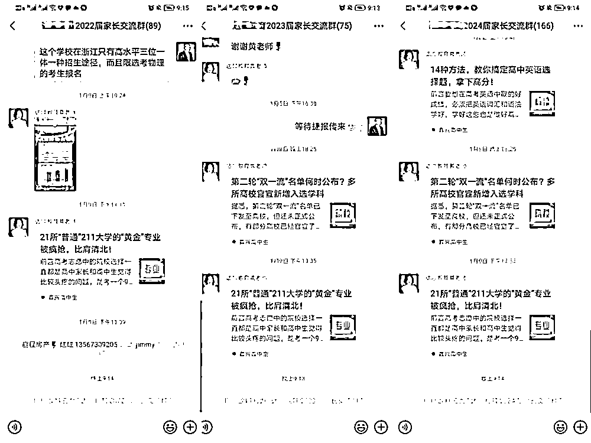
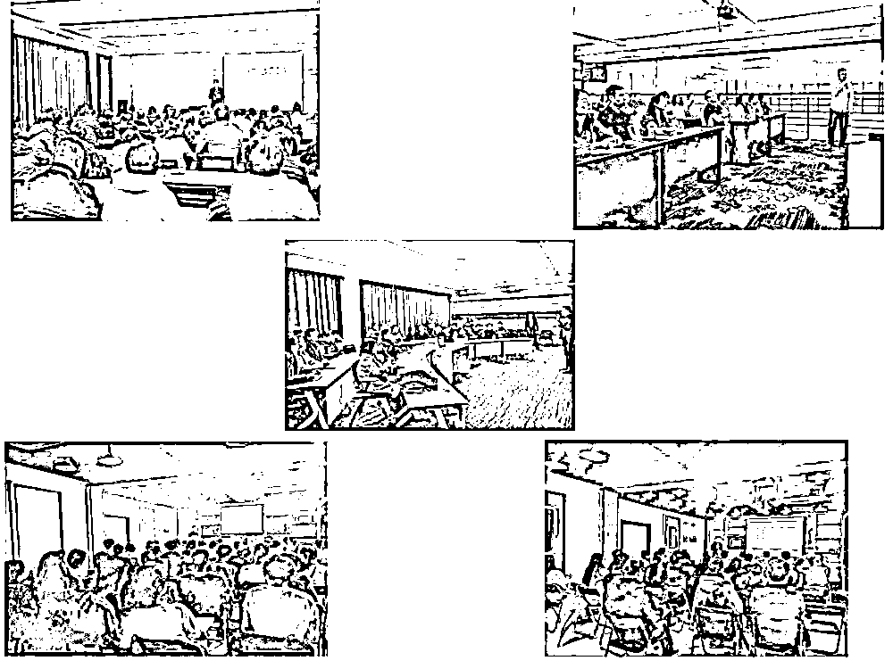

# 小城高考规划：八年，人均五十万

目录：
1. 方向：双减后哪块市场还有缝
2. 获客：付费家长从哪里来
3. 复制：小团队怎么带出来

分享人：鹏哥｜2022年2月22日

鹏哥，常驻一座非一线城市，主做新高考升学规划；从2014年算起，到2022年已是第八年。这些年经手的学生累计三千多名，公司年营收突破五百万元，团队平均每人每年贡献约五十万元GMV。2021年教育部对义务教育段实施“双减”，作业和培训两头压减，行业重新洗牌；可高考这条线，社会关注度和家庭投入意愿依旧很高，哪怕只做一个点，市场容量也够。这个行当专业要求高、交付周期短、从业压力不小，天然筛掉不少玩家；加上家庭经济条件改善、家长受教育程度提高，愿意为咨询买单的家庭在变多。我的判断是：好戏才刚开场。

下面按方向判断、产品搭建、获客打法、团队与文化赋能四块，拆我们自己的做法。

—01— 方向：先看双减后的缝

一、双减后，机会藏在哪

2021年“双减”落地，针对的是义务教育阶段：校内作业减负、校外培训减负。头部机构退出义务教育培训，约九成中小玩家关门或改行。其实在政策之前，低龄兴趣班和学科补习就在利润驱动下偏离了育人初衷。成人教育需求虽多，但在三线地级市组织规模化培训不容易，收益也分散。高中段不一样：结果指向明确，高考的不可替代性让家庭和社会都盯得紧，单点市场也有足够容量。再加上专业门槛高、离出结果近、从业心理压力大，竞争反而没那么挤，很多机构和个人不愿背这种风险。我们选的是难而正确的那条路，这和我们长期深耕的打法一致。

2022年元旦，《家庭教育促进法》施行，家庭教育被写进法律。孩子是家庭的未来，教育托着未来。升学规划把学生、父母、学校三方的期待放到一张桌上综合权衡。我们盼着复读人数少一点，九月开学后因专业或院校不匹配而退学、休学的情况少一点，家庭更顺、社会更稳。政策给了底气，几年实践也让我们更笃定。

二、产品体系怎么排

我们所在城市不少家长希望一个地方把升学规划、语言提升、学科补习、心理疏导都解决。需求分层又多变，所以交付偏重；好处是口碑链条更结实。服务从高中学业安排、选科建议、背景提升、综合评价等多渠道选择，一直延伸到末端的志愿填报。

一名全职顾问同时带五十名VIP学生，跨高一到高三，是能跑得动的；三个年级大致四二四开。高一家长最迷茫，意识强的人付费意愿也强，还爱结伴来问；高三临近大考，焦虑感推着家长快速拍板，占比也不低；高二最难转化——有想法的早入场，观望型在这个阶段下不了决心，尤其到付款那一步。

全流程规划收费的中位数是八千元。每月线上或线下再聊，继续发现家庭的多元需求。比如有学生想用宁波大学的分数冲浙大，浙江三位一体就是一条路，同一名学生便多出一个收费项目；走中外合作、强基或港澳院校的，单项收费四千五到三万，项目之间可叠加。出分后填志愿时，孩子手里能多出两三个选项，前期的辛苦就值了。这样一年跑下来，人均五十万GMV并不稀奇。

—02— 获客：付费家长从哪里来

这个生意不靠大场地、重设备，靠的是顾问的专业判断。顾问能不能替家长解决问题，是命门。家长和学生喊我们老师，所以电话轰炸、街边传单这种动作不能做，做了就掉价。也正因为如此，我们没设专职销售；成熟顾问在咨询过程里把销售动作悄悄融进去。几年下来，老客转介绍超过八成，口碑把更匹配的客户带了过来。

一、把服务做成定制

新高考的节奏一环扣一环：高一下学考，高二选科，高三小高考再接高考。三位一体、强基、综合评价、中外合作等路径，让个性化规划有了空间。升学规划是入口，服务好一名学生，后面还会冒出更多需求。

分数不再是唯一尺子，路径多元才是新高考的特点。英语有优势的，可看中外合作大学或4+0；数理化拔尖的，可冲强基（36所A类985本硕博衔接）和综合评价；想穿军装的，可报军校警校；预算充足的，可考虑港澳或留学。一个孩子可能同时有一项或几项需求。出分后选择摆在面前，家庭能挑出更合适的，这就是我们卖的价值。早做规划，录取时少用二十到五十分，这样的例子每年都能碰到。

本地一中的徐同学，团队先做职业性格测评，再找兴趣与优势交叉的专业方向；他慢慢找到学习节奏，目标清晰了，状态也变了，从被推着走到自己主动学，年级名次由五百多名升到第一次选考后的九十多名，最后被西南交通大学（211）录取。

二、微信群怎么做裂变

几年运营下来，最大体会是：必须把家长加到可直接对话的位置。早些年我们试过DM单页、电台广告、托校长或班主任进校，收效都平。2018年起，主阵地换成了微信群。

拿桐乡校区一个月的启动期举例。先做引流群：让熟识的家长和朋友凑一个五十人小群，成员只要是高中家长，不按年级筛；每周二、周四各做一场群直播，按主题顺序讲升学规划、选考、三位一体、综合评价，每次结尾留个引子，让家长愿意拉人。四周左右，群能长到两三百人。接着切年级群：满月后把临时群解散；解散前三天，通知大家转到高一、高二、高三的年级大群，说明年级群会持续发更对口的内容。这样我们手里就有两类群：短期引流群和长期年级群。最后按节点开专题群：各年级痛点不同，我们盯成交窗口拉临时小群，筛出精准家长；专题群完成收单就解散，只留年级群。高一下的学考选考、高三的三位一体、全年级的升学规划，都可以按节点做转化，循环使用。

三、线下讲座怎么促单

我们单价不低，卖的又是看不见摸不着的咨询，纯线上成交比例有限，多数家庭要见面才落单。线下讲座套路差不多，我给自己定死一条：面访率不到三成，就不办招生讲座。假设一场计划三十组家庭，我会在开讲前一周先上门聊十组左右，信任先建立，现场节奏和成交才可控。2019年5月19日那场最漂亮，三十二组到场，成交近五十三万元。

四、把转介绍做成闭环

测评主要看几件事：孩子兴趣与优势落在文科还是理工？思维偏理性还是跳跃？当前学习状态是良性还是欠火候？

我们把转介绍当成系统工程做：按升学方向送相关行业或报考书籍，邀请家长听讲座，持续补认知；已经帮忙转介绍的家长，给一定费用优惠，并把他推荐来的家庭约到茶话会或饭局；按目标院校送校徽、定制校名书签，把个性化体验做细。冗余资源被盘活，家长与我们的黏性也更强。有家长孩子毕业三年了，还在给我们推荐人。

我看家长认不认可，只盯一个动作：有没有转介绍。愿意主动推荐，本身就是专业度的证明。

升学规划第一站是测评。很多家庭选大学、定专业靠感觉，或听老师、亲友意见，最后常和预期错位。测评给出数据，父母和孩子再结合日常表现做判断、做比较，才容易找到兴趣与优势交叉的学科方向，这确实解决了一个大痛点。面访解读时，还能顺带了解家庭受教育程度与经济承受力，为后续多元方案打底；解读到位，信任才扎得深。

转介绍的心法不复杂：比同行多走一两步。同类产品你多往前一步，就有机会超车；多走两步，就能领先。家长来问选科，我不只给选科方案，还会讲这种组合在长三角就业端有什么优势。选科是目的吗？不是。选科为了上好大学，上好大学为了好工作，那我就把区域就业需求倒推回选科。再比如家长问英语怎么提，我不只讲听力、阅读、作文，还会点明：语数英里英语相对容易拉分。英语一上来，总分和排名跟着动，孩子状态进入正循环——你说该不该抓英语？

五、大航海带来的线上渠道

在参加生财有术大航海前，我一直想把线下那套搬到线上，但缺流程、缺步骤。两个月下来，我对抖音有了新的思维框架，实操后也摸出一套方法。现在做得不算漂亮，但方向和认知到位了，剩下就是动手干。

抖音内容同时分发到视频号；视频号推送更准，大航海期间抖音没带来收入，视频号倒引了两单到线下，成交一万五千八百元。最近又把视频同步到头条约，攒了一千多粉丝。

新媒体让我们获客更灵活、更贴近本地。下一步准备多开几个号做同城引流。现在四人参与：我写文案，一位同事拍摄，一位管场地和出镜着装，一位做后期。12月中旬起保持日更，春节想利用时间差冲一天两更。这里得谢一声生财（笑）。

—01— 团队：小组织怎么搭、怎么复制

一、用合伙人的心态招人

教育培训吃的是专业密度，队伍要小、要精，成员学历高、能力强。我们这种非一线城市，人才池浅，员工水平直接卡住公司速度和深度。团队都是80后、90后，这个群体除了钱，也看自我价值能不能落地；怎么点燃自驱力，是老板的必修课。

第一，薪酬和晋升要有拉力。初级顾问干到骨干顾问，收入抬五成；骨干再往事业合伙人走，年收入可到二十万，还能带徒弟、参股新分公司、独立扛一块业务。初级顾问经过三个月基础训练和实践能独立接客户，每单升学规划服务费八百元，另参会销业绩分成；骨干顾问每单一千二，还能凭客户积累整合公司资源开个人专场；合伙人拿骨干薪资，另带徒管理奖金和分公司参股权。想在这个行当站稳，至少磨两年。

第二，每周碰一次例会。常规事用文字报，时间留给非常规问题，比如案例复盘：从一线捞出新案例，一起拆解法子，再把步骤沉淀成百问百答，形成内部方法论。非常规问题被反复处理，慢慢就常规化，团队解题能力也往上走。

第三，不搞打卡。上班时点统一，下班按任务弹性安排；请假提前把工作交接好即可。周末加班可把孩子带到公司，小食堂管午饭，让员工兼顾工作和家庭；逢年过节给员工父母备礼，外地的直接寄过去，把关怀做到家人身上。

二、师徒搭班干活

师徒搭班有天然信任。信任在，目标一致，多加点班也愿意，情绪摩擦少。两个人一起在实战里找问题、解问题。我们跟家长签的是握手合同，既要守原则，又要让服务有温度，这个分寸就是“火候”。师傅能贴身示范，把价值观传下去。

姚老师进来两年，现在是桐乡校区负责人，也是合伙人。他此前卖纺织品，入职后主动、学习快；第一年我亲自带，一年后就能独立做志愿填报——这是行里技术含量最高的活；2021年开始带徒弟，有模有样；下半年上讲师台开专场，当地电视台还做了专访，年底升合伙人。两年从门外汉变成家长认的专家，收入翻了两番。

三、牵头联盟，整合同行资源

教育、医疗、养老是家庭最挂心的三件事，教育尤其牵着家庭未来。

新高考把人才培养从“分层选拔”转向“分类培养”。过去高分进好学校、低分进弱学校；如今中本一体化、嵌入式培养、三位一体、强基计划等通道，都在照顾个体差异。2021年一批职业技术学院升格为职业技术大学，国家引导的方向很清楚。多数家庭并不明白这些变化对升学和就业意味着什么，所以双减之后，高考咨询反而有更好的窗口。

我发起“浙江升学规划联盟”，让不同地级市的同行共享资源。想法很朴素：把蛋糕做大，既多帮学生，也让从业者做成事业。2019年联盟成立后，每季度挑一个地级市开经营分析会，一起解决招聘、产品研发、市场推广、法律风险等问题。这个虚拟组织成了大家的共享工具箱，谁有难处都有人搭手。通过抖音大航海，我还认识了外省同行，未来既可在专业深度上合作，也能在行业广度上互通。

教育托着一个家庭的未来。做这行，得始终把学生放在中心，在高考这个关键节点帮他们提前布局，握住更好的下一步。

附名词解释：
1. 中本一体化：三年中职加四年本科贯通培养，不走普通高中路线，通过单招定向方式选拔。
2. 嵌入式培养：常见于计算机软件领域的校企合作育人，毕业起点较高。
3. 三位一体：高考成绩占60%，高校综合测试占30%（笔试、面试），学考占10%，三项加权录取；它打破老高考唯分数模式，表达能力强能拿到实际降分。
4. 强基计划：2020年起，36所A类985高校面向基础学科和关键核心技术领域新增的招生通道；培养采用3+1+X，本科三年加一年研究生预备，再进硕博，本硕博贯通；高考分占85%，校测占15%，最低过本省一本线就有机会进清北复交等名校。