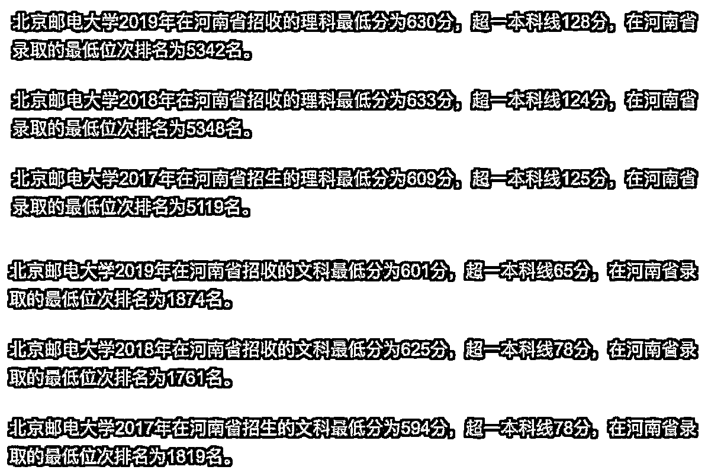
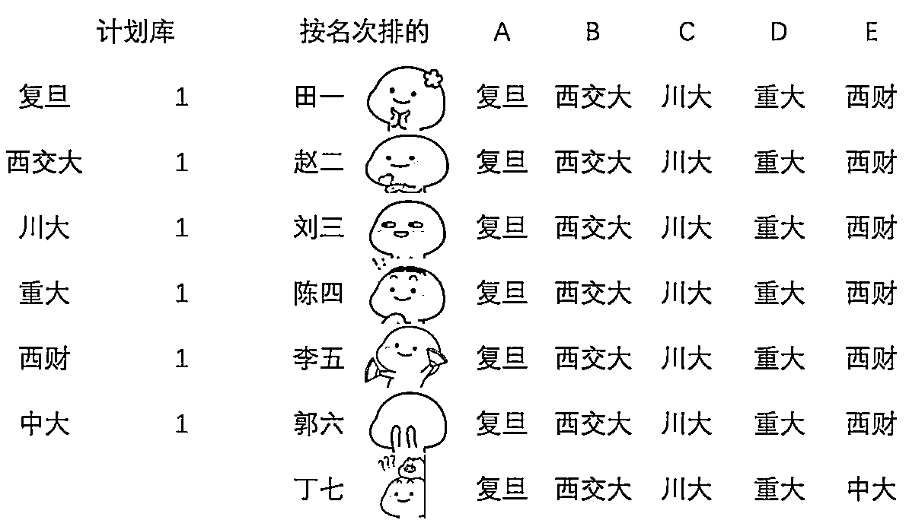
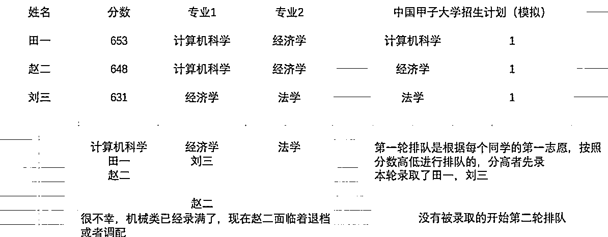
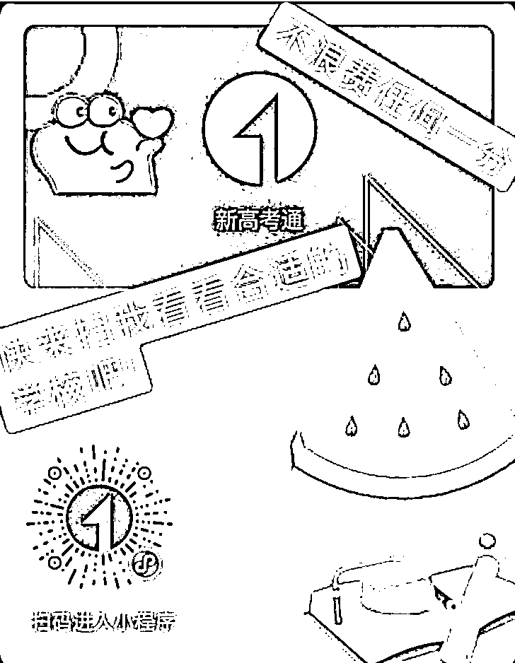

# 出分以后，报志愿这门生意的底层逻辑

作者：沐沐春风
日期：2021-06-23

每年高考一放榜，数不清的家庭都会陷入同一种忙碌：翻学校发的那本厚厚录取手册，越翻越没底。市面上教人报志愿的内容不少，抖音、各种渠道都能看到，但志愿这件事太重要，很多人买完卡还是想找真正的老师当面问几句。

今年我做了腾讯高考通，靠过去当老师时积累的人脉打开了第一批用户，同时把产品铺到闲鱼、微博等平台。为了把产品讲明白，我专门研究了一个问题：怎么填，才对得起考出来的每一分。

下面这个入口可以查省内排名，用手机号注册，每人限一次：

也欢迎大家转发给身边需要的人，大学四年，很大程度上就看这一次选择。

这篇整理下来有六千多字，建议先收藏。

分数出来后，考生要回答三个原点问题：
1. Who：我是谁？我的分数、身体、家庭基本面怎么样？
2. Where：我想学什么专业？想去哪座城市？
3. How：怎么填，才能去那个城市、进那所学校、读那个专业？

分数能帮你圈出一个大致范围，但要落到具体学校和专业，还得把家庭、兴趣、家族资源全放上台面。先认真过一遍这六件事：

1. 我在全省排什么位置？
2. 体检结果有没有“不宜就读”或“不予录取”的提示？
3. 我所在的省份和我的民族身份，有没有加分、优先录取政策？少数民族还可以关注预科班。
4. 家里的经济状况如何？有些学校适合出国，有些城市生活成本高，家里能不能接住？
5. 父母走的是什么样的职业路径？这些经验对我有什么参考？
6. 亲戚朋友在哪些城市发展？能提供什么助力？比如想去南方，先想想当地有没有已扎根的亲友，他们各自做什么。

下面一条条拆。

## 一、用“排位”和“线差”先给自己定档

判断自己属于哪个层次，主要看两个概念：排位和线差。

按分数高低，大致可以划出四档：

- 能上九校联盟或同层次高校的超高分段。九校联盟指清华、北大、复旦、上海交大、南京大学、浙大、中科大、哈工大、西安交大。
- 本科一批的高分段，对应双一流重点学科建设高校或同层次院校。
- 本科二批的中分段，能读非双一流、非211的普通本科。
- 专科的低分段，走高职高专。

填报时，有几个关键数据要盯住：

- 调档分，也就是高校提取档案的最低分。任何分数段都别忽略，否则可能落榜。
- 调档分位次，即最后一名被录取考生的全省排名。一分之差可能隔开几百人，必须重视。
- 调档本一线差、调档本二线差，分别代表录取最低分高出本一、本二线多少。

用北邮近年的录取数据为例：

普通二本也是同一套逻辑。把分数、线差、位次三个指标交叉验证，就能判断自己有没有戏。具体操作，下面继续讲。

## 二、体检结论要逐条看

军队、武警、司法警官类院校对身体条件要求高，最终以高考指定医院的体检结果为准。报告上任何一项标注都要仔细确认，拿不准就查《普通高等学校招生体检工作指导意见》。查的时候用“省份名+文件名”，比如河南省《普通高等学校招生体检工作指导意见》，搜索结果直接可用。

## 三、民族政策别忽略

各省政策不完全一样。少数民族地区考生，包括部分少数民族地区的汉族考生，可能加分，也可能享受优先录取。少数民族考生还可以关注预科班，这类计划在民族类院校里比较常见，具体以各校招生计划为准。

## 四、家庭经济条件决定选择宽度

家里底子厚，确实能多出不少选择。好学校的中外合作办学就是典型：学费一年几万到十几万，但地理位置、师资、同学圈都更好了，往届就业、考研、出国数据往往也很漂亮。只要家庭负担得起，这类项目大概率能进好学校的优势专业，除了贵，没有明显短板。

家里条件一般，甚至上学有困难的同学也别慌。国家政策不会让任何学生因为没钱而辍学。大学有助学贷款、助学金、校内岗位、学费减免，还可以先入学再申请当兵两年，用部队的津贴把学费和生活费挣出来。这条路完全走得通。

## 五、父母的职业资源是隐形财富

很多中产家庭的孩子，手里握着一张别人没有的底牌，却从没意识到。可以先问自己两个问题：爸妈的职业路是怎么蹚出来的？我怎么借力走得更顺？

中产家庭的父母，很多已经在行业里成了熟手，有律师、医生、教师，各有各的门道。正因为自己吃过苦，很多家长不希望孩子重走老路，干脆不建议孩子学自己这行。这个想法其实可惜。父母踩过的坑、攒下的人脉、摸清的行业节点，是一份现成的“职场攻略”。孩子将来碰到坎，爸妈知道怎么拉一把，而不是让孩子独自撞南墙。

看三个例子：

小冰，分数刚过二本线30分。父母都是普通公务员，母亲在食药监局，父亲在司法系统做行政，干了三十多年，有些人脉，家里有点积蓄，算二线城市中产。小冰没有偏科，各科均衡。结合家庭情况，建议选“三不限”专业，将来考公选择面广；学校选离家近的，省内录取分数比省外友好，平时回家也方便。

小芳，一本理科，分数刚过一本线30分。她对专业没什么研究，盯着金融、财会这类看似好就业的方向，但分数不够硬，好学校的优势经管专业并不稳。她忽略了一件事：母亲是三甲医院针灸推拿科主任，多年积攒的人脉对孩子就业帮助巨大，可母女俩都没意识到。从职业规划出发，最后建议她报中医药大学的针灸推拿专业，入学后她很喜欢。

小波，理科生，成绩能上985，但一直没找到喜欢的专业。他父亲是酒厂老板，家里做葡萄酒酿造多年，厂里老师傅经验丰富。这种情况下，选985院校的酿酒相关专业再合适不过，比如中国农大的酿酒专业，西北农林科技大学的葡萄与葡萄酒工程。专业与家业高度匹配，父亲还能在技术和销售上提供支持。小波在学校打基础，放假回厂跟师傅学，最终也很满意。

说到底，志愿选择是兴趣、价值观和能力的交集。但现实中三者很难完全重合，多数人只能选择对自己最重要的那一个。

出分之后，可以用“以终为始”的思路来选：

1. 先根据分数圈出能报的学校范围。
2. 看这些学校有哪些专业，尤其先标出自己绝对不能接受的。
3. 逐个了解专业：培养什么样的人？毕业去向是什么？
4. 问问身边亲友当年学什么、后来有哪些机会。
5. 去微博、知乎、贴吧找师兄师姐问真实体验，很多在校生都很热心。

专业尽量贴合自己的兴趣和特长，比如真的喜欢考古，就去认真研究考古。学校尽量靠近未来想就业的地方：想去哪里发展，就优先看哪个区域的学校；想在家附近读书，就选中心城市及周边高校。专业也可以跟上国家步伐，参考“十四五”规划里的新能源、新材料、人工智能等方向。高分段和低分段考生的就业思路应当不同。打算考研的同学，要把学风和考研率作为核心指标，比如曲阜师大考研率约25%，河南师大约23%，在二本院校中都很有竞争力。

以下是必须阅读的官方文件，而且要去当地政府官网查询：

1. 省级考试院当年的《招生工作实施规定》。
2. 各高校的《招生章程》。里面会写清楚办学类型、专业录取规则、专业志愿要求、单科成绩要求、加分降分规定、口试面试说明、外语语种限制、身体条件要求、奖学金助学金贷款说明，以及“服从调剂是否就保证不退档”这个关键问题。
3. 招生计划。
4. 《普通高等学校招生体检工作指导意见》。
5. 《军队和武警部队院校招收普通高中毕业生面试体检工作考生手册》。
6. 《公安普通高等院校公安类专业招生面试、体检、体能测评和政治考察工作方法》。

## 平行志愿怎么投档？

平行志愿投档原则只有一句：位次优先、遵循志愿、一轮投档。意思是同一批次按分排队，从高到低依次检索每个人的志愿表。只要检索到某个学校符合条件，档案就投过去，后面的志愿不再检索，这一轮也到此结束。

用一张表模拟投档，更直观：

假设7个考生填了同样的5所学校，每所学校都只招1人，7个人都服从调剂。检索从A志愿开始，依次往后。田一在A志愿被复旦提档；赵二在B志愿被西交大提档；刘三在C志愿被川大提档；陈四在D志愿被重大提档；李五在E志愿被西财提档。郭六和丁七在这5所学校里没被录取。郭六的分数过了西财的投档线，但学校承诺进档不退，所以他只能等待征集志愿或下一批次；丁七最后一个志愿填了中大，而中大正好还剩一个名额，于是在这一轮被投过去。

这个例子清楚地说明，志愿一定要有梯度。丁七要是没填中大，就只能等下一批次。

两点提醒：

1. 正常落榜的风险依然存在，合理填报和服从调剂能把风险压到最低。
2. 平行志愿要拉开梯度，冲的学校、稳的学校、保底的学校都要安排进去，每个位置都别浪费。

## 高校录取专业，常见三种规则

进档之后，高校怎么安排专业？常见的是专业志愿优先、分数优先、专业级差。具体以各校招生章程为准。最常用的是“专业志愿清”：同一个专业志愿内，按分数高低录取；如果考生不服从调剂，则直接退档。

下面模拟一次录取过程：

补充一个概念：专业级差。在第二轮排队时，像赵二这样的考生要减掉约2分，再和其他考生一起排序。两张表分别展示了考生基本情况和学校招生计划，下面是程序模拟。先比较第一志愿和第二志愿，再看分数优先的顺序：田一分最高，进计算机科学；赵二次之，计算机科学已满，进经济学；刘三再次，经济学已满，进法学。

## 用线差和位次排出“冲、稳、保”

怎么用线差、位次判断录取概率？怎么安排冲稳保梯度？大小年如何把握？调剂选项怎么勾？有了数据库，就不用来回翻书。

模拟一个真人案例。

晶晶，河南理科考生，580分，高出一本线80分，全省排名15900。不是少数民族，也不在少数民族地区。体检有近视，涉及“不予录取4、5，不建议就读4”。专业上，家里背景让她偏重化工方向，理工科没有特别排斥的。因为从小到大都在家附近读书，她特别想去外地看看，首选京津冀和包邮区。家里经济条件一般，不考虑中外合作办学，只考虑公办院校。

视力问题带来的专业限制，要逐条核对：

- 任何一眼矫正到4.8、镜片度数大于400度，海洋技术、海洋科学、测控技术与仪器、核工程与核技术、生物医学工程、服装设计与工程、飞行器制造工程不宜就读。
- 任何一眼矫正到4.8、镜片度数大于800度，地矿类、水利类、土建类、动物生产类、水产类、化工与制药类、武器类、医学类、心理学类、船舶与海洋工程、生物工程、动物医学等不宜就读。
- 一眼失明、另一眼矫正到4.8且度数大于400度，医学、法学各专业，以及应用物理学、应用化学、生物技术、地质学、生态学、海洋科学、生物科学、应用心理学等不宜就读。
- 轻度色觉异常（色弱），药学类、生物科学类、公安技术类、地质学类各专业、医学类等可不予录取。
- 色觉异常II度（色盲），除上述专业外，美术学、绘画、艺术设计、摄影、动画、博物馆学、应用物理学、天文学、地理科学、应用气象学也可不予录取。
- 不能准确识别红、黄、绿、蓝、紫中任何颜色的导线、按键、信号灯、几何图形，相关专业会受限；不能准确在显示器上识别这几种颜色的数码、字母，不能录取到计算机科学与技术等专业。
- 裸眼视力任何一眼低于5.0，飞行技术、航海技术、消防工程、刑事科学技术、侦察，以及专科的海洋船舶驾驶等相近专业，都不能录取。

然后开始选学校。

冲刺档要选“踮脚能够到”的学校，而且服从调剂后也没有自己绝对不读的专业。反过来说，如果学校的最低录取分比你高3分，或者学校够得着但冷门专业里有你完全不能接受的病理学，任何一条出现，都果断放弃。

打开腾讯高考通，选好分数和地区，界面会直接展示理科最低分和最低位次。冲刺校要确保分数达到最低要求；能接受冷门专业的话，高分考生可以给自己加2分看学校，也就是580分当作582分来用。冲刺阶段还要问两个问题：这个学校的第二专业能选什么？学校所在城市是不是未来想就业的地方？

稳妥档要看院校优势专业，参考四个指标：

- 近5年调档本一线差，确保自己大于这个差值。
- 近5年平均本一线差，看看自己每年比一本线高多少。
- 近5年调档分位差，不满足就换学校。
- 近5年平均分位次，确认自己是否在范围内。

碰到大小年怎么办？某年扩招、某年缩招，分数会上下浮动，这时候分数只能参考，名次才是硬指标。比如你排在65000名左右，要确认目标学校今年招多少人，往年录取大概在什么名次。两个问题有了明确答案，才不会浪费志愿。

最后是保底档，选录取线比自己低的学校，先保证有学上，再重点挑喜欢的专业。

回到晶晶。她父亲在政府机关，母亲在企业做财务，她本人倾向于考公，所以专业优先于学校。学校离家的远近无所谓，如果出门读书，她希望去南方发达城市。最终她选了这三所：

- 冲刺：天津商业大学，经管类专业，服从调剂，学校在直辖市，考虑大二辅修经济学或法学。
- 稳妥：齐鲁工业大学，法学，考公优势明显，学校在济南，学习氛围好。
- 保底：河南科技学院，计算机科学与技术，离家近，学校学习氛围好。

以上就是全部内容。这篇写了6481字，能看到这里，说明你很有耐心。

附上腾讯高考通的体验入口，选学校、地区、专业，就能看到自己的录取概率。没有开通VIP只能看部分院校；购买之后，我会提供填报咨询服务。

评论区：

依依na：您好，想请问如果想兼职做高考志愿规划或填报，有没有课程培训？

作者：你好，这个是付费会员。如果报考需要数据库，可以自行购买。我这边没有课程，但可以提供咨询服务。

依依na：谢谢大佬回答，方便加微信请教吗？

CQXchen，沐沐春风那边已经回话了：可以，放心。