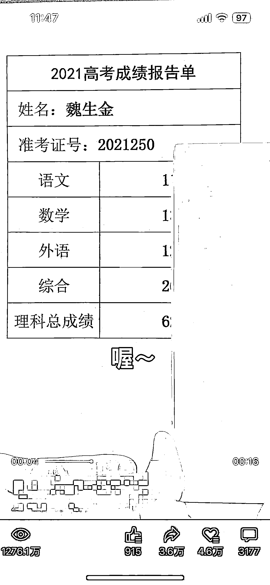
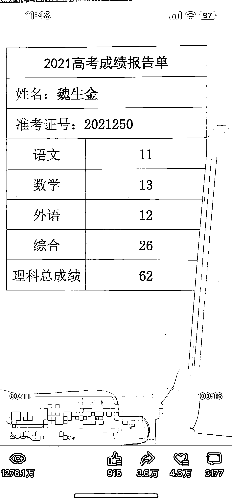

# 借高考做账号：四平台起量，播放破千万

又到一年高考时。每到这个节点，家长对志愿填报、专业选择的关注度都会猛增。我把自己前几年借高考热点做账号的路子整理一下：抖音、视频号、快手、📕一起铺内容，抓住精准家长粉，单条做到过1000万+播放；后面用短视频或直播卖志愿填报资料、选专业相关的书，转化很稳。

具体拆成三个时间点：

考前，做“历年高考考过什么题”的内容。图一来自网络，可以当参考。示例口令：0.56 jcn:/ 复制打开抖音，看看【生涯规划唐老师的作品】祝愿所有考生金榜题名，前程似锦#2023年高考 ...

考中，盯住第一个走出考场的人，或者抓拍考场外的感人瞬间。这个思路是我原创的。高考临近，考试快结束时，到你家附近的学校门口架好设备，等第一位出考场的考生；我之前这样做出过爆款（图二），也拍到过动人画面（图三）。

考后，做查分相关的段子，图四、图五、图六可参考。这个方向同样是我原创。思路可以举一反三，希望能给同行朋友一点启发。

https://v.douyin.com/ivapY6/

