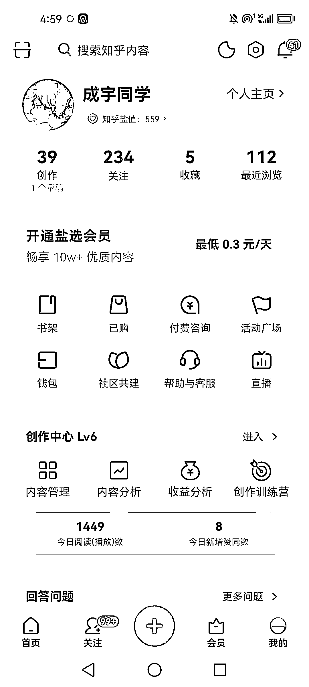
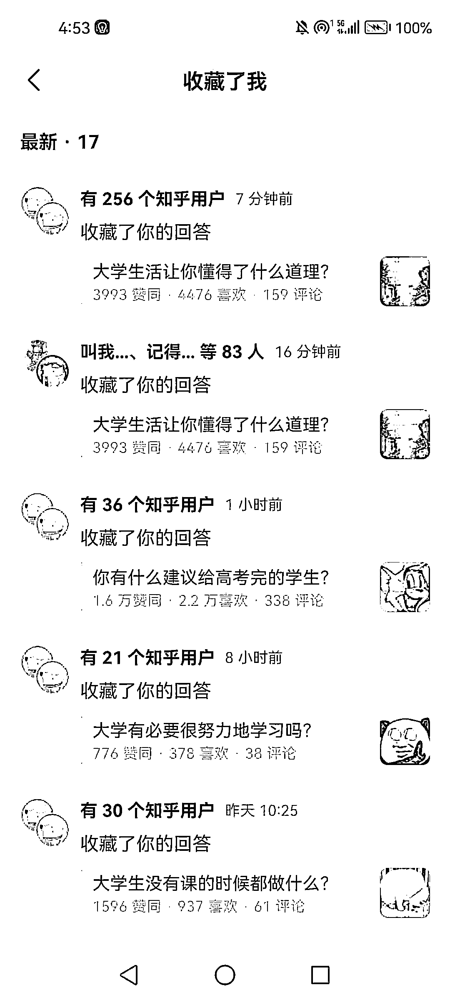
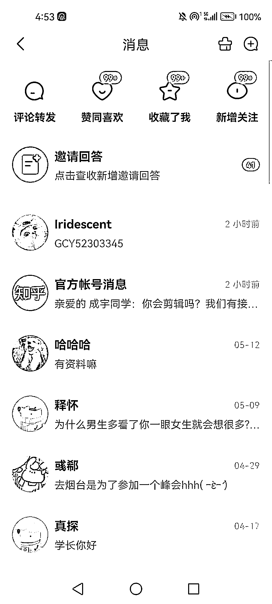

# 知乎流量正猛，准大学生是突破口

做大学生赛道、校园领域的圈友，别忽略知乎眼下这波流量。更值得切入的人群，是那些刚结束高中、马上要跨进大学校门的同学。

在知乎上可以围绕自己的大学成长轨迹写复盘，也可以列一份新生入学行动指南、提醒他们有哪些容易忽略的细节和坑。面对对大学还没什么概念的高三生，这类内容能帮他们快速补齐认知，同时吸引来一批目标非常明确的准大学生。

布局要趁早。等到六月高考落幕，相关需求会明显升温，甚至到达峰值；那时再开始，容易错过窗口。提前准备内容，就能承接住这一波准大学生关注。

发布者晒出的知乎账号叫“成宇同学”，其文章思路可以拿来参考：

这条分享也得到平台中标认可（术值+1），评论区有圈友称内容不错、表示有收获并赞赏；作者回应，这些文章写于两年前，当时自己还是大一。

（素材作者：郭成宇，2023-05-25）