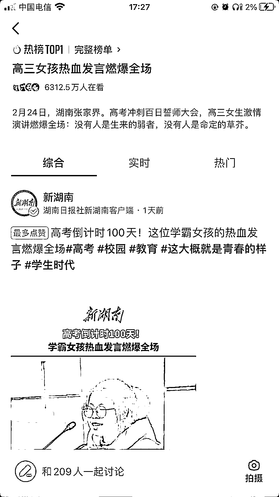

# 高考流量来了，周边生意抓紧安排

高考已进入最终冲刺阶段，时间不等人。抖音以及不少平台，最近都开始把流量往高考内容上倾斜。这个节点不只是刷题、晒分数那么简单，背后还有不少可操作的空间：志愿填报服务、把热血励志视频二次剪辑后赚平台流量分成、借助快递聚合平台做毕业季大件行李寄送、用内容把学生和家长导流到私域再卖教辅资料……方向已经很明确，想要赶这波机会的，最好现在就开始准备。

评论区：

龙哥 : 这条中标了，术值+1。在上方的 #星球栏目 专栏中，点击 #中标，就能看到所有中标风向标。