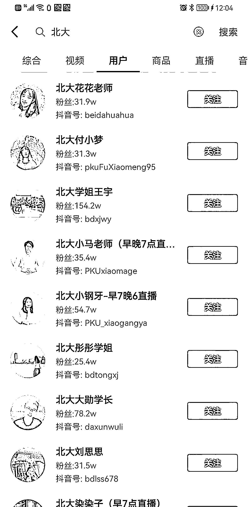

# 学霸笔记扎堆抖音，背后可能是一套矩阵打法

最近抖音刷得勤，加上常看龙哥盟，看到什么都容易往“这事怎么变现”上拐。刚好赶上中考、高考和期末考，我搜学习内容的频率高了，尤其想找英语怎么学、单词怎么背的答案。结果推荐流里大半都是相关内容。

其中有个现象挺值得琢磨：一批自称北大在读生的账号在分享学习方法，人设几乎清一色学霸，橱窗里挂的通常是状元笔记一类学习产品，少数还提供志愿填报服务。更微妙的是，这些账号的内容相似度不低，很难不让人猜：会不会有机构批量签约北大学生，统一培训后再用矩阵号推？

所以，懂抖音、手里又有预算的朋友，不妨试试找清北学生合作。

评论区里也有几种声音：
- Hope：每年卖学霸笔记的都不少。
- 龙哥：中标，术值 +1。点最上方 #中标 专栏，能看到全部中标风向标。
- 戴巍：单靠学霸笔记未必赚钱，后面往往还会带直播网课的小课包。
- 东向：这是矩阵操作。