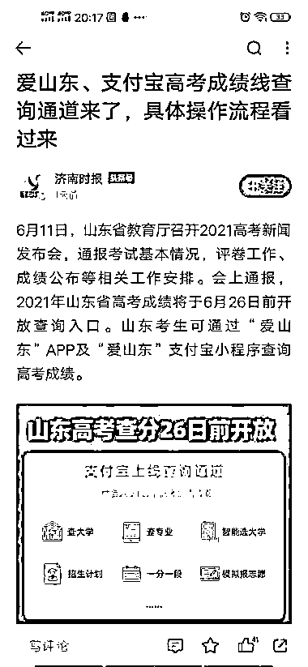
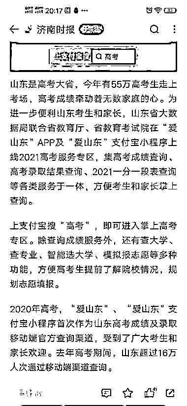

# 山东55万考生，查分认准这两个入口

山东一直是高考大省，今年共有55万名考生。成绩发布后，大家可以通过“爱山东”App，或者支付宝渠道来查分。

想用支付宝查分也很简单：搜索“高考”，进入掌上高考专区即可。这个专区不只有成绩查询，还能查大学、查专业、智能选大学、模拟报志愿，方便考生提前了解院校信息，把志愿填报规划得更清楚。

评论区：
几句：[强]
亦仁：中标。
想看更多中标风向标，点击最上方 #中标 专栏即可。