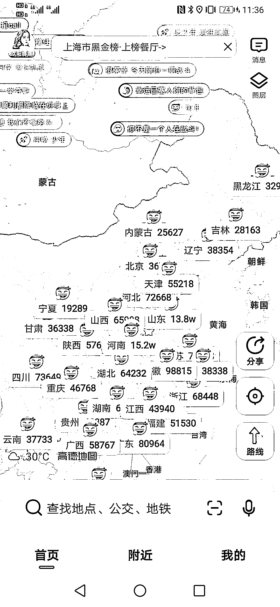
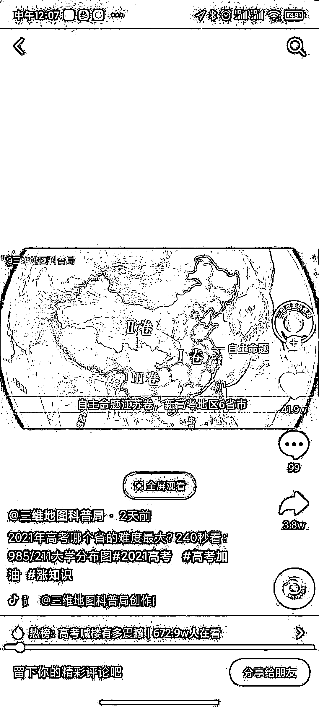
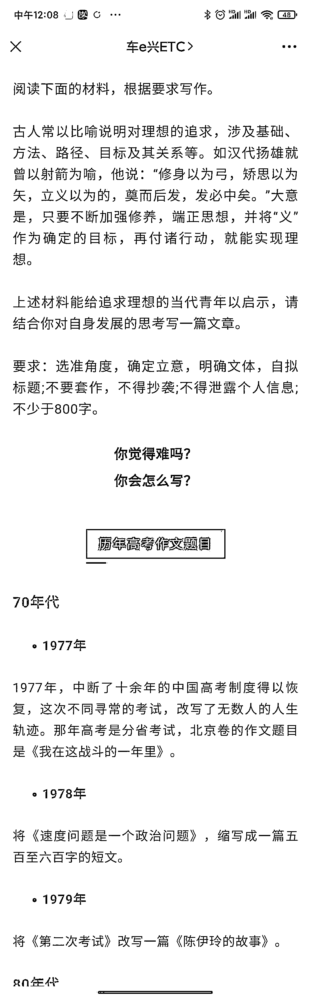

# 高考这波热度，别只让教育号接

高考自带关注度，能借势的不只是教育类账号。各类 App、自媒体和不同行业，都有切入空间。考后学生放假，驾校、旅游、毕业照、聚餐饭店等业务可以顺势延伸；志愿填报指导也值得做，还能对接互联网资源，把服务链拉长。

考试期间同样有文章可做：高德地图这类导航应用可以围绕“加油💪”做互动；短视频适合把考场故事、题目解析讲细讲透；👸号能做历年高考回顾。再配上抽奖、评论有礼，把用户引到🛰️私域，后续承接会更顺。

补充：本帖已中标，点帖中“中标”标签可查看全部中标风向标；置顶帖里点击 #中标 标签也能直达。