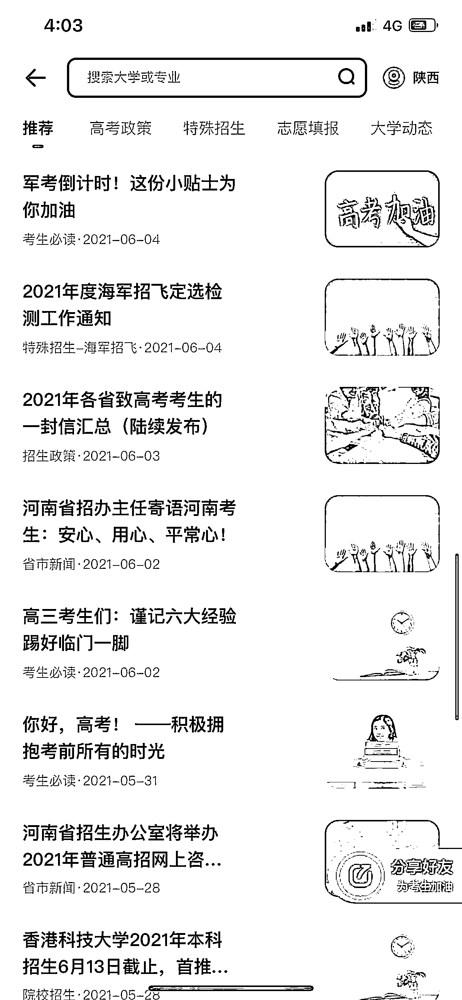
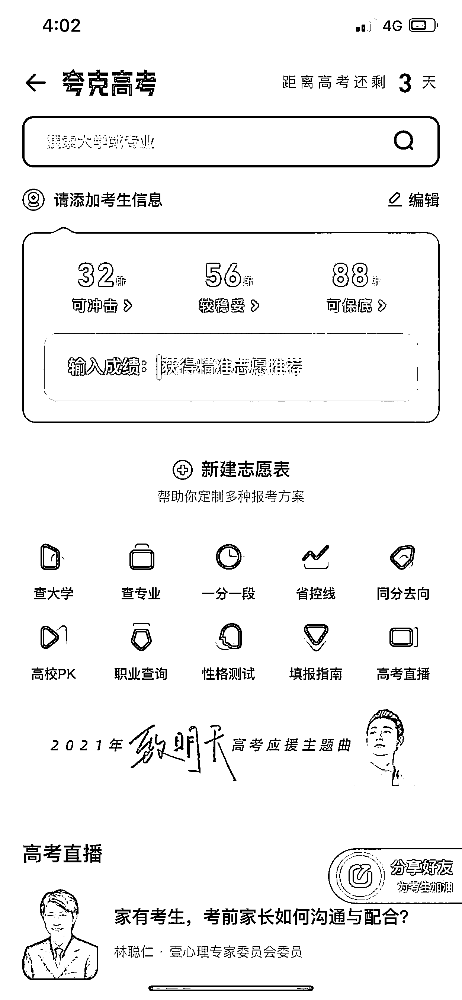

# 高考场外，别只等孩子

高考那几天，考点外总会聚着一批等孩子出场的家长。这个场景其实藏着一次很自然的触达机会：摆一张醒目海报，引导家长添加好友、进入社群，再免费送出志愿填报指南。别以为这只是个设想，夸克浏览器那边已经把相关内容备齐了。

评论区里，有人直接点赞，也有人用“中标”来盖章。还有同行观察到，如今拉群的做法越来越常见；与此同时，夸克近期在信息流广告上的投放力度也相当猛。

如果你是在风向标里刷到这条，点帖子中的“中标”标签，就能查看全部中标风向标；也可以到置顶帖里，点#中标标签直接抵达。