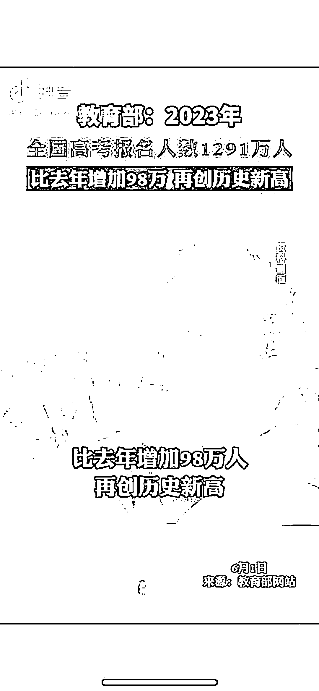

# 高考需求仍在扩容（6 赞）

作者：西柚  
日期：2023-06-02

高考承载的需求并非一次性释放，而是会随着每届考生更替不断补充。备考、志愿填报、升学衔接等环节，都会持续产生新的服务需求。它不像短期风口那样迅速退潮，更像一个按年度循环运转的市场。

与此同时，家庭对教育支出的重视程度在提高，升学选择也日趋多元。这意味着高考相关行业的天花板尚未出现，未来仍有拓张余地。

对从业者而言，机会在于找准考生家庭在不同阶段的痛点，以差异化产品和服务建立优势。谁更早完成布局，谁就更有机会承接后续增长。

评论区：目前尚无留言。