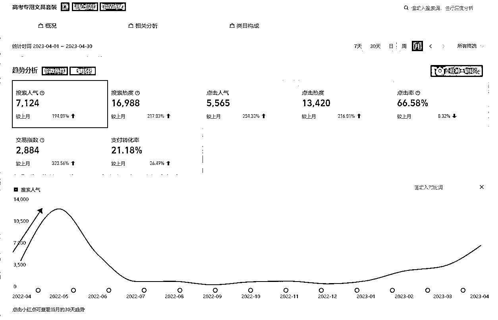

# 抓住备考季，乘风而起

做电商的人大概都懂，选对品是基本功，但真正拉开差距的，是懂得看风向。

每年的春夏之交，也就是四月份开始，中考、高考相关的商品就会迎来一波明显的需求上升。尤其是那些成套的考试用品，销量常常在短时间内迅速攀升。这个节奏，几乎是年年如此，稳定得像是季节更替。

现在很多电商平台已经不像从前那样有充足的自然流量了，过去那种躺着也能出单的日子一去不复返。越是在这种时候，越要会看趋势、懂节奏。与其盲目追热点，不如提前踩准节点，借势发力。

所以，与其琢磨什么品“永远好卖”，不如多留意“什么时候什么品会好卖”。顺势而为，往往比闷头努力更重要。

一句话总结：机会一直都在，关键在于你愿不愿意提前看到它。

评论区：
林仙森- : 这个是什么平台