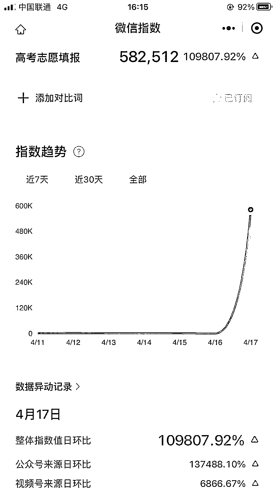

# 志愿填报热了，低频生意怎么接？

2023年4月18日，热心网友大表哥捕捉到一个变化：和志愿填报有关的🛰️指数正在抬升。

这不是一个天天都热闹的赛道。评论区有人直说，它一年只集中爆发一次，而且自己已经交过学费、踩过坑。话虽直白，却点出了这门生意的节奏：平时静，节点一到就拥挤。

真正被卖出去的，往往不是“信息”本身，而是围着它长出来的一整套服务。有人提醒，每到这个阶段，卖志愿卡的商家就会格外活跃；也有人看得更远，认为完全可以把服务线拉到生涯规划课程，利润空间并不小。

对做流量和做项目的人来说，这是一条很典型的低频刚需线索：需求不常来，但来的时候足够集中。这条风向标也被记为“中标”，术值+1。想翻看更多同类信号，可以到上方专栏点击 #中标。