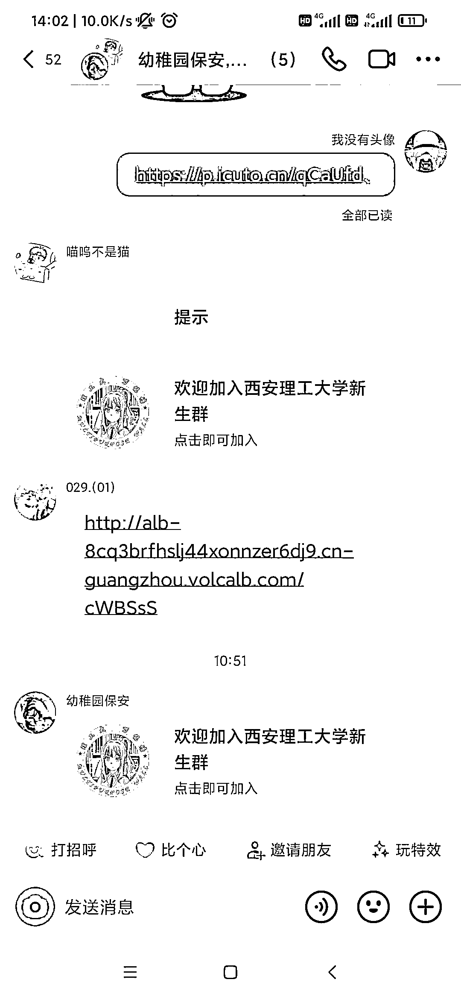

# 抖音报考群：规则、引流、变现全拆解

想用抖音报考群做获客和转化，先把平台规则吃透。下面把建群、进群、排名、人群和变现路径一次说清。

一、规则先摸清

① 建群限制：这项机制在6月5日16:00刚调整。单个账号在同一学校最多开2个群；一个账号最多覆盖5所学校，也就是累计10个群，之后会进入1～3天冷却。

② 进群限制：同一账号一天最多进10个群，从第11个开始会提前失败，只能等次日再继续。

③ 排名逻辑：群按创建时间排序。同一账号在同一学校同时开多个群时，最后建的那个反而更靠前；其他账号建的群会排在它后面。并且推荐位上有且只有一个群。

④ 其他细节：群人数上限是100；用户加入某个群后，该群会被置顶，也就是进入推荐位；平台每天会不定时清理部分学校的全部群，每天一次，具体清哪些学校没有准信，有的学校一直没被动过，有的已经被清3次了。

⑤ 当前人群：眼下以家长和本校学生为主。参考QQ群经验，高考新生季的流量可以提前判断：高考后、出成绩、录取后是三个高峰；目前家长占比更高，出成绩后的报考阶段会是家长和考生各一部分，也会有热心学长学姐来答疑，录取后进来的基本都是精准准新生。此前QQ群单校最高纪录是一天净增760人，而且只靠QQ群排名流量；抖音这波预计不会低于QQ，毕竟抖音也在布局志愿填报和高校渠道。

二、玩法怎么跑

抖音群里的聊天氛围偏弱，用户习惯并不好，所以更合适的方式是把人直接导到QQ和微信：在抖音群放跳转链接，路径就是抖音群→QQ/微信。家长尽量引到微信，他们大多不用QQ；学生引到QQ，管理更方便，还能结合QQ群优化和QQ频道做运营。

重点提醒：抖音群虽然有100人上限，但可以持续踢人，让群始终留在推荐位。

三、变现怎么做

家长端：主打高考志愿填报，床品等品类也能承接。

学生端：新生床品、校园电话卡、本地吃喝玩乐都可以做；还可以和本校学生团队对接合作。

补充一句：最关键的还是那句——群上限100人不可怕，持续踢人、保住推荐位，才是抖音报考群玩法的核心。