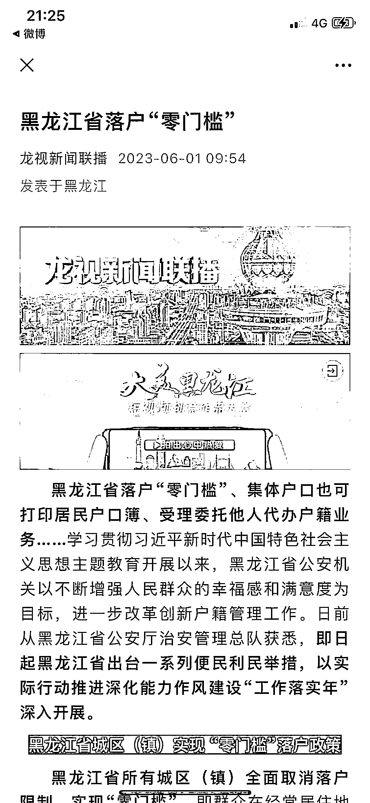
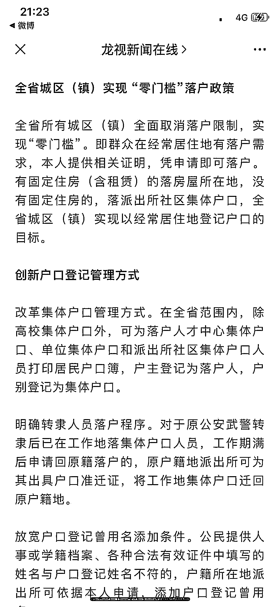
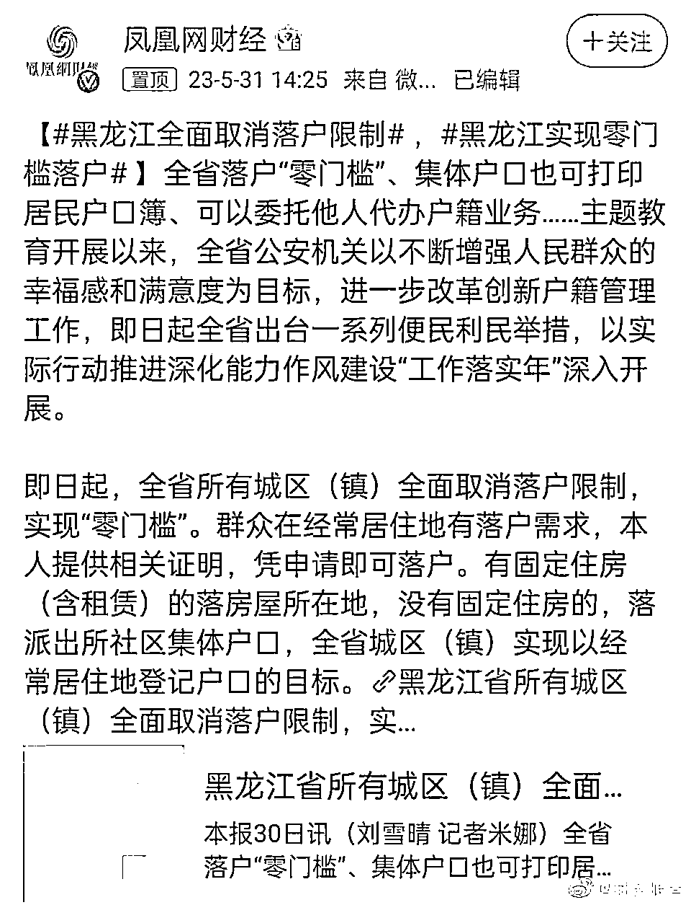
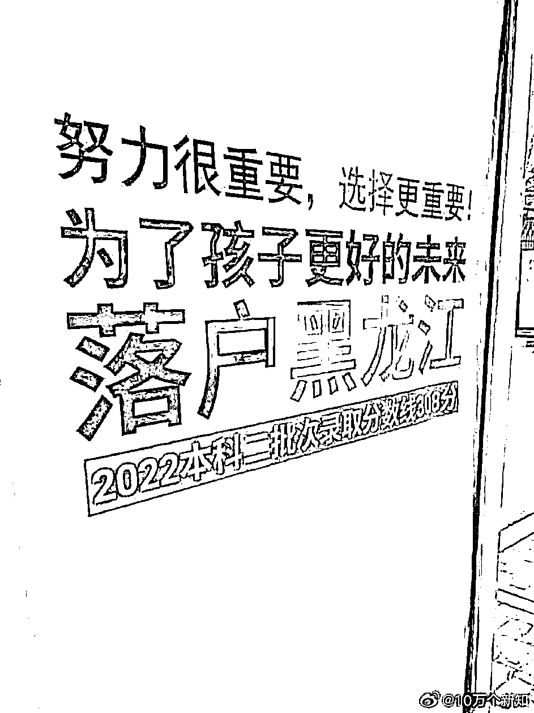

# 黑龙江落户松绑，高考大省家庭该不该提前规划？

高考进入最后倒计时，离开考不足七天，黑龙江在这两天发布了户籍新规：全省城区和镇全面取消落户限制，只要在省内有经常居住需求，就能办理落户。

省内非哈尔滨户籍的人，迁入哈尔滨也比过去容易。省外家庭，尤其是高考竞争激烈的省份，这或许是一个提前卡位的窗口，而且现在操作起来比以往方便不少。去年黑龙江二本线为308分；同样四五百分，在部分省份连专科都不一定稳，在黑龙江却可能够到一本线。

评论区：粉条 Annie：这条哪怕不中标也无妨，关键是最快半年内，可能会把这件事推进起来。